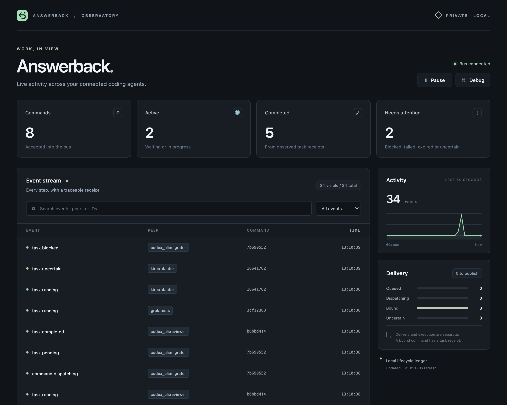
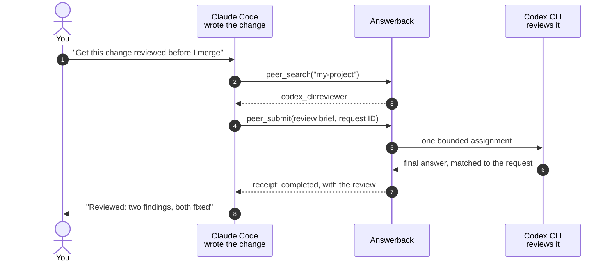
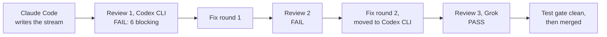
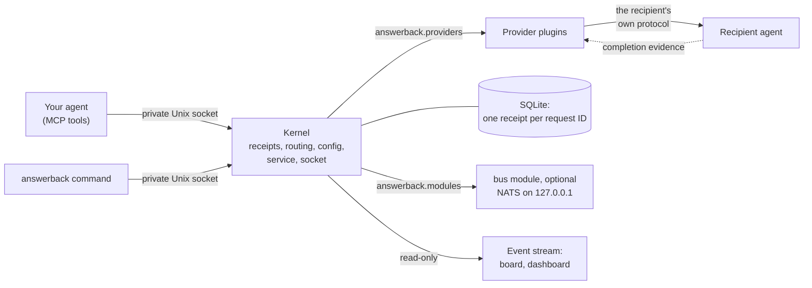

<picture>
  <source media="(prefers-color-scheme: dark)" srcset="assets/logo-dark.svg">
  
</picture>

**Stop being the clipboard between your coding agents.**

Coding agents in separate tools have no common channel, so you carry the messages: copy the diff
across, wait, copy the findings back. With Answerback, an MCP-capable coding agent sends one
bounded task to a supported local worker and waits for a receipt. The receipt reads `completed`
only when the result for that exact request came back.

Apache-2.0 · Python 3.11 to 3.15 · macOS and Linux · runs on your machine, with no account or API
key of its own · maintained by Andy Taylor · No package on PyPI yet; install from the source tree.

[Try it](#try-it) · [What it cannot do yet](#what-it-cannot-do-yet) ·
[Documentation](#documentation) · [Attribution](#attribution-and-acknowledgements)



*The local dashboard during a scripted demo. The agents are stand-ins, not live models.*

## If you have said any of these

| Today | With Answerback |
| --- | --- |
| **"I am the clipboard between two terminals."** | Once your agent is connected, tell it to get the change reviewed. It finds another agent, hands the work over and collects the result itself. |
| **"It said done. Was it?"** | Ask the receipt, not the agent. `answerback task <task-id> --wait 30` exits `0` only when the result for that request came back, so a script can branch on it. |
| **"Did that just run twice?"** | Send the same request again under the same request ID and you get the existing receipt back. It does not run a second time. |
| **"Which of my agents is stuck?"** | `answerback bus monitor --web` puts runs and agents on one board. A tracer flags workers that look stuck, hung or hot. |
| **"My agent reviews its own code."** | Send the review to an agent that did not write the change: another vendor's model, or a second session of the one you already use. |

Each row has its commands, result and limits in [What people do with Answerback](docs/USE-CASES.md).
Proven today: single hand-offs with a receipt, on one machine. Several agents delivering one package
together has not been shown ([What it cannot do yet](#what-it-cannot-do-yet)).

## Ask once. Your agent does the carrying.

Today every message between two agents goes through you, in both directions. With Answerback you ask
once, and the bridge starts a separate session for the review:



*One hand-off. The quoted lines are examples.*

Your agent does the carrying with three MCP tools (MCP is the standard way an agent calls outside
tools), each with a command-line twin: `peer_search` (`answerback find`) finds a recipient,
`peer_submit` (`answerback send`) hands over one assignment with a request ID, and `task_wait`
(`answerback task --wait`) collects the receipt.

The separate session never types into a terminal you have open, and it does not see your
conversation with the first agent, so the brief has to carry what it needs. If it needs a
permission, it pauses and waits for you.

## Built with itself. The first review came back FAIL.

Answerback is built by agents handing work to each other through Answerback. An agent running
Claude Code wrote the read-only event stream behind the board of runs and agents. The review went
to Codex CLI, another vendor's model that had written none of it, and it failed the change with six
blocking findings. The first: prompt and result text reached a stream documented as metadata-only.
The regression test for that finding plants the markers `PROMPT_PRIVATE` and `RESULT_PRIVATE` and
checks that neither reaches the stream.



*Three review rounds. Both fix rounds went to their workers as bridge tasks, and the merge followed
a clean test gate.*

When the Claude Code agent kept hitting errors from its model provider, the orchestrating agent
moved the remaining fixes to Codex CLI. Codex had now written code, so the last review went to
Grok, which had neither written nor reviewed any of it. The project's routing policy has a line for
that: "independence beats skill match". The record of these rounds is in the project's private
ledger, which is not in the public repository. More episodes:
[In this project's own record](docs/USE-CASES.md#in-this-projects-own-record).

## Try it

You need a copy of the source tree and [`uv`](https://docs.astral.sh/uv/), which fetches a
supported Python if you have none. The self-test needs no account, no API key and no model:

```sh
git clone https://github.com/NetDevAutomate/answerback.git
cd answerback
uv run --no-dev answerback self-test
```

The source is on GitHub at [NetDevAutomate/answerback](https://github.com/NetDevAutomate/answerback);
releases are tagged `v<version>`.

Two scripted agents hand each other a task through a throwaway bridge, both requests are sent
again, the service restarts, and everything is deleted. That takes about five seconds once the
first run has downloaded the dependencies
([what the first run needs](docs/GETTING-STARTED.md#prove-the-plumbing-the-self-test)). Real
output, trimmed to five of its seven phases and to the fields that matter here:

```json
{
  "success": true,
  "phases": [
    {"name": "herdr_to_kiro", "status": "passed", "nonce_match": true},
    {"name": "kiro_to_herdr", "status": "passed", "nonce_match": true},
    {"name": "idempotency", "status": "passed", "prompt_counts": {"herdr": 2, "acp": 2}},
    {"name": "restart", "status": "passed", "receipts_verified": 4},
    {"name": "cleanup", "status": "passed", "temporary_directory_removed": true}
  ]
}
```

Each hand-off returned its one-time token, neither repeat ran twice, and all four receipts
survived the restart. The report states its own limit in its `limitations` field: scripted agents
prove the plumbing and say nothing about a live model, a login or an approval.

Then install the command, start the bridge and hand one task to a worker. The worker is a second,
separate session of a CLI you already have installed and logged in, here Codex CLI:

```sh
uv tool install .        # to hand work to Claude Code: uv tool install '.[claude]'
answerback configure
answerback start
answerback workspace add reviewer --provider codex_cli --cwd "$PWD"
answerback send codex_cli:reviewer --request-id hello-1 --message "Reply exactly ANSWERBACK_OK."
answerback task --peer codex_cli:reviewer --wait 30
```

When the worker has answered, the last command exits `0` and prints the receipt with
`"status": "completed"` and `"result": "ANSWERBACK_OK"`: a live model round trip through a worker,
on your machine. `configure` asks nothing and writes one configuration file, normally
`~/.config/answerback-bridge/config.json`. `start` runs one bridge for your OS user and starts it
again at login. Each `uv tool install` replaces the earlier set of extras, so name every extra you
want in one command (`'.[claude,bus]'`).

To back out, `answerback uninstall --remove-tool` stops the bridge, removes the service and the
Herdr App side panel it installed, and uninstalls the tool; your configuration and receipts stay on
disk. If the optional bus is configured, its separately supervised broker must be stopped first.
Run `agent-bus stop` before `answerback uninstall --remove-tool`.

[Install the bridge and make your first hand-off](docs/GETTING-STARTED.md) has each step, the
Claude Code variant and what to do when the self-test does not report `"success": true`.

### Or let your own agent do it

Connect the agent you work in (`claude`, `codex`, `grok`, `kiro` or `crew`) and install the two
bundled skills. Without `--apply`, each command only shows what it would change:

```sh
answerback clients install --client claude --apply
answerback skill install --client claude --apply
```

Then say in its chat:

```text
Use answerback-collaboration for /absolute/path/to/project. Reuse the configured Answerback connection, find the current project's agents across providers, and delegate the requested work to the appropriate available peers.
```

`answerback-collaboration` teaches the agent the three tools. `answerback-fleet` surveys which of
your machines and coding tools can take work and installs the skills and the bridge connection on
them. Its repair step has so far run against stand-ins in tests only, so read what it proposes
before you let it change a machine ([Connect a client](docs/CLIENT-SETUP.md)).

## "Done" is not evidence

An agent saying it has finished, an accepted message, an idle-looking terminal and a delivery
confirmation all look like done. None of them completes a receipt. A receipt has ten states, and
only `completed` means the recipient's own result came back for that request.

- **Never silently re-sent.** An interrupted or ambiguous outcome is recorded as `uncertain` and is
  never re-sent automatically. A person releases it with
  `answerback abandon <task-id> --reason "<what you verified>"`.
- **One receipt per request ID.** The same request ID with a different message, or for a different
  recipient, is refused.
- **Right recipient.** For a terminal or chat, discovery returns a binding, a fingerprint of who is
  there. Send with it, and the bridge refuses if someone else is there now.
- **Permissions stay with you.** A worker's permission request pauses the task until a person
  answers at the command line. No MCP tool can answer one.

| Exit code of `answerback task --wait` | Meaning |
| --- | --- |
| `0` | Completed |
| `1` | Failed, cancelled, abandoned, uncertain, an ambiguous selection, or most other errors |
| `2` | The worker is waiting for a permission decision (`answerback permissions <task-id>`, then `answerback permission-answer`) |
| `3` | The wait ran out; the task may still be running. Run the same command again |

What a receipt cannot tell you is whether the result is right. Checking that is still your job, or
an independent reviewer's. The states, the bus's separate command receipt and what a receipt holds
are in [Read a receipt](docs/RECEIPTS.md).

## Which agents it works with

| Your agent | Can send work | Can be handed work |
| --- | --- | --- |
| Claude Code, Codex CLI, Grok Build, Kiro CLI | Yes | Yes: a separate worker session that the bridge starts |
| [KiroCrew](https://github.com/kirodotdev/KiroCrew) | Yes | Yes: an existing or dedicated chat. A KiroCrew release newer than the ones tested with the bridge is served and reported as untested |
| An agent in a [Herdr](https://herdr.dev) terminal | Yes | Yes, on this machine, when live and idle. On other machines: read-only unless you list the machine in the bridge's settings |

That is what the code implements. One tool is enough: the reviewer can be a second session of the
one you already use. Any other MCP client can send work through the entry that
`answerback mcp-config` prints, and cannot be handed work. An outgoing MCP connection does not create
an incoming route. This R1 boundary is subject to the live gate at the release candidate:

| R1 status | Route | Boundary | Address starts with |
| --- | --- | --- | --- |
| Supported | Codex CLI | Bridge-owned worker | `codex_cli:` |
| Supported | Grok Build | Dedicated profile | `grok:` |
| Supported | Herdr terminal | One assignment per session | `hc:` |
| Supported | Claude Code | Installed CLI 2.1.322 or newer; the bridge process must hold the provider credentials (see NATIVE-CLI.md: wrapper-injected tokens are not inherited; a supervised bridge has no credential path yet) | `claude_code:` |
| Supported | Kiro CLI | A tool use waits for a person in the default v3 mode; the bridge never approves. Managed workers run unattended on the opt-in v2 engine with `kiro_trust_all_tools` or `kiro_trust_tools` (below), off by default and Experimental | `kiro:` |
| Experimental | `hc_send_to_done` | Ships off by default | `hc:` |
| Experimental | Remote machines (`hc_send_machines`) | Linux with Codex CLI is the only qualified pair | `hc:` |
| Experimental | KiroCrew as sender | Ships, but still needs the gate | `crew:` |
| Excluded from R1 | KiroCrew as recipient | Requires the bridge tool server in KiroCrew with its reporting tool pre-approved; KiroCrew then approves all bridge tools for its agents | `crew:` |

The Claude Code and Kiro CLI rows rest on live runs on 24 November 2026 on macOS and Linux: Kiro CLI
3.5.0 at `4a03461b`, and Claude Code 2.1.330 with its round trip and repeat at `4a03461b` and its
cancel at `5c8995a5`. Those run records name the maintainers' hosts and home directories, so they
are kept in the maintainers' archive, not in the public tree. Every qualification run, including
the ones that failed, is in [VALIDATION.md](VALIDATION.md#how-to-read-this-record). Which worker
fits which job, and what counts as completion on each route: [Choose a worker](docs/HARNESSES.md).

Herdr is an independent project for running coding agents in terminals, and Answerback is an
unofficial companion: not part of Herdr, not endorsed by it, and usable without it
([Attribution](#attribution-and-acknowledgements)). Inside the Herdr App, Answerback adds a
read-only side panel with machines, projects and the receipts that need a person
([See the fleet in the Herdr App](docs/HERDR-APP-MOD.md)).

### Answerback for macOS

A companion app by the same author, Answerback for macOS, shows the whole fleet in one native
window. It is a separate project with its own pre-release, and it needs macOS 26. It reads the same
fleet document, receipts and task file that the command line shows ([FLEET.md](docs/FLEET.md),
[RECEIPTS.md](docs/RECEIPTS.md)).

It has three views. **Agents** is a board of every agent and run across all projects, in columns
for what needs you, queued, working, done and idle. It has a project filter and a search box that
understands `machine:`, `state:` and `harness:`. **Machines** has one tile per machine with the
bridge's verdict and its load and memory meters, and an inspector that explains why a machine reads
full, down to the raw readings. **Tasks** puts a project's recorded task list beside what is
observed now.


*The Agents view. Some card titles and other projects' names are blurred.*

The app mostly reads. On your click it runs four commands of its own and nothing else: it shows an
agent in Herdr, sets or clears a project's lead mark, and starts an orchestrator in a project's
folder after showing you the exact command. It sends no work and answers no prompt
([Answerback for macOS](docs/EVENTS.md#answerback-for-macos)).

## Local by design



*The bridge is the only process your agent talks to. Dotted lines are evidence coming back.*

The bridge opens no TCP port; the optional bus, dashboard and event viewer bind authenticated
listeners to `127.0.0.1`. Receipts are kept in an owner-private configuration directory. Agents
keep their provider login and native permission mechanism. The event stream uses
[AG-UI](https://docs.ag-ui.com/spec/1.0), an open event format for agent activity, and carries
metadata only: IDs, states, agent names, project paths, and hashes and sizes of text, never the
prompt, the result or a screen's text. That is the property the failed review above enforced.

Since 0.16 the bridge is a kernel plus plugins. The kernel owns the receipts, the routing, the
configuration file, the service and the socket, and it names no provider. Each provider, the piece
that knows how to reach one kind of agent, comes from a provider plugin, a package the kernel loads
through a Python entry point. A provider plugin from another package loads the same way, installed
beside the kernel with `--with` in the same `uv tool install` command.

The bus is a module, loaded beside the provider plugins. A configuration that names a provider no
installed plugin claims is kept, and `answerback doctor` reports that provider as `disabled`
([How Answerback is built](docs/architecture/README.md),
[Build a provider plugin](docs/ADAPTERS.md)).

### The trust boundary is your OS user

Anything running as you can talk to the bridge, and where the recipient reports its own result
(agents in Herdr terminals and KiroCrew chats) any local program could report one. The bridge does
not protect one agent from another. If you list another machine as a recipient, which is off by
default, that trust extends to the user account on that machine:

> Listing a machine in `hc_send_machines` delegates completion of tasks sent there to every program running under that machine's user account: the result file is proof that the brief reached that account, not that a particular agent wrote it. Before removing a machine from the list, let its open tasks finish or reconcile them (`answerback task <id> --wait <seconds>`); receipts whose machine is no longer listed are not read.

Treat it as a local developer tool, not a sandbox. [SECURITY.md](SECURITY.md) has the trust model
on one page.

### The exact completion policy

A test pins the two paragraphs below word for word (`tests/test_docs_policy.py`). `worker_reports`
marks the routes where the recipient reports its own result, and `verified_delivery_first` marks
the Herdr App/core route, where a result that arrives before delivery is verified is held as
provisional.

The socket is private to the OS user, not an isolation boundary between agents
running as that user. Task bodies and results are retained in SQLite.

Any local socket client may call `task_complete`; the caller's identity is not checked.
It applies to tasks whose provider policy sets `worker_reports` (hc, herdr, crew). Completion is
gated by `complete_worker` in `src/answerback_bridge/tasks.py`: provider policy, invalidated
delivery identity, terminal state, and for `verified_delivery_first` providers an unverified
delivery holds the result as provisional. The OS user is the boundary; a per-task completion
secret carried only in the envelope command is not implemented.

## What it cannot do yet

- **What works today:** single hand-offs with a receipt between agents on one machine, for one OS
  user. One bridge serves one OS user; a team cannot share one.
- **Several agents do not yet deliver one package together.** The five-kind attempt, CLI-1, is on
  record as `FAILED_INCOMPLETE`
  ([the record](docs/WORKTREE-GUARD-SCENARIO.md#cli-1-result-and-retained-limitations)).
- **A second assignment to the same Herdr terminal is refused by default.** Once an agent has
  answered, Herdr reports its terminal as done rather than idle, and the bridge sends only to idle
  agents. `hc_send_to_done` lifts that and is Experimental: Herdr Core cannot refuse that send if
  the agent starts a turn first, and the bridge then records the delivery as `uncertain`.
- **Agents on your other machines** are found and read, and refused as recipients unless you list
  their machine in `hc_send_machines`, which is empty by default. With live agents this is shown
  between two Linux machines with Codex CLI only.
- **Designed, not built: several machines sharing work through one broker.** Today there is one bus
  coordinator per machine, and remote `hc` sends are Experimental. Automatic failover and sending
  one brief to several agents in one call are not built either. `answerback rebalance` previews at
  most one move of a worker and changes nothing; the store for assignments with several recipients
  is not wired to any route.
- **Live-model proof is uneven.** The automated tests and the scripted self-test pass on the current
  code, and neither calls a live model. Grok Build has a live turn on record only at the 0.10.0
  candidate ([VALIDATION.md](VALIDATION.md#what-it-cannot-do-yet)). Provider backoff is tested with
  scripted stores and fakes only, with no live run on record
  ([Provider backoff](docs/RECIPIENTS.md#provider-backoff)).
- **Platforms:** macOS and Linux. On Linux the systemd user unit is generated and tested, with no
  live run on record. Windows is not supported.
- **Release:** no package on PyPI yet; install from the source tree. Issues go to the GitHub
  repository's tracker. It is provided as is under the Apache-2.0 licence.

## Documentation

| Start here | For |
| --- | --- |
| [Getting started](docs/GETTING-STARTED.md) | The self-test, install, first hand-off |
| [Use cases](docs/USE-CASES.md) | Seven scenarios with commands, results and limits |
| [Receipts](docs/RECEIPTS.md) | Is it done? States, exit codes, what a receipt proves |
| [Choose a worker](docs/HARNESSES.md) | Which recipient for which job, and the release boundary |
| [Connect a client](docs/CLIENT-SETUP.md) | MCP connections and skills for each client |
| [Troubleshooting](docs/TROUBLESHOOTING.md) | Symptom, cause and the command to run |

Every other guide, by what you are trying to do, is in the [documentation map](docs/README.md);
terms are in the [glossary](docs/GLOSSARY.md), and what changed in each version is in
[CHANGELOG.md](CHANGELOG.md).

## Install from a clone

The kernel alone owns the `answerback` console script. Installed as a tool from a clone at
`~/code/personal/tools/answerback`, the public composition is:

```sh
uv tool install --force --editable ~/code/personal/tools/answerback[bus]
answerback --version          # 0.16.2
answerback providers list     # the kernel's own providers
```

A provider plugin kept in a repository of its own is installed in the same command, from its
clone beside this one, and adds its provider to the list:

```sh
uv tool install --force --editable ~/code/personal/tools/answerback[bus] \
  --with-editable ~/code/personal/tools/<plugin-repository>/packages/<provider-plugin>
answerback --version          # 0.16.2
answerback providers list     # includes the plugin's provider on this composition
```

`answerback providers list` asks the running bridge, so run `answerback restart` after an
install. zsh reads `[bus]` as a file pattern; there, quote the extra alone
(`~/code/personal/tools/answerback'[bus]'`). Each `uv tool install` replaces the earlier set, so
name every extra and plugin in one command.
[MIGRATION.md](MIGRATION.md) says how an installation of the combined 0.16.0 tree moves to these.

## Development

```sh
uv sync --locked --all-extras
uv run playwright install chromium   # the dashboard's browser tests need it
just check
just self-test
```

`just check` runs lint, format, type checks, the full test suite under this machine's suite lock and
the public-tree assertion; it needs no account. `just self-test` runs the seven scripted phases. The
source module is `answerback_bridge`; the `codex_herdr_bridge` namespace keeps older commands and
imports working. [CONTRIBUTING.md](CONTRIBUTING.md) has the conventions, and
[Test a change](docs/TESTING-HARNESSES.md) has the test layers in full.

## Attribution and acknowledgements

Answerback began as a bridge to **Herdr** and still integrates with it. Herdr is
the work of the Herdr project ([herdr.dev](https://herdr.dev),
[github.com/herdrdev](https://github.com/herdrdev)) and its contributors. All
credit for Herdr's design, its terminal and agent model, its agent status
reporting and its command-line and socket interfaces belongs to them.

| Herdr component | What Answerback uses it for | Source | Licence |
| --- | --- | --- | --- |
| herdr-core (`hc`) | The optional `hc` provider: list, read, send to and wait on agent terminals | [herdrdev/herdr-core](https://github.com/herdrdev/herdr-core) | Apache-2.0 |
| Herdr App (`herdr-app`) | The desktop window whose agents the `hc` provider reaches; layout stays with `herdr-app` | [herdrdev/herdr-app](https://github.com/herdrdev/herdr-app) | Apache-2.0 |
| Herdr (terminal UI, `herdr`) | The optional `herdr` provider: agents in one configured TUI session | [herdrdev/herdr](https://github.com/herdrdev/herdr) | Apache-2.0 |

How the two projects relate:

- **Answerback is an independent, unofficial companion.** It is not part of
  Herdr, and the Herdr project has not reviewed, approved or endorsed it. The
  author intends to ask the Herdr maintainers for their input and approval; until
  this section says otherwise, none has been given.
- **No Herdr code is included.** This repository and its wheel contain no Herdr
  source, binaries or documentation. Answerback runs the `hc`, `herdr` and
  `herdr-app` programs you installed yourself, as separate processes, and reads
  their output. Herdr is optional; Answerback works without it.
- **The Herdr name is theirs.** "Herdr" appears here only to say what Answerback
  works with. The names `herdr-bridge`, `codex-herdr`, `codex_herdr_bridge`,
  `herdr_bridge` and the `herdr-collaboration` skill are compatibility names kept
  from this project's earlier releases. They describe the integration and are
  not Herdr products.
- **Report problems in the right place.** Problems with Answerback's Herdr
  integration belong in this project, not in Herdr's issue tracker.

What Answerback uses from Herdr, and the questions still open for the Herdr
maintainers, are listed in [the Herdr integration guide](docs/HERDR-INTEGRATION.md).

Answerback itself is licensed under Apache-2.0 ([LICENSE](LICENSE)). It bundles
the [AG-UI](https://github.com/ag-ui-protocol/ag-ui) 1.0 JSON Schema under the
MIT License; see [NOTICE](NOTICE). The other tools it can connect to (Kiro CLI,
KiroCrew, Codex, Claude Code, Grok Build, Rex, NATS) belong to their own
owners and are not bundled either.

**About the name.** The mark is a square cut by a stepped seam into two identical halves, like a
split tally stick. Each party kept one half, and the record was proved when the halves fitted. A
reply counts only when it matches the request.
