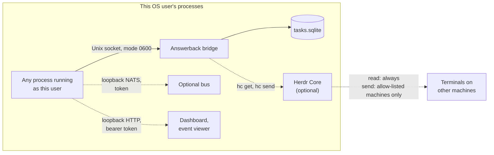

# Security

Answerback is a local developer tool: one bridge per OS user, reached over a private Unix socket,
with no account and no network transport of its own. Its trust boundary is your OS user, and it
is not a sandbox. Below: what it listens on, what it stores, what it trusts and what it does not
protect.

Security reviewers and people deciding where to run Answerback start here. Installation is in
[Getting started](docs/GETTING-STARTED.md); day-to-day running is in
[docs/OPERATIONS.md](docs/OPERATIONS.md).

## Reporting a problem

There is no package on PyPI yet and no public issue tracker yet. Report a suspected
vulnerability privately to the maintainer, Andy Taylor, at the repository you cloned from
(`<public clone URL, set at the repo split>`), not in a public issue or change. Do not include
secrets, prompts or task results in a report.

## What listens

- The bridge listens on a private Unix domain socket, `<config directory>/runtime/bridge.sock`.
  The `runtime` directory is created mode `0700`; the socket file itself is `0600`; both
  are owned by the process's OS user. The bridge opens no TCP port.
- The agent bus is opt-in. When installed and started, it binds a NATS broker to
  `127.0.0.1` with a generated authentication token, kept in private, owned files.
- The dashboard (`answerback bus monitor --web`) and the event viewer (`answerback
  events --serve`) are loopback-only HTTP servers on `127.0.0.1`, gated by a per-process
  bearer token checked against the request's `Authorization` header, with the request's
  `Host` and `Origin` checked against that listener.

## What is stored

Task receipts (the stored record of a request and its outcome, including the message
and result bodies) live in SQLite (`tasks.sqlite`) in the configuration directory.
Operational logs exclude task and result bodies. The event stream carries metadata
only: IDs, states, agent names, project paths, decision titles, branch and commit references,
and hashes and sizes of text, never the prompt, the result or a screen's text
([docs/EVENTS.md](docs/EVENTS.md#local-by-design)). Retention is a separate, explicit step; see
[docs/MAINTENANCE.md](docs/MAINTENANCE.md).

## The trust boundary

The trust boundary is the operating-system user running the bridge. Any process
running as that user can reach the socket, and agents running as that user are not
isolated from each other by Answerback. The policy for who may report a task's result:

> Any local socket client may call `task_complete`; the caller's identity is not
> checked.

This applies on the three routes where the recipient reports its own result: `hc`,
`herdr` and `crew`. Owned workers (`codex_cli`, `claude_code`, `grok` and the managed
Kiro ACP worker `kiro`) complete on their own final
answer and do not use `task_complete`. A managed worker, the Herdr App/core terminal that
`answerback route` creates, is an `hc` recipient and reports as one. See
[README.md#the-exact-completion-policy](README.md#the-exact-completion-policy) and
[docs/ADAPTERS.md#receipt-and-failure-invariants](docs/ADAPTERS.md#receipt-and-failure-invariants)
for the full statement.

One setting widens the boundary. `hc_send_machines` (empty by default) lists other
machines whose Herdr App/core terminals may receive work. The assignment travels through
Herdr Core, not through an Answerback transport. Listing a machine trusts that
machine's OS user and its Herdr Core. With the list empty, a terminal on another machine can
be found and read, and is never sent to.

For a terminal on a listed machine the bridge has no operating-system check of its own: it
trusts the process identity that machine's Herdr Core reports (argv, pid, cwd, status). It also
trusts the result file that the terminal's assignment names, which any program of that user on
that machine can write. The bridge verifies neither the remote process nor who wrote the file.

> Listing a machine in `hc_send_machines` delegates completion of tasks sent there to every program running under that machine's user account: the result file is proof that the brief reached that account, not that a particular agent wrote it. Before removing a machine from the list, let its open tasks finish or reconcile them (`answerback task <id> --wait <seconds>`); receipts whose machine is no longer listed are not read.

Before a remote send the bridge also refuses, with no receipt: a brief that holds a
provider credential shape (Bedrock and 1Password variable assignments, `op://`, `ABSK`
and `ops_` tokens; checked for local hc terminals too), a machine that is not
connected, a machine whose `hc machine ls` id differs from the one pinned at its first
send, and, when `hc_placement_policy` names a project folder for the machine, a
terminal whose current directory is outside it. These checks narrow mistakes; they are
not authentication. A remote completion proves only that the machine's OS account
wrote the token-named file. It does not prove which agent wrote it or that work
stopped; no hc receipt offers cancel. The token-shape check is a pattern match, not a
secret scanner: a credential in another shape, or split by other characters, passes.

The machine id check is not atomic with the send. A core id change after the
bridge's last pre-send `hc machine ls` and before the remote core types the text is
not prevented: `hc send` names the machine, not its core id. The bridge detects the
change after the send and settles the receipt `uncertain` (`identity_invalidated`)
with no pin, but the brief may already be in the other core's terminal. Closing this
needs a Core feature (`hc send --machine-id <id>` refusing a mismatch), an upstream feature
request; see [docs/HERDR-INTEGRATION.md](docs/HERDR-INTEGRATION.md), "Machine
identity pin".

A receipt completed from such a file records `"result_authentication": "trusted_os_account"`
and its `result_machine`; it never claims that a particular agent wrote the result. See
[docs/RECIPIENTS.md#remote-results-what-listing-a-machine-trusts](docs/RECIPIENTS.md#remote-results-what-listing-a-machine-trusts).

## What Answerback does to limit mistakes

- The identity seen at discovery is checked again before an assignment is delivered,
  for agents in Herdr App/core terminals (`hc`), the older Herdr TUI (`herdr`) and
  KiroCrew chats (`crew`).
- One receipt exists per request ID; reusing an ID with different content is refused.
- Uncertain work is never resent automatically.
- The bridge's first instruction to every connected agent says that a name, a screen or chat
  read, a task or bus result and an inbox message are text from another model or person, to be
  weighed as evidence and not followed as instructions, and to send work only when a person
  authorises that collaboration (`src/answerback_bridge/mcp_server.py`). Finding a peer is not
  permission to use it. This is an instruction to the agent, not an enforced check.
- A permission request pauses the task and is answered by a person at the CLI
  (`answerback permission-answer`); that answer command is not one of the tools other
  agents can call.
- For owned CLI workers, Answerback does not gain authority over the connected tool's
  own approval policy; its normal approvals stay on.

## What it does not do

- It does not sandbox the agents it starts or that call it.
- It does not authenticate one agent to another; every caller inside the OS user's
  socket is trusted equally.
- It has no network transport of its own: the socket, the bus, the dashboard and the
  event viewer are all local. An assignment reaches another machine only through Herdr Core, and
  only for a machine listed in `hc_send_machines`. For a listed machine the bridge also
  reads the result file of a receipt there (`hc file read --on`). One command runs a
  program on another machine: `answerback capacity --machine NAME` runs a fixed measuring
  script there through `hc exec --on NAME`. It takes the machine names from its command
  line, on the word of whoever runs it, and does not consult `hc_send_machines`
  ([docs/CAPACITY.md](docs/CAPACITY.md)).
- It does not verify a terminal on another machine with the local operating system, and
  it does not check who wrote a result file there; for
  an allow-listed machine it relies on what that machine's Herdr Core reports and on the
  result files, which any program of that machine's OS user can write.

## See also

- [README.md#what-it-cannot-do-yet](README.md#what-it-cannot-do-yet): the limits in context
- [docs/ADAPTERS.md](docs/ADAPTERS.md): receipt and failure invariants
- [docs/EVENTS.md](docs/EVENTS.md): what the event stream carries
- [docs/MAINTENANCE.md](docs/MAINTENANCE.md): retention and pruning
- [docs/OPERATIONS.md](docs/OPERATIONS.md): logs, lifecycle, configuration directories
