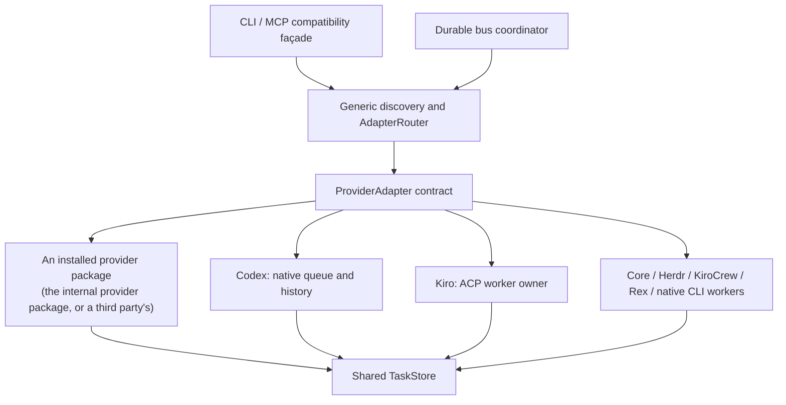

# Build a provider plugin: the adapter contract

A provider plugin is a package the kernel loads from the `answerback.providers` entry-point group.
It gives the bridge one more kind of recipient: how to find it, bind one target, submit one
assignment and read the evidence that the work completed. The kernel keeps the receipts, the routing
and the configuration file; the plugin keeps everything that knows the recipient's native protocol.

This page is for someone writing or changing a provider plugin or a module. Have a source checkout
and the [architecture overview](architecture/README.md) first; for the package layout and a worked
`answerback-example`, use the [provider package template](PROVIDER-TEMPLATE.md).

The smallest plugin is one class and one adapter. `FixtureAdapter` below is the provider's own
`ProviderAdapter` subclass, the part that speaks its native protocol; the
[provider package template](PROVIDER-TEMPLATE.md#adapter-minimum) shows the methods it needs.

```python
from answerback_bridge.adapters.catalog import ProviderDefinition
from answerback_bridge.adapters.contracts import ProviderAdapter
from answerback_bridge.plugin import PLUGIN_API, KernelContext, ProviderPlugin

from .adapter import FixtureAdapter


class Plugin(ProviderPlugin):
    api_version = PLUGIN_API
    definition = ProviderDefinition("fixture", "fixture", recovery_states=("running",))
    capabilities = frozenset({"discovery", "send"})
    config_schema = None  # or a ProviderConfig dataclass, see "Configuration blocks"

    def build(self, ctx: KernelContext) -> ProviderAdapter:
        return FixtureAdapter(ctx.config, ctx.config_path, ctx.store)
```

Declared in a distribution's `pyproject.toml` under `[project.entry-points."answerback.providers"]`,
this plugin loads beside the kernel's own providers. `tests/test_plugin.py` composes the same class
(`FixturePlugin`) through `build_adapters` and runs discovery, dispatch, duplicate suppression,
restart and recovery against it.

## Ownership



*Who owns what: the kernel routes and stores; every provider, built-in or installed, meets the same
contract.*

The coordinator owns durable command admission and the decision never to replay a claimed command
blindly. `TaskStore` owns persistence and atomic receipt transitions. An adapter controls when its
native submission is reserved and how native evidence updates that receipt. `AdapterRouter`
validates returned IDs, target, request key and message against the persisted receipt.

The built-in adapters live in `providers/{codex,kiro,crew,rex}/adapter.py`,
`providers/native/adapter.py` and `providers/herdr/adapters/{core,herdr}.py`. The native package
owns the CLI workers `codex_cli`, `claude_code` and `grok`, including their receipts in
`providers/native/workers.py`. The Herdr App/core adapter hands `hc` submission to
`providers/herdr/core_tasks.py`. Kiro keeps ACP launch, identity and readiness in
`providers/kiro/{acp,workers}.py`. Rex uses explicit enrollment and cooperative
receive/acknowledge/complete; it types into no terminal and wakes no agent.

The composition root (`adapters/factory.py`) builds one adapter per provider plugin from a
`KernelContext`. Adapters do not import or receive `Bridge`. Some native dependencies use explicit
getters so a configuration change replaces the client without retaining stale connections.

## Composition: the plugin half

`plugin.py` is the other half of the provider contract. `ProviderAdapter` says how a provider
dispatches; `ProviderPlugin` says how it composes into the kernel:

| Member | Meaning |
| --- | --- |
| `api_version` | Must equal `plugin.PLUGIN_API` (currently `1`); see the loader rules below. |
| `definition` | The provider's `catalog.ProviderDefinition` row; see [The catalog row](#the-catalog-row). |
| `capabilities` | `frozenset[str]` of the capability names the provider's status block reports (`send`, `read`, `discovery`, `permissions`, `cancel`, `worker_report`, ...). |
| `config_schema` | The provider's config block, a `provider_config.ProviderConfig` dataclass, or `None` for a provider with no settings; see [Configuration blocks](#configuration-blocks). |
| `build(ctx)` | Returns the `ProviderAdapter`. |
| `rpc()` | `{"<provider>_<verb>": handler}`; the service merges every plugin's table into `Bridge.METHODS` and dispatches by name. |
| `agent_programs()` | Executable names recognized in Herdr App/core terminals, mapped to the established public `agent_kind`. |
| `cli(commands, run)` | Adds subcommands to the kernel's subparsers and binds each handler with `run(parser, handler)`. |
| `mcp_tools()` | `ToolSpec` entries; see below. |
| `event_sources()` | `EventSource` objects: `provider` is the `peer_id` prefix answered for; `tail(target, peer, resources)` returns the text the observer digests. |
| `store_hooks()` | The provider's receipt-store policy (`StoreHooks`), or `None`; see [Store hooks](#store-hooks). |
| `registrar()` | The provider's `ClientRegistrar`, or `None`, for a provider that is also an MCP client the bridge installs itself into; see [Client registrars](#client-registrars). |
| `status(config)` | The provider's block in `provider_status` (`doctor`, `status`), or `None` for the kernel's generic block. |
| `receipt_reasons()`, `receipt_reason_order()` | The provider's fleet-snapshot reason rules and their historical projection positions. |
| `mcp_instructions()` | One sentence for the MCP server's instructions text, or `None`; sentences are joined in catalog order. |
| `start`, `close` | Optional; a plugin that has nothing to contribute leaves the defaults (`None` or empty). |

Four of these rows carry more than the table shows. An `api_version` other than `PLUGIN_API` makes
the loader warn and skip a third-party plugin; an incompatible entry point owned by this package is
a programming error and raises `PluginVersionMismatch`. A `config_schema` dataclass carries
defaults, `validate()` and `flat_key()` for the pre-0.16 names; the kernel stores it under
`providers.<name>` in `config.json` and exposes it as `config.providers[<name>]`. An `rpc()`
handler may be a `plugin.Verb`, whose body is a method of an object read on every call, with an
optional `requires` (the provider that must be registered first); a `cli` handler receives the
parsed arguments and the RPC client.

A `ToolSpec` from `mcp_tools()` has `build(call)`, which returns the tool function (its name,
signature and docstring are the tool's name, schema and description), `kind`, which picks the
read/write/send annotations, and `public_errors`, which routes refusals through the server's public
wording. The kernel merges `agent_programs()` in
registration-name order and rejects duplicate executable names.

The kernel generates the surfaces from these hooks: `service.Bridge.METHODS` is `KERNEL_METHODS`
plus every plugin's verbs, `cli.parser` registers each plugin's subcommands after
`notification-status`, `mcp_server.create_server` adds each plugin's tools to the kernel's, and the
observer (`events/collector.bridge_sources`) tails a peer through the source whose `provider`
matches. Plugins are merged in registration-name order, and a verb, tool or source two contributors
declare is a `SurfaceCollision` at startup. `tests/test_plugin_surfaces.py` composes a fake plugin
through all four and pins the tool list, the verb set, every provider subcommand's help and the
status output, for the public composition and the internal one side by side.

`KernelContext` is a frozen dataclass and is everything a plugin may touch: `config` (the one live
`Config`, mutated in place and never replaced), `config_path`, `store`, `events`, `locks` (the
service's task lock stripes), `launch_argv` (`process.module_launch_argv`) and `shared`. `shared`
holds the kernel kits a plugin builds on instead of importing another provider: `acp` (the ACP
client), `native_workers` (the owned native CLI receipt owner) and `process` (`run`, `spawn_owned`,
and the cancellation-safe `settle`).

`plugin.py` imports no provider, bus or herdr code; `tests/test_plugin.py` checks that with an AST
scan, so a plugin package can import it without loading any other provider. A provider package
constructs its plugin through the public helpers `provider_plugin`, `PluginOwners`, `owned_verbs`
and `OwnedEventSource`. The template asks a provider package to carry an AST guard of its own that
checks nothing in the package reaches a private kernel name.

Beyond the surface hooks, a plugin may contribute its `provider_status` block (`status`), its
fleet-snapshot reason rules (`receipt_reasons`), one sentence of the MCP server's instructions
(`mcp_instructions`) and, through `errors.register_public_validations`, the reviewed `ValueError`
codes its raise sites use (a code or message already catalogued under another entry is refused).
`ProviderRegistry.apply` and `ensure_idle` let a plugin's verbs edit its own configuration block the
way the kernel does.

### The catalog row

`adapters/catalog.py` declares `ProviderDefinition`, the one row every provider carries on its
plugin. `catalog.definitions()` is the table of the loaded plugins' rows, built on first use and
sorted by `order_key()`, so task recovery, manual completion, bus admission, maintenance and debug
leases decide by the providers this installation composes.

| Field | Meaning |
| --- | --- |
| `registration`, `name` | The registration name (`kiro`, `hc`, ...) and the wire name receipts and peer ids carry. |
| `recovery_states`, `worker_reports`, `verified_delivery_first` | Crash-recovery states, whether the recipient reports its own result (`task_complete`), and whether a result that arrives before delivery is verified is held provisional. |
| `routing_fields`, `digest_keys`, `ignored_child_fields`, `legacy_neutral_defaults` | The routing-digest contract; see [Configuration fingerprints](#configuration-fingerprints). |
| `registration_binary_field` | The config-block field whose value names the executable `providers register` probes with `shutil.which`; the default is `binary`. |
| `order` | The catalog slot: where the row sits in `config.PROVIDERS`, the `providers` listing, a freshly written `provider_selection` and the adapter registry. |

`registration_binary_field` set to `None` marks a provider that registers configuration only (an
HTTP endpoint, say). The loader requires the matching flat key `<registration>_<field>` to exist in
the block; a third-party provider whose schema lacks it is skipped with a warning.

Rows sort by `order`, then registration name; a row with no `order` follows every row that has one.
The kernel's rows carry 10, 20, ...; a provider another package installs can declare the slot it
held before it left the kernel.

### Loading

The package declares one `answerback.providers` entry point for each built-in factory
(`pyproject.toml`), and third-party distributions use the same group. Each built-in lives with its
provider policy: `providers/kiro`, `providers/codex`, `providers/crew`, `providers/rex`, and the
shared `providers/native` package for `codex_cli`, `claude_code` and `grok`. The `hc` and `herdr`
factories live together in `providers/herdr/`, one package with two registrations because the
App/core and older TUI transports share identity and task machinery. `adapters/builtins.py` is a
compatibility composition shim only: it loads those entry points, restores historical adapter order
and rebinds first-party plugin owners. A provider plugin from another repository adds one more
distribution through the same group, installed beside the kernel; that package documents its own
behaviour.

`plugin.load_plugins(group)` reads the installed entry points once per process, instantiates each
target (a zero-argument factory or a plugin object), and runs these checks in order:

1. the factory loads and returns;
2. `api_version == PLUGIN_API`;
3. the plugin names a nonempty registration (`definition.registration`; `name` for a module);
4. no earlier plugin claimed that registration name (a `SurfaceCollision`, naming both entry points,
   whoever owns them);
5. every flat key the config block declares (`<registration>_<field>`, or the block's `flat_aliases`
   where the pre-0.16 name was different, as `desktop_threads` for `codex`) is free: it must not
   shadow a reserved name (a `Config` field, method, property or descriptor, or the flat key an
   earlier plugin's block already routes), two fields of the same block must not alias one key, and
   the `registration_binary_field` key must exist.

A plugin passes or fails as a whole: its registration name and flat keys are committed only after
every check, so a plugin refused on its second key owns neither its first key nor its name, and a
later plugin may use either. Ownership decides the consequence. The loader identifies this package's
built-ins by the entry point's distribution name (`answerback`): a broken, incompatible or colliding
built-in is a programming error and stops startup (`PluginLoadError`, `PluginVersionMismatch`,
`SurfaceCollision`), while a third-party factory failure, API-version mismatch or flat-key refusal
is skipped with one warning that names its entry point and the key or owner at fault, and the other
plugins load. An optional third-party plugin cannot disable the kernel, and a damaged installation cannot run
partially. The warning text and the operator's remedies are in
[TROUBLESHOOTING.md](TROUBLESHOOTING.md#provider-and-module-plugins).

`builtin_plugins()` keeps its compatibility name and reads that loaded set. It preserves the
built-in adapters' historical registry order, followed by installed providers in catalog order
(`order`, then name). With `PluginOwners.of(service)`, package-owned plugins are rebound to the
service's live clients. Without owners, the CLI and MCP frontends compose their declarations but
cannot build or run those adapters. Reading entry-point metadata and composing built-ins imports no
provider transport.

`uv sync` installs this checkout editable, so
`importlib.metadata.entry_points(group="answerback.providers")` sees the same `pyproject.toml`
declarations that an installed wheel exposes. After pulling a change to `pyproject.toml`, run
`uv sync` before using the environment with `--no-sync` or its Python executable directly; startup
rejects stale editable metadata with a `uv sync` or reinstall message.
`tests/test_plugin_loading.py` has an explicit metadata fixture and a real temporary third-party
`.dist-info` distribution that verifies both paths.

### Configuration blocks

A block class names its provider (`provider: ClassVar[str] = "fixture"`), declares its fields with
defaults, and validates itself in `validate()`, which `Config` runs for every block when it is
constructed and on every `Config.save`, in catalog order. The kernel builds `SCHEMAS` and
`FLAT_KEYS` from the successfully loaded plugins before any configuration is constructed, so a
third-party block reaches `Config` through the same entry point as its adapter and surfaces. The
kernel builds one instance per schema, reads it from `providers.<name>` in `config.json`, and writes
a block back only when the provider is selected or the block differs from its defaults.

Until 0.17 the loader also reads the flat pre-split keys (`<provider>_<field>`, or the block's
`flat_aliases`), and `Config` exposes the same flat names as read-write attributes so existing code
keeps working while it is moved to the blocks; a flat key beside its nested twin is ignored with one
warning. A flat key whose prefix is a provider the file's own `provider_selection` names and no
loaded plugin claims is kept as that provider's disabled block, so an old file still loads when its
plugin is absent; any other unclaimed flat key is refused. A `providers.<name>` block or
`provider_selection` entry no loaded plugin claims is kept in `Config.unknown_providers`, written
back verbatim, excluded from `registered_providers()`, listed by `disabled_providers()` and reported
by `doctor` as `disabled` with the reason; the loader logs one warning naming the providers. The
same rule covers a `client_registrations` entry no loaded registrar installs (`disabled_clients()`).
`answerback providers register <unknown>` still refuses: the operator's choice is checked, a saved
file is not.

### Client registrars

A provider that is also an MCP client the bridge installs itself into returns a `ClientRegistrar`
from `registrar()`; none of the kernel's own providers does. The registrar names the
client's install and migration paths, the lock files its plan takes, the validation of a plan before
it is written, the rollback of a migration and the skill destination; the kernel runs the
transaction (`registration.install_clients`, `migrate_clients` and the skill installer): compare
before write, private backup, atomic replace, rollback on failure. A registrar builds on the public
`installer_kit` module (path, route, snapshot, private-backup and process helpers) and never on
registration internals. `registration.CLIENTS`, `config.client_names()` and the
`clients install --client` choices come from the loaded registrars, so an installed provider's
client appears beside the kernel's six; `config.CLIENT_NAMES` still lists the kernel's six
([deferred to 0.17](#deferred-to-017)).

### Modules

`ModulePlugin` uses the parallel `answerback.modules` group for non-provider services. A module
contributes `rpc()`, `cli()` and `mcp_tools()` surfaces, an optional `status()` block and an
optional `MaintenanceContributor`, and runs under the service's shared `stopping` event through
`run(ctx, stopping)`; collisions with a kernel, provider or other module verb or tool fail startup
through the same `SurfaceCollision` check. The loader applies the same ownership rule as for
providers (a broken built-in stops startup, a broken third party is skipped with a warning); the
flat-key check does not apply because a module has no configuration block.

A module that has a request expected to wait declares `long_poll_verbs` as
`{verb: maximum_concurrent}`. Every declared verb must be in its own RPC table, and the kernel
enforces that capacity outside its four short-operation slots. The declarations of all modules
together may not exceed `MAX_LONG_POLL_CONNECTIONS` (32, the client connection cap); a module whose
declarations exceed it fails bridge start, like a module that declares an unknown verb. A module may
also declare `long_poll_refusals` as `{verb: factory}` returning a `ModuleError`, so its capacity
refusal keeps a public payload (the bus does this to keep `ActorError("capacity")` on the wire).

The built-in `bus` entry point owns the bus and actors together because their config, NATS transport
and lifecycle are coupled. Its optional `extra = "bus"` does not hide surfaces: all five `bus_*`
verbs remain present without the extra and keep their local queue behaviour, including store-only
submission and diagnostic status. Broker-facing CLI operations still return the standard
installation refusal. The module owns actor slot admission and its own status block. Package-owned
modules may be rebound to the live service after the loader has verified distribution ownership;
third-party modules receive only `KernelContext` in `run()`.

A module's `run()` must honour `CancelledError` promptly. At service shutdown the kernel waits at
most five seconds for module workers (`runtime.MODULE_SHUTDOWN_TIMEOUT`), logs `module_failed` with
the module name and `shutdown_timeout` for a worker that remains, then the service runner allows at
most one more second to cancel leaked tasks before it closes the loop and exits with code `1`. A
stubborn module therefore exits in about six seconds, within the ten-second `ExitTimeOut` and
`TimeoutStopSec` of the shipped launchd and systemd units.

This is a process-exit bound, not process isolation: installed modules run at the kernel's trust
level, like provider plugins. A pending task may be destroyed while the loop closes, so cancellation
cleanup is part of a module's contract. Pending-task diagnostics at teardown go through the bridge
logger as a JSON `shutdown_pending` record in `bridge.log`.

A module may also return a `MaintenanceContributor`. The contributor declares the exact
`(store, table)` pairs it owns and inspects module-shaped payloads before the kernel plans a prune.
The bus contributor decodes command envelopes and verifies command outbox rows; the kernel retains
closure, age, selection and atomic-apply policy, so `maintenance_policy.py` imports no bus protocol
and the retention records and protected reasons stay the same.

### Store hooks

The kernel store holds no provider rule about which receipts may be corrected after the fact. A
plugin that has such a rule returns a `StoreHooks` object from `store_hooks()`:
`is_reconcilable(task)` says whether this receipt still has a recovery path,
`reconcile(store, task, *, result, evidence)` checks the evidence against the receipt's durable
metadata and writes the correction under a compare-and-swap (the adapter's
`TaskReconciler.reconcile` gathers `result` and `evidence` from the provider's own records first),
and `project_of(metadata)` names the metadata path of the receipt's project
(`ProjectPathHooks("peer", "project")` covers a provider that reconciles nothing).

`build_adapters` registers each plugin's hooks on `TaskStore.hooks` under its receipt kind
(`definition.name`). `TaskStore.reconcile` asks that registry which hooks claim the receipt, refuses
when none does, and writes through the claimant; `Bridge.reconcile_task` asks the same question
before any provider work and then dispatches to the receipt's adapter. Two claimants raise
`StoreHookConflict`: a composition error, never resolved by picking one.

The receipt maintenance tool loads the built-in provider store hooks and installed module
maintenance contributors. The built-ins' table (`builtins.STORE_HOOKS`) builds each hooks object on
first read, so the Codex class, which lives in its adapter module, loads only when a store or that
tool asks; `builtin_store_hooks()` adds every installed plugin's hooks. A receipt of a provider
whose plugin is not installed has no hooks: it is never reconciled and its project is unknown.

### Conformance

The `answerback` distribution registers `answerback.testing.conformance` in the `pytest11`
entry-point group, so pytest loads it wherever Answerback and pytest are installed. It runs nothing
by itself. A provider package opts in by declaring its package contract in its `tests/conftest.py`
and passing the fixture to one small test; pytest then parametrizes that test over five cases:
`plugin-shape` (`PLUGIN_API`, the definition and config fields, the registrar's exports), `surfaces`
(RPC, CLI, MCP and event sources callable and exact), `config` (the nested round trip and the
unknown-provider disabled warning), `store-hooks` and `receipt-reasons` drift. The module imports
nothing from this repository's `tests/`. The kernel's Kiro provider runs the same five cases
(`tests/test_kiro_provider_conformance.py`); the
[provider package template](PROVIDER-TEMPLATE.md#opt-in-to-conformance) shows the `conftest.py`.

## Typed records

`adapters/contracts.py` defines:

| Record | Contract |
| --- | --- |
| `Peer` | Canonical peer ID, provider, native target, project and kind; immutable native snapshot |
| `PreparedPeer` | The selected peer plus its durable native target key |
| `Submission` | Nonempty message and stable request ID |
| `TaskReceipt` | Persisted task identity, request ID, target, provider and validated execution state |
| `DiscoveryPage` | Immutable peer and diagnostic collections, including incomplete/excluded providers |

Native fields are encoded as an immutable JSON snapshot. `as_record()` returns a fresh copy for
native implementations, existing persistence and legacy RPC serialization. Generic routing uses
typed fields; it does not interpret native thread, profile, terminal or session details. Legacy JSON
boundaries still use dictionaries, confined outside the typed adapter operations.

## Required operations and effects

`ProviderAdapter` combines the discovery contract with execution operations. `StoredAdapter`
supplies common stored-observation and resource-free defaults.

| Operation | Required behaviour |
| --- | --- |
| `enabled()` | Read the current explicit provider selection |
| `discover()` | Read-only inventory; preserve missing/truncated data as diagnostics |
| `resolve_exact(selector)` | Optionally resolve an exact handle without exhaustive inventory; otherwise return `None` |
| `prepare(peer)` | Read-only binding/preflight; preserve selected peer/provider identity |
| `submit(prepared, submission, guard=...)` | Reserve durably before native sending; call the guard after awaited preflight and immediately before admission/send |
| `observe(receipt, refresh=...)` | Return a correlated observation; update storage only from valid provider evidence |
| `previous(selector, submission)` | Optional safe lookup before discovery; a matching retry can retain access even when the recipient disappears |
| `matches(peer, receipt)` | Provider-specific exact matching for legacy "task for peer" lookup |
| `poll_ids(limit)` | Bounded list needing observation; default empty for push/worker-owned updates |
| `close()` | Stop/detach only the execution resources this adapter owns |

Preparation is not permission to send later under a changed identity. The router checks provider
selection and the caller's routing guard. Each adapter invokes that same synchronous guard at its
final admission point after awaited checks. Native expected-identity checks remain mandatory. Where
a native API lacks atomic conditional sending, retain post-send identity verification and explicit
uncertainty.

Discovery records for hc, Herdr and KiroCrew carry a `binding` digest of the identity seen at
search time; `Bridge.peer_submit` requires that string from the caller and compares it with the
re-resolved peer before `prepare`. Missing and mismatched strings refuse new admission. An
installed provider plugin that exposes a string binding receives the same check. Rex's structured
enrollment binding is checked separately against its immutable peer ID and current native identity.

Codex reserves before reading the thread so it can preserve an idempotent failed preflight receipt.
It checks the guard again after the read and before queuing. Kiro and Core check after their awaited
preflight and before reservation. Background execution belongs to the admitted, bound task; changing
unrelated configuration does not authorise restarting that task.

## Receipt and failure invariants

1. Reuse the same request ID only for the same target and message.
2. A duplicate native send is not a recovery strategy. Look up the existing
   reservation and preserve uncertain outcomes when delivery cannot be established.
3. A broker ACK, native queued response, idle status or timeout never proves
   execution completion.
4. Return the receipt persisted under the submitted request. The router
   rejects nonexistent IDs and conflicting request/target records.
5. Observations cannot change the task identity. The router returns current
   persisted state after observation, avoiding a stale response downgrading a
   newer completion.
6. Ordinary late acknowledgements preserve terminal results. Contradictory
   native identity evidence must invalidate even an early completion claim.
7. Core worker reports remain provisional until its delivery identity is
   verified; provisional result bodies stay out of public receipts.
8. Any local socket client may call `task_complete`; the caller's identity is not checked.
   `complete_worker` (`tasks.py`) gates completion on provider policy (`worker_reports`),
   invalidated delivery identity, terminal state and, for `verified_delivery_first`
   providers, delivery verification; the OS user is the boundary and a per-task
   completion secret carried only in the envelope command is not implemented.

Preparation errors (`ValueError`, `BridgeError`, bounded timeouts) mean admission was refused. Once
submission has begun, an exception alone does not establish whether an external effect occurred:
inspect the durable reservation. The bus does this automatically by its stable adapter request key
and recorded target. Adapters return failed/uncertain receipts according to their native evidence;
callers must not infer retry permission from an exception class.

### Typed admission refusal

`AdmissionRefused` is a typed pre-reservation target-lock refusal from `TaskStore`. Its
`blocking_task_id` is safe operational metadata. The coordinator records a rejected command with
`reason_code: target_busy`; it does not invoke the provider. Do not raise this exception after
reservation or external submission.

Arbitrary exceptions remain uncertain and are reconciled against the durable adapter request key.
An exception type cannot substitute for evidence about execution.

## Optional controls and lifecycle policy

### Owned subprocess shutdown

The command runner, Codex history reader, native Codex client and ACP client create children through
`process.spawn_owned`. On POSIX, it starts a new session and retains the direct child as the
exclusive waiter. `wait()` observes exit using `waitid(WNOWAIT)`; it does not reap the child. The
waitable leader pins its PID and process-group identity until `stop_child` has finished signalling
the owned group and observing output-pipe closure.

```mermaid
stateDiagram-v2
    [*] --> Running: spawn_owned
    Running --> ExitedWaitable: wait observes exit
    Running --> Stopping: stop_child
    ExitedWaitable --> Stopping: stop_child
    Stopping --> Reaped: signal owned group / pipes close / reap
    Running --> Uncertain: ownership lost
    ExitedWaitable --> Uncertain: external waiter reaps
    Stopping --> Uncertain: ownership or cleanup cannot be verified
    Reaped --> [*]: repeated cleanup sends no signals
    Uncertain --> [*]: report failure; never signal reused PID
```



*The states of one owned child. Once ownership is uncertain, nothing signals a PID that may have
been reused.*

```python
child = await spawn_owned(
    binary,
    "app-server",
    start_new_session=True,
    stdin=asyncio.subprocess.PIPE,
    stdout=asyncio.subprocess.PIPE,
)
try:
    await child.wait()  # Exit observed; identity still retained.
finally:
    await stop_child(child, cleanup_seconds=2)
```

Do not call `Popen.poll`, `Popen.wait`, `os.waitpid` or an independent child watcher on this owner.
Unexpected `ECHILD` latches lost ownership and refuses further signals. An arbitrary POSIX
`asyncio.subprocess.Process` is not accepted as group authority: its watcher can reap before
publishing `returncode`.

Windows retains asyncio's handle-based process termination. Python versions exposing `os.waitid`
use it directly; earlier Python versions on 64-bit Darwin use the public libc `waitid` ABI, and
other unsupported POSIX combinations fail before spawning. Darwin may return `EPERM` for a group
containing only its zombie leader, which is accepted only when a complete bounded `PROC_PGRP_ONLY`
snapshot contains no other PID and the leader is still owned and waitable.

Cancellation settles creation and cleanup before returning. If bounded cleanup cannot confirm exit
or output-pipe closure, it raises `CommandCleanupError`; closing local readers afterwards does not
turn that into successful cleanup. A killed but not yet waitable child retains a reap-only task that
never sends another signal. The contract claims no control of descendants that leave the owned
process group and does not defend against unrelated code violating the exclusive-waiter contract.

### Controls and reconciliation

`controls` is either a `TaskControls` implementation or `None`. It supplies owned execution status,
permission decisions and cancellation; among the kernel's providers Kiro implements it, and an
installed plugin may. Unsupported controls are rejected explicitly; another provider is never selected as a fallback. A future
cooperative-inbox capability should likewise be explicit, with its own ownership rules, rather than
a fake implementation on every provider.

`TaskReconciler` is an optional structural contract for explicit receipt recovery. The service
selects the receipt's provider through the registry and invokes `reconcile(task_id)` only when
supported. Each provider that implements it (Codex among the kernel's) owns its own native
evidence rules and audit records, so no recovery routes through Codex and generic dispatch carries
no provider switch. Recovery never submits work; providers without the capability return an explicit unsupported
outcome.

### Configuration fingerprints

Configuration fingerprints include each definition's routing fields. Declared display-only child
fields can be excluded (`ignored_child_fields`). Add a new provider's relevant endpoint/session/binding fields to its definition; do not edit
the bus's fingerprint algorithm.

A newly added optional provider can declare `legacy_neutral_defaults` for its complete routing
block. The generic fingerprint omits that block only when the provider is unselected and every value
and type matches those defaults. Selecting the provider or changing any setting fingerprints the
whole block. Existing provider fingerprints and stored command digests are never rewritten.

A definition names its routing fields by dotted block path (`kiro.binary`), and the fingerprint
reads them from the provider blocks, so a field with no flat key still counts. Each field is hashed
under the row's `digest_key`: the pre-0.16 flat name for every field a published digest already
covers (`ProviderDefinition.digest_keys`, frozen on the row), the dotted name for a field added
later. The config split therefore left every stored digest valid. `Config.save` writes a provider's
`providers.<name>` block only when the provider is selected or the block differs from its defaults;
a saved file names no provider it does not use. A file saved by 0.16 or later is not readable by an
earlier version (it has no flat keys); roll back by restoring the previous file.

## Core event follower (behind `hc_events`, default off)

`providers/herdr/core_events.py` follows `hc events --json` (hc 0.1.21) instead of polling. With the
`hc_events` switch off (the default), nothing runs it and `Core` runs `hc ls --json` and one
`hc get` per terminal on every listing. With `"hc_events": true`, listing peers reads the follower's
view. The bridge reads the switch when it starts, so restart it after editing the config file.

`TerminalView` is pure. It applies the first line (the bare subscribe result: `seq` plus every
terminal), then JSON-RPC `event`, `heartbeat` and `missed` notifications. An event applies only at
`seq == last + 1`; a later `seq` raises `GapError`, an earlier one is ignored. Only `created` and
`restarted` replace a record; each patch type (`status`, `turn`, `title`, `labels`, `keep`, `size`,
`finished`, `lost`) changes only its own fields, and `finished` always clears `foreground` and
`status`.

Unknown event types advance `seq`; an event of any other type (`doc` excepted) marks that
terminal's record `unverified=True` until a full record for it arrives. Lines, strings, argv, labels
and the terminal count are capped; truncated records carry `truncated=True`, and too many terminals
raise `ViewLimitError`.

`EventFollower` owns one `hc events --json` child (argument list, scrubbed `HC_*` environment,
`spawn_owned`/`stop_child`). A gap, bad line, EOF or exit marks it stale, kills and reaps the child
and restarts after a doubling, capped backoff. `snapshot(max_age)` returns `None` while stale or
when no line (heartbeats arrive every 15 s) came within `max_age` seconds.
`wait_for(address, predicate, timeout)` resolves on the next matching `status` or `turn` event and
raises `FollowerStale` if the stream drops.

### Discovery from the event view

With `hc_events` on, the bridge service starts one follower as the last step of building itself (and
again when `hc` is re-registered or reconfigured) and stops it, killing and reaping its child, at
shutdown. `Core.inventory()` asks for `snapshot(45)`: Core sends a heartbeat every 15 s, so a view
with no line for 45 s has lost its stream, and a `None` snapshot means that call uses `hc ls` plus
`hc get` as before. Otherwise the live records in the view are the terminal inventory and one
`hc machine ls --json` supplies machine availability. Each record is turned back into the fields
`hc get --json` would report and run through the same readiness code, so peer ids, `binding`,
`send_ready` and `send_readiness_reason` are the same on both paths; a record flagged `truncated` or
`unverified`, or missing a field that decision reads (`pid`, `created_ms`, `argv`, the foreground
`argv` or `cwd`, the status `app`), is read with `hc get` instead. `excluded_finished` counts the
view's finished records rather than `hc ls`'s `hidden_finished`.

`peer()` and `send()` always call `hc get` themselves, `send()` before the send and again after a
send receipt it accepts; a send that fails, or whose receipt it refuses, is uncertain delivery. The
event view is never a send token. `title` events wake no `wait_for` waiter, trigger no listing and
write no log line.

`answerback status --json` shows `providers.hc.events` (`running` or `stale`)
while the switch is on; the key is absent while it is off. `wait_for` is not used by the bridge yet.
Strings in the view (titles, labels, argv, cwd, status text) are untrusted and not stripped of
control or escape sequences; a consumer must sanitise them before display.
[The Herdr integration guide](HERDR-INTEGRATION.md) has the rest of what the bridge uses from Herdr.

## Core session and document store (experimental, not wired)

`providers/herdr/core_rpc.py` holds one long-lived `hc connect` child (hc 0.1.21) and speaks
JSON-RPC 2.0 to it in the plain line mode, one request per line. Nothing in the bridge uses it yet:
there is no config field and no service change.

`CoreSession` starts `hc connect` as an owned child (the same scrubbed `HC_*` environment as the
event follower) and sends `hello {"generation": 1, "framed": false}`; a result that does not report
`framed: false` and generation 1 closes the session. `call(method, params, timeout)` sends only
methods in its allow-list (default `rpc.discover`, `doc.get`, `doc.set`) that the core's `hello`
also lists, one request in flight at a time. An unknown or stale id, a malformed, oversized (4 MiB
cap) or non-JSON-RPC line, a request from the core, a timeout, a cancellation or the child ending
all close the session (`CoreProtocolError`, `CoreCallTimeout` or `CoreSessionClosed`) and kill and
reap the child. A JSON-RPC error reply raises `CoreErrorReply` (`code` and `data.kind`, control
characters removed) and keeps the session open.

`DocStore` wraps `doc.get` / `doc.set` on the local core only. `get(name)` returns
`(value, version)`, or `(None, version)` when absent or deleted.
`set(name, value, expected_version)` returns the new version and raises `DocConflict` on a version
mismatch; `delete` writes `null`, and Core keeps counting the version after a delete. Names must
match `answerback[a-z0-9._-]{0,22}` (at most 32 characters, Core's own limit), so the store can
never touch another program's document such as the App's `herdr-app`. Values must be JSON objects
with string keys, at most 64 levels deep and at most 1 MiB serialised compactly; anything else
raises `DocRefused` before a byte is sent.

## Adding a provider

1. Implement its discovery and `ProviderAdapter` operations in its own package. Use `StoredAdapter`
   defaults only where they match actual behaviour.
2. Create a `ProviderPlugin` whose `definition` carries its registration, lifecycle and routing
   policy, whose `config_schema` owns its settings, and whose `build` constructs the adapter from
   `KernelContext` with explicit dependencies.
3. Publish a zero-argument factory (or plugin object) in the distribution's `answerback.providers`
   entry-point group. Built-ins declare their factories in this package's `pyproject.toml`; external
   providers declare the same group in their package.
4. Run the shipped conformance contract described in the
   [provider package template](PROVIDER-TEMPLATE.md) and native protocol tests. Add supported
   CLI/MCP setup or specialized capability hooks where needed.
5. Exercise the installed package through the real delivery path before claiming live support.

The extension test (`tests/test_adapter_extension.py`) injects a separate adapter into the same
registry and exercises discovery, direct dispatch, bus dispatch, observation, fresh-instance
recovery and unsupported controls. No provider case is added to `AdapterRouter`, `Directory`, the
bus gateway or its coordinator. The registration catalogue remains explicit inside each plugin. The
kernel loads only installed package entry points; it does not import arbitrary user-supplied paths.

## Testing

The adapter and plugin tests run in a few seconds on their own:

```sh
uv run pytest tests/test_adapter_contract.py tests/test_adapter_providers.py \
  tests/test_adapter_extension.py tests/test_adapter_guards.py \
  tests/test_adapter_routing_config.py tests/test_plugin.py \
  tests/test_plugin_loading.py tests/test_plugin_surfaces.py -q
```

```text
124 passed in 6.43s
```

The count is the eight files' tests at this commit; a new provider case raises it. Type-check the
adapter layer and the two bus modules that call it:

```sh
uv run ty check src/answerback_bridge/adapters \
  src/answerback_bridge/bus/coordinator.py src/answerback_bridge/bus/gateway.py
```

```text
All checks passed!
```

Before sending the change, run the whole gate, `just check`
([TESTING-HARNESSES.md](TESTING-HARNESSES.md)). Use isolated scripted native processes and a real private NATS broker for routine tests. Keep
live-harness probes separately identified, bounded and authorised. Assertions must cover durable
receipts and observed native calls, not merely mock call counts or successfully importing a
`Protocol`. The two compositions the kernel suite runs in, and the public-tree assertion, are in
[TESTING-HARNESSES.md](TESTING-HARNESSES.md#the-two-compositions).

## What it cannot do yet

- The `hc_events` follower is off by default; `wait_for` is not used by the bridge.
- `CoreSession` and `DocStore` are in the code and wired to nothing: no config field, no service
  change.
- A third-party plugin cannot get a service-owned object: `PluginOwners` hard-codes one field per
  built-in ([deferred to 0.17](#deferred-to-017)).
- Modules run at the kernel's trust level. The shutdown bound is a process-exit bound, not
  isolation.

## Deferred to 0.17

These were found while closing Phase 1 of the modular split and left in place on purpose.
The 0.16.0 changelog, now in the maintainers' private archive, records the same eight items;
the lines below are copied from it. The pre-0.16 flat-key window (flat keys read, `Config` flat
attributes and positional arguments) closes in the same release.

- **Deferred to 0.17:** `src/answerback_bridge/transport.py`: retain `from .actors.model import ActorError`; the kernel transport still carries the bus actor error and needs a kernel-owned actor-error protocol before this dependency can invert.
- **Deferred to 0.17:** `src/answerback_bridge/cli.py`: retain `from .actors.cli import dispatch`; the bus module's `actor_handler` binding is unreachable from this local dispatch path, so 0.17 should use `_bind(..., local=True)` rather than the by-name branch.
- **Deferred to 0.17:** model a module disabled-with-reason path so a module whose declarations exceed the connection cap can be skipped instead of failing bridge start.
- **Deferred to 0.17:** make `config.CLIENT_NAMES` and `Config.unknown_client_registrations` include late client registrars, matching `client_names()`.
- **Deferred to 0.17:** `src/answerback_bridge/events/debug.py`: retain `from ..bus.monitor import EVENT_FIELDS, safe_text`; these are bus-owned, read-only event projection constants and moving them would duplicate the public monitor schema.
- **Deferred to 0.17:** `src/answerback_bridge/cli.py`: retain `from .actors.frontend import create_actor_server`; the actor MCP binding is a bus module’s public frontend selected only for `mcp --actor-binding-file`.
- **Deferred to 0.17:** `src/answerback_bridge/events/collector.py`: retain `from ..bus.monitor import Monitor`; its bus monitor is an optional event source and needs a module event-source protocol before extraction.

- **Deferred to 0.17:** service-object ownership (T-262): `service.py` still constructs the built-ins' service objects and `PluginOwners` hard-codes one field per built-in that a third-party plugin cannot get; the remaining kernel-to-provider import edges are pinned exactly by `tests/test_provider_imports.py` until a plugin-declared service-object factory replaces them.

Two of the items have a reader-facing consequence today. The connection-cap item: a module whose
declarations exceed `MAX_LONG_POLL_CONNECTIONS` fails bridge start (see [Modules](#modules)). The
service-object item: the objects `service.py` still constructs are Herdr, Core, CoreTasks, the Kiro
workers, the Desktop index and the Rex service, and the fix is a plugin-declared service-object
factory or owner slot, after which that test's allowlist shrinks to nothing.

## See also

- [PROVIDER-TEMPLATE.md](PROVIDER-TEMPLATE.md): the package layout and a worked
  `answerback-example`.
- [TESTING-HARNESSES.md](TESTING-HARNESSES.md): the two compositions and the public-tree assertion.
- [TROUBLESHOOTING.md](TROUBLESHOOTING.md#provider-and-module-plugins): what an operator sees when a
  plugin is skipped.
- [RECEIPTS.md](RECEIPTS.md): the ten receipt states the invariants above protect.
- [architecture/README.md](architecture/README.md): where the kernel, plugins and modules sit.
