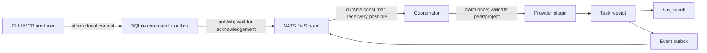

# Queue work that survives a restart

The agent bus takes a hand-off into a local queue and delivers it when the recipient, the
broker or the bridge comes back. A command is committed to SQLite before anything else, so a
disconnected producer, a broker restart or a coordinator restart loses nothing, and the
same request ID returns the same command receipt instead of a second run.

This page is for someone whose direct `peer_submit` calls are not enough because the sender
cannot stay around to retry. You need a running bridge ([OPERATIONS.md](OPERATIONS.md)) and
[NATS Server](https://docs.nats.io/) with JetStream on this machine. The bus runs on one
machine, with one coordinator, and the broker binds to 127.0.0.1. It has been tested so far
with scripted agents, not live models.

## The shortest path

```sh
brew install nats-server            # or your distribution's package
answerback stop                     # only if the bridge runs: the next line replaces its environment
uv tool install '/absolute/path/to/answerback-<version>-py3-none-any.whl[bus]'
agent-bus configure --server /opt/homebrew/bin/nats-server
agent-bus start
agent-bus status
```

`agent-bus configure` writes a private `bus/` directory beside the bridge configuration
with a token and a `nats.conf`. `agent-bus start` starts the broker as a service of its
own and then the bridge. Real output of `status`, trimmed to six of its fields and the
`coordinator` object to two:

```json
{
  "configured": true,
  "url": "nats://127.0.0.1:<port>",
  "commands": {},
  "outbox_pending": 0,
  "broker_reachable": true,
  "coordinator": {"connected": true, "last_error": null}
}
```

`broker_reachable: true` means the broker that answers on the port is this configuration's
own; `coordinator.connected: true` means the bridge's coordinator holds its consumer.
Before `start`, the same command prints `broker_reachable: false` with
`broker_error: "broker not running (supervisor not installed)"` and `coordinator: null`.

Then queue one assignment. Take `peer_id` and `project` from `answerback find` or
`peer_search`; the values below are placeholders:

```sh
agent-bus submit codex_cli:REVIEWER \
  --project /absolute/path/to/project \
  --message-file /absolute/path/to/assignment.md \
  --request-id review-42 \
  --ttl 3600
agent-bus result <command-id>
```

`submit` prints the command receipt. Real output, trimmed to four of its fields:

```json
{
  "command_id": "a36ce9f8-4714-4428-b207-f063422a979e",
  "request_id": "review-42",
  "delivery": "queued",
  "task_id": null
}
```

`delivery: "queued"` is the proof that the command is committed locally and waits for
admission; `task_id` is `null` until the coordinator admits it. `result <command-id>` repeats these
fields and adds `task`: `null` until `delivery` is `bound`, then the task receipt the
command produced. Only that task receipt's `status: "completed"` means the work is done.
A `submit` for a recipient whose provider is not registered is refused before anything is
stored: `{"error": "Recipient provider is not registered"}`, exit `1`.

## Delivery and execution have different receipts



*One command's path: committed locally, published, claimed once by the coordinator, bound to
a task receipt.*

The command ID tracks delivery. The task ID tracks execution. `delivery: "bound"` means the
command has a task receipt; read `task.status` and its result to decide whether the work
finished. Task failure, a permission request and an uncertain execution stay separate
outcomes ([RECEIPTS.md](RECEIPTS.md)).

| Delivery state | Meaning |
| --- | --- |
| `queued` | Accepted locally; waiting for admission and, under provider backoff, for `not_before`. Can be cancelled |
| `dispatching` | Claimed before the submission to the provider plugin. Inspect; do not resubmit |
| `bound` | A task receipt exists. Follow it |
| `rejected` | Identity, project, routing or preflight check refused admission. A preflight refusal's `detail` names only the exception type, for example `Admission preflight refused (ValueError)` |
| `expired` | The TTL passed before dispatch |
| `cancelled` | Cancelled before admission; a delayed broker copy is harmless |
| `uncertain` | Admission may have started, and no matching task binding was recovered |

Reuse `request_id` for the same assignment: the same content, recipient, routing and TTL
return the existing command; anything different under the same key is refused. A duplicate
broker delivery cannot create a second provider submission once the command is claimed.

## How a command moves

The bus is one module, the `bus` entry point of the `answerback.modules` group. The kernel
imports nothing from it: it merges the module's `bus_*` and `actor_*` RPC verbs, adds the
`bus` and `actors` CLI trees, collects its five MCP tools and supervises its worker beside
every other installed module. The `agent-bus` command is the same program as
`answerback bus`. Durable commands and [messages between enrolled actors](ACTOR-MESSAGES.md)
share the bus configuration and connection and use separate streams and receipts. The module
contract is in [ADAPTERS.md](ADAPTERS.md#modules).

The coordinator is the one process per machine that claims a command and admits it to a
provider plugin through the `Gateway` protocol (`prepare`, `send`, `lookup`, `get`). A
Herdr terminal is one recipient among others, reached through the `hc` provider; Herdr is
optional. The C4 views are in [architecture/README.md](architecture/README.md).

## Install and enable

The bus is opt-in. Its Python client `nats-py` and the process-inspection dependency
`psutil` ship as the `bus` extra. Without the extra every core command, including
`answerback --help`, keeps working; the five `bus_*` RPC and MCP names stay registered and
keep their local store behaviour, and a command that needs the broker (`bus start`,
`bus stop`, `bus status` of a configured bus, `bus submit` without `--offline`) exits `1`
with a JSON `error` containing
`The agent bus needs the optional extra: install answerback[bus]`. A running service records
that error in `bus_status`'s `coordinator.last_error` instead of starting the coordinator.

Stop the bridge before you reinstall, and name every extra you use in one command (each
`uv tool install` replaces the earlier set). A service that has recorded the missing extra
does not try the bus again until it restarts. An import error naming a module inside `nats`
or `psutil` means the package is installed and does not match: reinstall with the extra.
The service then records only the exception type, such as `ImportError`, in
`coordinator.last_error`; `answerback bus status` shows it.

The server dependency is NATS Server with JetStream; the bus refuses a server older than
2.10.0, which it needs for create-only consumer semantics. The `bus` extra pins the client
to `nats-py==2.16.0`. No committed record names a server version the bus ran against.
Register the providers you intend to use (`answerback providers register codex`), then
discover recipients with `answerback find` or `peer_search`. Discovery does not itself
authorise an assignment.

### The broker service

`agent-bus start` installs the broker under its own label, `local.agent-bus.nats.<namespace>`:
a launchd agent at `~/Library/LaunchAgents/local.agent-bus.nats.<namespace>.plist` on
macOS, with unconditional `KeepAlive`, or a systemd user unit at
`<config dir>/bus/supervisor/local.agent-bus.nats.<namespace>.service` on Linux, with
`Restart=always` and `[Install] WantedBy=default.target`, enabled by absolute path. Either
way the broker starts again at login and after every exit. Starting before login is your
optional `loginctl enable-linger`; `agent-bus` never runs it. Use `agent-bus start` rather
than a distribution's broker service, so the generated authentication and loopback settings
apply.

`agent-bus stop` unloads or disables the owned service and removes its definition, so the
restart policy no longer applies. It stops only the broker this configuration owns and
refuses an unmanaged one. Stopping the broker leaves the coordinator, active tasks and
stored receipts intact; `agent-bus start` brings it back.

Before `start` and `stop` call the service manager they verify the stored definition
against the configured NATS executable and the private `nats.conf` path. Starting an
already reachable broker returns its status without a restart. A start after an upgrade
reloads a registered launchd job when its definition changed, and the first `start` on this
version moves a plist that an earlier version wrote under `bus/supervisor/` (a place
launchd never reloads) into `~/Library/LaunchAgents`, with a brief broker restart; one
`start` is enough.

At configuration time `agent-bus configure` resolves the executable to the file the broker
process runs and stores that path. It asks `mise which nats-server` only for a shim under
`~/.local/share/mise/shims/`, `$MISE_SHIMS_DIR` or `$MISE_DATA_DIR/shims`, a symlink to the
`mise` executable, or a small script whose body names `mise`. Any other wrapper is refused
with `configure the real nats-server binary; a launcher shim cannot be owned`. An existing
configuration that holds a launcher reports
``configured executable is a launcher shim; run `agent-bus configure` again``;
reconfiguration keeps the token and port.

If an older coordinator is already running, `agent-bus start` reports the version mismatch.
Let its work settle, install the new package and run `answerback restart` before starting
the bus. A start on an occupied, unverified port is refused.

### Who answers on the socket

Before sending the shared token, every status probe and JetStream connection checks the
socket it is actually connected to: the peer must name this configuration's namespace, and
the OS process and socket records must show that it belongs to the current user's
configured executable, launched with exactly `-c /absolute/path/to/bus/nats.conf`. A
namespace claim alone is public and can be copied; the UID and socket ownership come from
the OS, so another OS user cannot forge them. Unavailable or denied process inspection
refuses authentication. This is a local ownership check over plain loopback NATS: no TLS,
and no protection from a process already running as you.

When the check fails, `agent-bus status` reports `broker_reachable: false` and a
`broker_identity_error`: `Broker peer identity could not be verified` when the greeting or
the records do not establish this installation's broker, or
`Broker process evidence could not be read on this machine` when inspection failed first.
When no broker answers, it reports a fixed `broker_error` from the supervisor instead, for
example `broker not running (launchd: exited 0, not restarted)`. The bridge publishes the
same reason as `bus.last_error` in `answerback status --json` and as
`coordinator.last_error` in `bus_status`. None of these messages includes the token,
configuration contents or raw service-manager output.

## Submit and follow a command

```sh
agent-bus submit codex_cli:REVIEWER \
  --project /absolute/path/to/project \
  --message-file /absolute/path/to/assignment.md \
  --request-id review-42 \
  --ttl 3600
agent-bus result <command-id>
agent-bus events --after 0 --limit 50
agent-bus cancel <command-id>
```

`--message-file` keeps the assignment out of the shell's process arguments; `--message` is
the inline alternative. `--ttl` is in seconds and defaults to 3600. Submission commits to
SQLite first, then the CLI tries to publish up to 100 pending outbox rows per stream. If
NATS is offline the result says `stored_locally: true` with the publish error, and the
coordinator publishes later. `--offline` skips the immediate attempt. The MCP `bus_submit`
commits locally and leaves publication to the coordinator. `cancel` works before dispatch
only.

The MCP tools:

| Tool | Returns |
| --- | --- |
| `bus_submit(peer_id, project, message, request_id, ttl_seconds)` | A durable command receipt |
| `bus_result(command_id)` | The delivery state and any bound task and result |
| `bus_events(after, limit)` | A cursor page of lifecycle events |
| `bus_cancel(command_id)` | Cancellation before dispatch only |
| `bus_status()` | Configuration, backlog and the coordinator's connection observation |

An MCP process that was already running needs a reload before its tool inventory gains
them.

### Recovery after a restart

On restart, a claim in progress is reconciled by its stable request key
(`bus:<command UUID>`), exact message and recorded recipient. An existing task is bound. A
missing or conflicting receipt leaves the command `uncertain`, and **the coordinator never
sends that work again**: inspect the recipient and the receipts before authorising a new
attempt.

If the broker goes away, ordinary bridge RPC keeps working; reconnection resumes
publication and consumption. Broker API refusals are counted per outbox row across
reconnects and restarts. On the 20th failure the row is quarantined: it stays stored and
leaves the pending set, so later rows of that kind can advance. Connection loss and a
missing publish acknowledgement leave a row pending for retry, not quarantined.
`coordinator.outbox_errors` names a stream's current publish error and
`coordinator.outbox_quarantined` counts the retained rows. A quarantined command can still
show a `queued` delivery receipt: quarantine concerns publication and proves neither
execution nor rejection. Nothing replays or deletes a quarantined row on its own. Inspect it
without exposing assignment text:

```sh
sqlite3 -readonly /absolute/path/to/bus/ledger.sqlite \
  'SELECT o.id, o.kind, o.command_id, f.attempts, f.last_attempt_at,
          f.quarantined_at, f.error_type
   FROM outbox AS o JOIN outbox_failures AS f ON f.id = o.id
   WHERE o.published_at IS NULL AND f.quarantined_at IS NOT NULL
   ORDER BY f.quarantined_at, o.created, o.rowid;'
```

### Provider backoff: `not_before`

`bus_submit` never refuses work because a provider account is rate-limited. While the bridge
holds the recipient's account ([RECIPIENTS.md](RECIPIENTS.md#provider-backoff)) the command
is accepted and stays `queued` with `not_before` set to the time the pause ends (wall-clock
seconds; `null` when there is no hold). Its outbox row is not published before then. Later
commands are not held behind it, and a held command is published in its original order once
`not_before` has passed. The `command.accepted` event of a held command carries
`not_before`. A Kiro or owned-worker peer ID names its account; an `hc:` or `herdr:` ID does
not, so such a command waits behind the held account whose pause ends last. `rex:`, a
provider plugin's prefix and unknown prefixes are never held. A repeated `bus_submit` with
the same request ID returns the command with its first hold. An older release ignores the
hold table and publishes held rows at once.

### Disable the bus or roll back

To disable the bus completely, cancel the queued commands you intend to drop and let
admitted work settle; stop the broker and the bridge; move the private `bus/` directory
aside as a backup; restart the bridge. No bus directory means no bus worker. Restoring the
directory restores its queued commands too, so inspect them first.

For a package rollback, stop the broker and bridge after work settles, reinstall the earlier
wheel with the extras it had (`<wheel>[bus]`), and restart the bridge. An older bus release
does not honour quarantine, so keep the coordinator stopped until quarantined rows have been
reviewed. A release before 0.8 ignores the bus ledger; keep the directory for recovery. The
bus never changes the task-table schema.

## Bounds

| Item | Bound |
| --- | --- |
| Message | 1 to 100,000 UTF-8 bytes; 128,000 bytes on the wire |
| TTL | 1 to 86,400 seconds; default 3,600 |
| Ledger | 10,000 commands not yet pruned, completed ones included. At capacity new commands are refused; there is no automatic pruning ([MAINTENANCE.md](MAINTENANCE.md)) |
| Command stream | File-backed work queue, 64 MiB, 100,000 messages, 7 days |
| Event stream | File-backed, 32 MiB, 100,000 messages, 30 days. Replay is bounded by this; the ledger keeps the history |
| Broker | 256 MiB file store, one replica, 120-second duplicate window |
| Coordinator | One durable consumer, at most one unacknowledged command; recipient preparation 30 seconds, submission 60 seconds |
| Outbox | Pending through bounded retries, quarantined after 20 API refusals |

The consumer binding `coordinator_v1` verifies its acknowledgement, redelivery, subject,
replay and pull settings; a mismatch is refused without changing the consumer, and a missing
consumer is created with create-only semantics and read back before binding. This is
defence in depth against a conflicting same-user configuration, not tenant isolation: a
token holder has JetStream administrative access.

The token and `nats.conf` are private files; no token goes in a CLI argument, URL or
service environment. The ledger and the command stream contain assignment text, so a backup
of `bus/` is private user data. One OS user is the trust boundary. An external publisher
cannot create executable work by publishing to NATS alone: the coordinator requires an
identical command previously admitted to the local ledger. Broker deduplication lasts 120
seconds; the ledger is the duplicate guard after that. None of this promises exactly-once
side effects at the recipient.

## Live monitor

```sh
answerback bus monitor --web
answerback bus monitor --board --once
```

`--web` serves an authenticated dashboard on 127.0.0.1, prints its private URL and opens
the browser; `--no-open` leaves opening to you and `--port 0` picks an unused port. Ctrl+C
stops only the monitor. The page reads the lifecycle ledger and never consumes the command
queue. It keeps the last 200 event rows; pause freezes it and resume continues from the
retained cursor. Debug shows safe metadata and blocking-task IDs, never prompt or result
bodies.

The printed URL carries the session's bearer token in its fragment: anyone who can read
your terminal can use it. The browser is not started with that URL, because every local
account can read a process's arguments. It is started with the path of a page only you can
read (mode 0600 in a 0700 temporary directory, removed when the monitor stops), which
forwards to the dashboard with a single-use ticket valid for 120 seconds. If the browser
cannot read that page or the ticket has expired, the dashboard shows "Access needed": open
the printed URL yourself.

The Board section (runs, peers, decisions) is fed by the bridge's observe-only AG-UI 1.0
stream ([EVENTS.md](EVENTS.md)); `--board` shows the same tables in the terminal, `--once`
prints one frame, `--all` shows every retained run instead of the last 24 hours plus every
unfinished or failed one, `--rows N` sets rows per table (default 12) and `--page N` pages
the retained receipts 100 at a time. The Board needs a running bridge; without one its label
reads `WAITING FOR BRIDGE`.

The Board does not need the bus. The ledger panels above it read one of two labels when the
monitor cannot read a bus:

- **"Bus not configured"** is not a failure. The monitor reports it only when no earlier
  read by this monitor found the bus's `config.json`, and the `bus` folder beside the
  bridge configuration is absent, or is an ordinary folder (not a symbolic link) that the
  monitor may list and that holds no entry. The page names `agent-bus configure`. Terminal
  mode prints one notice to stderr and exits `0`; with `--json` the notice is an object
  with `configured: false`, so stdout carries event lines only.
- **"Ledger unavailable"** is a failure. The monitor reports it for a `config.json` that is
  gone after this monitor has read it once (a bus that loses its configuration while the
  monitor runs, even if the folder is now absent or empty), for a bus whose `config.json`
  is found but whose ledger is missing or not a private regular file, and for a folder
  that holds bus files without `config.json`, is a symbolic link or not a folder, or
  cannot be listed. The page keeps the rows it has; terminal mode exits `1` with an error
  object on stderr. A failed read that found no `config.json` does not stop a later
  "Bus not configured" report.

Terminal mode also takes `--after SEQUENCE`, `--count N`, `--timeout SECONDS`,
`--interval SECONDS` and `--json` for NDJSON; these are rejected with `--web`.

## What it cannot do yet

- One machine, one coordinator. There is no remote admission API, no TLS and no shared
  broker between machines; a multi-machine producer would need an authenticated admission
  path that is not built.
- No live-model run of the bus is recorded. The tests cover broker restart, offline
  producer and coordinator, lost acknowledgements, forced duplicate delivery, crash recovery
  on either side of the provider submission, cancellation, expiry, changed identity and
  event-stream backpressure, with scripted recipients (they need `nats-server` on `PATH`).
- No automatic reset or resend of a quarantined or `uncertain` command.
- Changing the broker cannot repair a recipient's missing completion evidence.

## See also

- [ACTOR-MESSAGES.md](ACTOR-MESSAGES.md): messages between enrolled actors over the same bus.
- [RECEIPTS.md](RECEIPTS.md): the task receipt a `bound` command points to.
- [EVENTS.md](EVENTS.md): the event stream behind the Board.
- [TROUBLESHOOTING.md](TROUBLESHOOTING.md#the-optional-bus): reinstalling with the extra, and the bin paths.
- [MAINTENANCE.md](MAINTENANCE.md): pruning the bus ledger.
