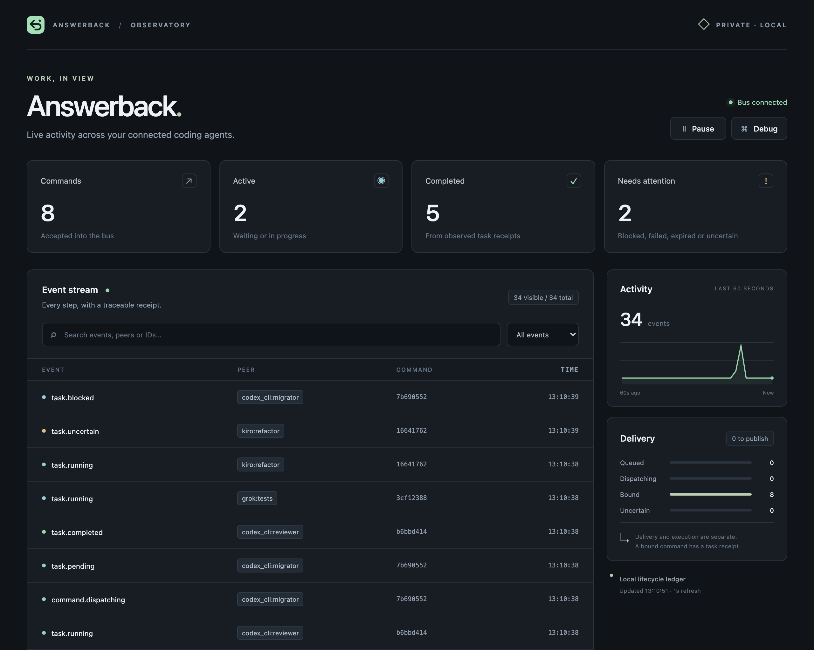
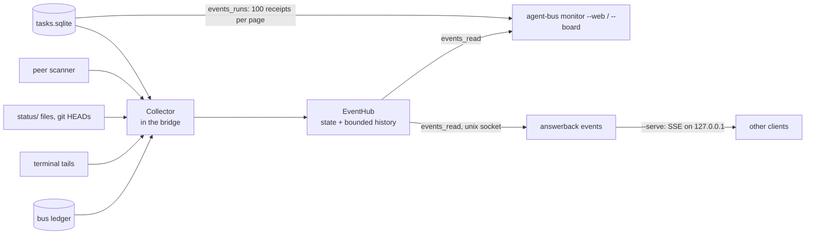

# Watch your agents: the event stream and the board

The bridge publishes one read-only stream of [AG-UI 1.0](https://docs.ag-ui.com/spec/1.0) events about
runs, agents and receipts. You can follow it from a terminal, a board or the local dashboard. AG-UI is an
open event format for agent activity. The stream carries metadata only: it never carries a prompt, a
result or the text of a screen.

This page is for someone who wants to see what their agents are doing. Have a configured, running bridge
first ([Getting started](GETTING-STARTED.md)).



*The local dashboard during a scripted demo. The agents are stand-ins, not live models.*

## Follow the stream

```sh
answerback events --count 2
```

The first line is always a `STATE_SNAPSHOT`, then every change follows. Real output from one machine,
trimmed to the second event, with the peer address replaced and the digest shortened:

```json
{"type": "ACTIVITY_SNAPSHOT", "messageId": "tail:<peer>", "activityType": "answerback.tail",
 "content": {"peerId": "<peer>", "runId": null, "sha256": "215530a1…", "lineCount": 59, "chars": 4983, "changedMs": 1795636113514}}
```

That event is about an agent's terminal. It holds a SHA-256 digest, a line count and a character count of
the screen, and not the screen's text. The command exits 0 after `--count` events.

| Command | What you get |
| --- | --- |
| `answerback events` | the stream as NDJSON, one event per line |
| `answerback events --sse` | the same as SSE frames, with event IDs |
| `answerback events --after <id>` | resume after an event ID |
| `answerback events --run <task-id>` | one run's lifecycle only, as a single-run AG-UI stream |
| `answerback events --alerts-only` | only new anomalies, rate-limit signals and interrupts ([TRACING.md](TRACING.md#board-and-alerts)) |
| `answerback events --serve [--port N]` | HTTP SSE at `http://127.0.0.1:N/events`; prints the bearer token |
| `agent-bus monitor --board [--once]` | runs, peers, decisions, apply queue and HEADs as terminal tables |
| `agent-bus monitor --board --all [--page N] [--rows 0]` | retained receipts, 100 per page; `--rows 0` shows every row |
| `agent-bus monitor --web` | the dashboard above, with a Board section fed by the stream |

`--count N` and `--timeout S` stop a follower. `--port 0` chooses an unused port. `agent-bus …` takes the
same subcommands as `answerback bus …`. If the running bridge is older than the stream, the commands say
the stream is unavailable.

```sh
answerback events --serve --port 8765
curl -N -H "Authorization: Bearer <token printed above>" http://127.0.0.1:8765/events
```



*Where the stream's data comes from. Every arrow is a read; nothing on the stream sends work.*

## Local by design

The stream is metadata only. It carries IDs, states, agent names, project paths, decision titles, branch
names and commit references, and hashes and sizes of text. It never carries the prompt, the result or the
text of a screen or chat. A worker's screen shows the brief it was sent and the result it is writing, so
the bridge reads a screen only to compute a SHA-256 digest, two sizes and the time the digest last
changed. No setting publishes screen text.

A receipt's detail is free text too and may quote either. It is not selected from the store. Every error
event carries a fixed message and a code, so read why a task failed from its receipt
([RECEIPTS.md](RECEIPTS.md)). These are all of them, from `RunTracker._close` and `RunTracker.attach` in
`src/answerback_bridge/events/producers.py`:

| Cause | Event, message and code |
| --- | --- |
| receipt `failed` | `RUN_ERROR` `Task failed` / `failed`, after `SUBAGENT_ERROR` `Run failed` / `failed` if a worker was attached |
| receipt `cancelled` | `SUBAGENT_ERROR` `Run cancelled` / `cancelled` if a worker was attached, then `RUN_FINISHED` with outcome `cancelled` |
| receipt `abandoned` | `SUBAGENT_ERROR` `Run abandoned` / `abandoned` if a worker was attached, then `RUN_FINISHED` with outcome `cancelled` |
| the worker leaves the listing while the run is open | `SUBAGENT_ERROR` `Worker peer is no longer listed` / `peer_gone` |

Nothing on the stream accepts a command. Work is still handed off with `peer_submit` or `bus_submit`.

## What the board shows

- **Runs come from the receipt store**, direct `peer_submit` hand-offs included. At start the bridge reads
  every retained receipt, so runs that ended earlier are on the board. Only what happens after that is
  announced as lifecycle events.
- **The default view is the last 24 hours, plus every run that is unfinished or failed**, whatever its age.
  A run is unfinished until its receipt is `completed`, `failed`, `abandoned` or `cancelled`. A failed run
  has `attention: true`.
- **All shows retained history**: the `All` button on the web board (100 runs a page, `Older` / `Newer`), or
  `--all --page N` in the terminal. Pages read the receipt store through the read-only `events_runs` RPC,
  apart from the live working set. The web viewer keeps only its current page; selecting `All` again
  refreshes it. A run leaves history when retention deletes its receipt. The live working set reconciles
  retention every minute and refills the slots it frees.
- **A date is shown for anything not from today.** Times are in the viewer's time zone, which each board
  names, at the offset in force on their own date. A time on today's date is `HH:MM:SS`, any other is
  `YYYY-MM-DD HH:MM:SS`. The bus timeline above the board uses the same rule.
- **The live working set holds at most 5000 runs**, unfinished ones included. Open runs come first, then
  failed runs, then other ended runs, newest first within each group. Both boards show `truncated, N more`
  from `bridge.runsOmitted`, with a route to All. Eviction from the set removes no receipt.
- History pages are ordered by creation time and ID, newest first, and return `total`, `offset`,
  `nextOffset` and a `runs` map. Each page is one read-only SQLite transaction. New receipts or retention
  can shift offsets between requests, so start at page one for a fresh pass. Pages synthesize no
  lifecycle events and are not a frozen snapshot across requests.

## What is emitted

| Source | Event |
| --- | --- |
| a receipt is first seen | `RUN_STARTED`: `threadId` is the ledger task (from the brief, else from the request ID), `runId` is the bridge task ID |
| a receipt changes status | `STEP_FINISHED` for the old status, `STEP_STARTED` for the new one |
| a receipt reaches `completed` | `RUN_FINISHED`, result `{status, resultChars}` (never the body) |
| a receipt reaches `failed` | `RUN_ERROR` with the fixed message `Task failed` |
| a receipt reaches `abandoned` or `cancelled` | `RUN_FINISHED`, outcome `cancelled` |
| the peer scanner sees the run's worker | `SUBAGENT_STARTED` (`subagentRunId` is `<peer>#<run>`), then `SUBAGENT_FINISHED` or `SUBAGENT_ERROR`; code `peer_gone` if the worker disappears |
| peers, runs, decisions, apply queue or HEADs change | `STATE_DELTA`, an RFC 6902 patch against the state |
| the terminal tail of a worker with an open run changes | `ACTIVITY_SNAPSHOT`, then `ACTIVITY_DELTA`: `{peerId, runId, sha256, lineCount, chars, changedMs}` |
| a `reserved` decision is open past `needed_by` | `RUN_STARTED` and `RUN_FINISHED` with outcome `interrupt`, once while the decision stays in the scan window (`runId` is `decision:<id>`) |
| a bus ledger row (what `agent-bus monitor --json` prints) | `RAW`, source `answerback.bus` |
| a provider rate-limit signature is seen | `CUSTOM` named `answerback.provider_throttled` (below), then `STATE_DELTA` on `pressure` |
| the tracer raises an anomaly | `CUSTOM` named `answerback.anomaly` ([TRACING.md](TRACING.md)) |

Every event carries `metadata.answerback` with `runId`, `threadId` and `peerId` where they apply, because
`RUN_ERROR`, `STEP_*` and `SUBAGENT_*` have no identity fields in the protocol.

Tail activity covers the full text the source returns. Tracing separately hashes the suffix bounded by
`tracing.tail_bytes`, so a change outside that suffix still updates the activity digest, sizes and
`changedMs`. Neither path publishes the text.

### State

The values below are placeholders. The field names are the real ones.

```json
{
  "schema": "answerback.board/1",
  "bridge": {"version": "…", "instanceId": "…", "startedMs": 0, "sourceErrors": {}, "runsOmitted": 0, "runsPageable": true},
  "runs": {"<task-id>": {"threadId": "<task>", "peerId": "hc:t61", "status": "submitted", "step": "submitted",
            "attention": false, "subagentRunId": "hc:t61#<task-id>", "provider": "hc", "requestId": "…", "createdMs": 0, "updatedMs": 0}},
  "peers": {"hc:t61": {"name": "…", "provider": "hc", "project": "/…", "agentKind": "claude", "state": "working",
            "sendReady": false, "reason": "working", "runId": "<task-id>",
            "metrics": {"tokens": null, "cpuPercent": null, "rssBytes": null, "children": null}}},
  "decisions": {"<decision id>": {"task": "<task>", "class": "reserved", "status": "open", "title": "…",
                "neededBy": null, "answered": false, "overdue": false, "project": "/…"}},
  "applyQueue": {"/project": {"pending": ["…"], "done": ["…"]}},
  "heads": {"/project": {"/worktree": {"branch": "main", "sha": "81fc3840aa11"}}},
  "activities": {"tail:hc:t61": {"activityType": "answerback.tail"}},
  "pressure": {"kiro:default": {"provider": "kiro", "account_hint": "default", "level": 0, "until": null,
               "last_signal": null, "clean_since": null}}
}
```

The tracing collector fills `peers/<id>/metrics` and adds `peers/<id>/trace` with a bounded state timeline,
the activity hash and the active anomaly reasons. A value is `null` until a source exists, and `null` is
not an error. `bridge.debug` describes manual debug scopes ([TRACING.md](TRACING.md#manual-debug)).

### Provider pressure

`answerback.provider_throttled` is emitted once per signal: a line of a worker's screen, or the evidence or
reviewed error of a bridge-launched worker's turn, matched a rate-limit signature. The value carries the
class only:

| Field | Meaning |
| --- | --- |
| `provider` | the rate-limited account's provider: `kiro` or `bedrock` |
| `account_hint` | the label set in `events.json` at `pressure.providers.<provider>.account_hint` (default `default`); never a credential or a path |
| `model` | the model, when the surface names it; otherwise `null` |
| `harness` | `kiro`, `claude`, `codex`, `grok`, `crew` or `unknown` |
| `source` | `hc_screen` (terminal screen scan), `native_evidence` (a native turn's evidence), `native_error` (a reviewed `BridgeError`), `acp_text` (a Kiro turn's answer) |
| `signature` | `kiro.rate_limit`, `bedrock.throttling`, `bedrock.http_429`, `mantle.stream_error` or `codex.rate_limit` |
| `observed_at`, `until` | epoch seconds: when it was seen, and until when dispatch for the account waits |
| `level` | the account's pressure level after this signal (1 or more) |

No screen text, answer text, brief or digest of either is published. A line that appears verbatim in the
receipt's own brief never counts, and an unchanged screen line is one signal, not one per scan. A
bridge-launched worker that is relaunched after a throttled turn and throttled again emits one event per
launch.

The `pressure` section has one entry per account, keyed `<provider>:<account_hint>`. `until` is `null` at
level 0. Whether a hold is still running is `until` against the viewer's clock: the section changes only on
a signal, a decay step or a clear, and the end of a hold is not an event. Levels, the hold formula and
`answerback pressure` are in [TRACING.md](TRACING.md#provider-pressure). What dispatch does while an account
is held is in [RECIPIENTS.md](RECIPIENTS.md#provider-backoff).

## Connecting, resuming and falling behind

- An event ID is `<epoch>-<seq>`. The epoch changes when the bridge restarts, and the sequence only grows.
- A new reader gets a connect page: one `STATE_SNAPSHOT`, an `ACTIVITY_SNAPSHOT` per live activity and up
  to 50 recent lifecycle events marked `metadata.answerback.replayed: true`, then live events. A consumer
  that alerts on events skips the `replayed` ones.
- The connect page is one unit. Its last event carries the stream position `<epoch>-<seq>`, and the events
  before it carry a part ID, `<epoch>-<seq>.<part>`. A reader that returns with a part ID is sent the whole
  page again. A `STATE_SNAPSHOT` resets the reader's state, so a page received twice is safe.
- The state lists the live activities under `activities`, at most 16. A reader keeps an activity only while
  its message ID is listed.
- A reader that returns with `Last-Event-ID` inside the retained history gets exactly what it missed.
  Outside it, or after a restart, it gets a fresh snapshot. A delta is never applied to the wrong base.
- History is a ring of 2000 events by default. Readers pull, a slow one falls behind and is resynchronised,
  and producers never wait for a reader.
- Receipts are read every second, in `(updated, id)` order, so receipts that share a timestamp are each
  read once. Peer scans, tails and files are read every 15 seconds. With tracing on (the default), scans
  run without a viewer so that alerts stay current. With `tracing.enabled: false`, scans need a reader seen
  in the last two minutes.

### Event size and identity bounds

- Each retained event is at most 65,536 bytes of ASCII-escaped JSON. An oversized event becomes a marker
  with `metadata.answerback.oversized: true`. A lifecycle marker keeps its event type, required fields and
  bounded run, thread and peer correlation. Other events become `CUSTOM` named `answerback.oversized`. An
  oversized interrupt keeps an interrupt signal with reason `event_oversized`, so it never reads as success.
- State changes are checked before they are applied. A patch is atomic: if one operation is over the
  ceiling or cannot be encoded, the whole update is omitted and the previous state stays. Large batches are
  split into several bounded deltas in order. A reader that crosses an omitted delta gets a fresh connect
  page. Repeating the last refused patch adds no loss count, and connect snapshots carry the cumulative
  `metadata.answerback.omittedUpdates`. Fix the producer's oversized field and send a fresh update.
- A connect snapshot with many valid rows can exceed 64 KiB. It is not capped as one event.
- Peer IDs are kept exactly up to 1024 printable characters. A longer ID, or one with control characters,
  is omitted rather than shortened into a possibly colliding identity, and counted under
  `sourceErrors.peerIdentifiers` within the first 200 scan rows.
- Run display text is bounded: thread and request IDs to 128 characters, provider, status and step to 32.
  A run peer ID over 1024 characters becomes `peerId: ""` with `peerIdOmitted: true`. A subagent ID over
  1280 characters becomes `null` with `subagentRunIdOmitted: true`. Receipt routing identities are unchanged.
- Lifecycle identity survives cache eviction in a private temporary SQLite index (1 MiB page cache) that
  holds projected run metadata only and is deleted when the tracker closes. Unchanged receipts produce no
  new events. A later correction to a closed receipt updates its state without reopening the run.
  Retention is reconciled every minute by joining IDs inside that index, so there is no inventory cap.
- An overdue decision is remembered only while it is in the current scan. One that leaves the window and
  returns can be announced again.

### Board file limits

The board reads decisions, apply queues and HEADs from the `status/` folder and git worktrees of the
projects it knows. File identities must be printable and fit these UTF-8 byte limits. An identity over its
limit is omitted, and the board's `SOURCES WITH ERRORS` summary names the kind and count, for example
`queueFileNames: 2 queue file names omitted`. Counts describe the current successful scan and clear on
recovery; a failed scan keeps the previous counts. Shorten or correct the identity to restore it.

| Input | Limit | Counter under `bridge.sourceErrors` |
| --- | --- | --- |
| Decision `id`, or filename without `.md` when no `id` is present | 256 bytes | `decisionIdentifiers` |
| Decision `id` already held by an earlier project in the scan | the first project keeps it; the later file is omitted | `decisionDuplicates` |
| Queue filename, including `.json` | 255 bytes | `queueFileNames` |
| Queue directory bucket name | 255 bytes | `queueBucketNames` |
| Queue directory buckets per project | the first 16 valid names in lexical order, plus root `pending` | `queueBuckets` |
| Worktree path | 4,096 bytes | `worktreePaths` |
| Main project path | 512 bytes; a refused project is left out of all three file sections | `projectPaths` |

The scan windows are eight projects, the last 200 decision files per project, 64 worktrees plus the main
HEAD, and 50 filenames per queue list. Configured projects come before live peer projects. Names are
checked before the 50 are selected, so refused names do not displace valid neighbours. Buckets past the
first 16 are counted without scanning their contents. Omissions are
counted within each window and are separate from `metadata.answerback.omittedUpdates`.

A project's `.git` marker must be a local directory (not a symlink to one) or a regular worktree pointer
file of at most 4,096 bytes, opened without following links. A symlink, FIFO, oversized pointer or a marker
that changes to a non-regular file ends the search for that project.

### Debug drawer admission

The debug drawer is the local file that `answerback debug` writes ([TRACING.md](TRACING.md#manual-debug)).
One background writer appends and rotates it, and admission never waits for storage. The queue holds at
most 256 records and 4 MiB, and a fixed one-second window admits at most 256 write attempts, projection
baselines included. An interval that crosses two windows can admit up to 512. A record cannot exceed the
4 MiB segment limit.

Overflow, rate limiting and failed writes are best effort. `answerback debug status` reports the cumulative
`droppedWrites` and the most recent error: `DebugDrawerWriteQueueFull`, `DebugDrawerWriteRateLimited`,
`DebugEventExceedsDrawerBound`, `DebugDrawerNotRegularFile`, `DebugDrawerCloseTimeout` or a storage
exception class. After a lost projection the next write starts with a scoped snapshot. The drawer opens
without blocking on a FIFO and writes only to a regular file, so replace any special file at its path.

Shutdown stops admission and waits at most one second for the writer. On timeout, queued records are
discarded and counted in `droppedWrites`, and shutdown returns. The in-flight write may still finish, and
the writer thread can stay until the process exits if the file system stays stuck. Fix the storage and
restart the bridge. `DebugController.flush()` is an unbounded drain for tests and embedded callers; no
daemon path calls it. Call `flush()` or `close()` outside the event loop. Writes to the lease file stay
synchronous.

## Settings

Put an optional `events.json` beside the bridge `config.json`. Every key is optional. An invalid file does
not stop dispatch: the bridge uses the defaults and shows `sourceErrors.settings` in the state.

| Key | Default | Range |
| --- | --- | --- |
| `enabled` | `true` | `false` stops the collector; `events_read` still answers with the empty state |
| `receipt_seconds` | `1` | 0.2 to 60 |
| `scan_seconds` | `15` | 2 to 3600 |
| `history` | `2000` | 16 to 100000 events |
| `projects` | `[]` | up to 8 absolute paths whose `status/` folder is shown even when no peer works there |
| `tracing` | on, with defaults | see [TRACING.md](TRACING.md#settings) |
| `pressure` | on, with defaults | see [TRACING.md](TRACING.md#provider-pressure) |

Without `projects`, the board finds projects from the working directories of the discovered peers, and a
worktree maps to its main checkout.

## Exposure

- The bridge opens no TCP port for the stream. `events_read` and `events_runs` are read-only RPCs on the
  private unix socket (mode 0600). Their reads have their own capacity of 8 concurrent readers, apart from
  the dispatch slots. A poll ends and frees its slot as soon as its client closes the socket or the service
  stops.
- HTTP SSE is served by the viewer process, bound to `127.0.0.1`. `Host` and `Origin` must be the listener,
  a per-process bearer token is required in the `Authorization` header (never in a URL), and only `GET` is
  accepted. It allows at most 4 concurrent streams and 8 concurrent request handlers. A request header must
  finish within 3 seconds and 16 KiB, or it is refused and frees its handler. A reader that leaves gives its
  stream back within a second.
- Anyone who can read your terminal can read the token, so treat it like the dashboard URL. To view it from
  another machine, use an SSH local port-forward.
- The dashboard's `/api/session` gives the page that `agent-bus monitor --web` opens its token once, for a
  single-use ticket in the `Authorization` header (`Ticket ...`). The ticket is valid for 120 seconds and
  exists only when the monitor opened a browser ([AGENT-BUS.md](AGENT-BUS.md#live-monitor)). The route is
  GET-only and has the same Host/Origin and request capacity checks.
- The dashboard's `/api/runs?offset=0&limit=100` has the same GET-only, bearer, Host/Origin and request
  capacity checks. The limit is 1 to 100. A page is metadata only; result and error-detail bodies are never
  selected.
- All stream text is untrusted input to a consumer. The terminal board prints printable characters only,
  and the dashboard writes with `textContent`.

## Conformance

The tests validate every emitted event against the vendored AG-UI 1.0 JSON Schema
(`src/answerback_bridge/events/schema/`, MIT). The package does not depend on the AG-UI SDK.

AG-UI 1.0 describes one run per stream. This stream is a multiplex: several receipts are open at once and
board events sit between them. Each run's own events are in order, and `--run` (or `?run=<id>` over SSE)
gives one run as a conformant single-run stream that opens with its `RUN_STARTED`.

## Answerback for macOS

Answerback for macOS is a native window over the whole fleet, by the same author. It is a separate project
with its own pre-release, and it needs macOS 26. It reads the same fleet document, receipts and task file
that the command line shows ([FLEET.md](FLEET.md), [RECEIPTS.md](RECEIPTS.md)).

It has three views. **Agents** is a board of every agent and run across all projects, in columns for what
needs you, queued, working, done and idle. It has a project filter and a search box that understands
`machine:`, `state:` and `harness:`. **Machines** has one tile per machine with the bridge's verdict and its
load and memory meters, and an inspector that explains why a machine reads full, down to the raw readings.
**Tasks** puts a project's recorded task list beside what is observed now.


*The Agents view: the machine pool on the left, agents by project and by what you must do in the middle,
and on the right the inspector for the local machine, which reads full because CPU load per core is 1.10
and the memory compressor holds 34% of physical memory. Some card titles and other
projects' names are blurred.*

On your click the app runs four commands of its own and nothing else: it shows an agent in Herdr, sets or
clears a project's lead mark, and starts an orchestrator in a project's folder after showing you the exact
command. It sends no work and answers no prompt.

## What it cannot do yet

- `--run` is refused when the run's `RUN_STARTED` has left the 2000-event ring, or the run ended before this
  bridge started: `answerback events --run` exits 1 and SSE answers 410. Read the run's state from the full
  stream or its receipt. A future run can still be followed until it starts.
- The stream reports, it does not alert. `--alerts-only` is input for an external consumer; it sends no
  message and configures no destination.
- There is no merged stream of several bridges. Each bridge publishes its own, and agents on other machines
  appear only as the Herdr terminals that this bridge can read.

## See also

- [TRACING.md](TRACING.md): the anomaly flags, provider pressure and manual debug on the same stream.
- [RECEIPTS.md](RECEIPTS.md): what a receipt state means, which the stream only reports.
- [AGENT-BUS.md](AGENT-BUS.md#live-monitor): the dashboard's bus timeline and its access checks.
- [CAPACITY.md](CAPACITY.md): load and memory per machine, which the stream does not carry.
