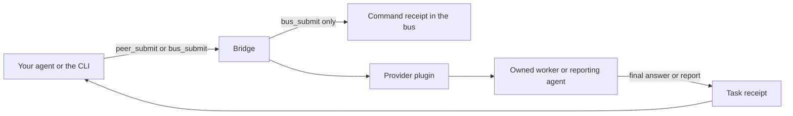

# Choose which worker takes the work

Answerback can hand one assignment to an agent in five kinds of place: a worker session the bridge starts, an
agent in a Herdr terminal, a KiroCrew chat, an enrolled Rex conversation, or a terminal that `answerback route`
creates for you. Pick one by what its receipt proves when it reads `completed`, and by whether the release
supports its route.

It is for someone who has a running bridge and wants to choose a recipient. Set the bridge up first with
[Getting started](GETTING-STARTED.md); [Recipients](RECIPIENTS.md) has the setup of each route.

## Pick a recipient

An **owned worker** is a session the bridge starts and owns for one assignment. A **recipient-reported** route
is one where an agent that is already running reports its own result. The receipt of an owned worker completes
on the worker's own final answer. The receipt of a recipient-reported route completes when the agent reports,
and reads `submitted` while it works.

| You want | Use | Address | Session | Completes on |
| --- | --- | --- | --- | --- |
| A separate session of Codex CLI, Claude Code, Grok Build or Kiro CLI, with nothing typed into your terminals | an owned worker | `codex_cli:`, `claude_code:`, `grok:`, `kiro:` | the bridge starts it | the worker's correlated final answer |
| An agent you already see in a Herdr terminal | the `hc` route | `hc:` | yours, one assignment per session | the agent's `task_complete` call or `answerback complete` |
| A chat in KiroCrew | the `crew` route | `crew:` | an existing chat, or one `crew-create` makes | the chat's explicit result report |
| A conversation that agrees to poll its own mailbox | Rex | `rex:` | yours, enrolled once | `rex-complete` after `rex-ack` |
| Keyword routing that picks or creates a terminal for a brief | `answerback route` | `hc:` | a Herdr terminal that `route` may create (a managed worker) | the same as `hc` |

One tool is enough. The reviewer can be a second session of the one you already use, for example a second
Claude Code worker reviewing the first one's change. Agents keep their provider login and their native
permission mechanism. Answerback scopes the tools of the workers it starts, appends the receipt instructions to
each assignment and ships optional collaboration skills.

The owned worker is the shortest path when you start from nothing:

```sh
answerback workspace add reviewer --provider codex_cli --cwd "$PWD"
```

```json
{
  "peer_id": "codex_cli:reviewer",
  "project": "<absolute path of --cwd>",
  "kind": "bridge_managed"
}
```

That is the whole output, with the project path replaced by a placeholder. The workspace now has an address,
`codex_cli:reviewer`, for a worker the bridge owns. Send it the brief and wait for its receipt:

```sh
answerback send codex_cli:reviewer --request-id review-42 --message-file review-brief.md
answerback task --peer codex_cli:reviewer --wait 30
```

`send` starts a real model turn, so the output of these two commands is not shown here. Success is the last
command exiting `0` with the receipt's `status` reading `completed`. It exits `1`, `2` or `3` otherwise
([exit codes](NATIVE-CLI.md#exit-codes)), and [Receipts](RECEIPTS.md) explains each state.

That separate session does not see your conversation with the first agent, so the brief has to carry what it
needs.

## Release support

This table records the R1 support boundary. **Supported** is subject to the live gate at the release candidate.
An installed provider plugin or an MCP connection alone does not establish that status.

| R1 status | Route | Boundary | Address starts with |
| --- | --- | --- | --- |
| Supported | Codex CLI | Bridge-owned worker | `codex_cli:` |
| Supported | Grok Build | Dedicated profile | `grok:` |
| Supported | Herdr terminal | One assignment per session | `hc:` |
| Supported | Claude Code | Installed CLI 2.1.322 or newer; the bridge process must hold the provider credentials (see NATIVE-CLI.md: wrapper-injected tokens are not inherited; a supervised bridge has no credential path yet) | `claude_code:` |
| Supported | Kiro CLI | A tool use waits for a person in the default v3 mode; the bridge never approves. Managed workers run unattended on the opt-in v2 engine with `kiro_trust_all_tools` or `kiro_trust_tools` (below), off by default and Experimental | `kiro:` |
| Experimental | `hc_send_to_done` | Ships off by default | `hc:` |
| Experimental | Remote machines (`hc_send_machines`) | Linux with Codex CLI is the only qualified pair | `hc:` |
| Experimental | KiroCrew as sender | Ships, but still needs the gate | `crew:` |
| Excluded from R1 | KiroCrew as recipient | Requires the bridge tool server in KiroCrew with its reporting tool pre-approved; KiroCrew then approves all bridge tools for its agents | `crew:` |

The Claude Code and Kiro CLI rows rest on live runs on 24 November 2026 on macOS and Linux: Kiro CLI
3.5.0 at `4a03461b`, and Claude Code 2.1.330 with its round trip and repeat at `4a03461b` and its
cancel at `5c8995a5`. Those run records name the maintainers' hosts and home directories, so they
are kept in the maintainers' archive, not in the public tree.

### Claude Code credentials

An owned Claude Code worker under a supervised bridge gets credentials only from the bridge unit's environment,
which carries none by design, or from `settings.json` `env` (non-secrets only). A bridge started by hand with
`answerback start --standalone` inherits the starting shell. A credential source that the supervised bridge reads
at start is not built. [Native CLI setup](NATIVE-CLI.md#register-and-submit) says what reaches the worker and why
a shell wrapper's export does not.

### Unattended Kiro workers

The managed Kiro route runs unattended v2 workers behind two experimental settings, off by default.
`kiro_acp_engine: "v2"` makes the bridge write its fixed `answerback_bridge` agent to
`~/.kiro/agents/answerback_bridge.json` under the worker's HOME and launch
`kiro-cli acp --agent-engine v2 --agent answerback_bridge`. The agent has the same scope as the v3 inline profile:
read, write, shell and the bridge MCP server, with no global MCP servers or powers. A session that answers any
other `currentModeId` is refused before a prompt.

Then either `kiro_trust_all_tools: true` adds `-a` (Kiro approves every tool use) or `kiro_trust_tools: ["read"]`
adds `--trust-tools read` (Kiro approves the named tools). `["read"]` is the set shown live: a read completed with
no permission callback while a write or a shell command still asked. The two settings are mutually exclusive. For
owned CLI workers, Answerback does not gain authority over the connected tool's own approval policy. These flags
are Kiro's policy, chosen by the owner in the bridge's config, and the bridge still never approves anything itself.

The receipt records which mode ran as `kiro_trust` (`"ask"`, `"all"` or the list). For v2 it also records
`"mcp_readiness": "server_initialized"`, because the v2 engine reports that the bridge MCP server started
without a tool list (v3 reports `"tools_verified"`). Each receipt retains the newest 128 resolved permission
rounds as metadata-only `permission_events` facts (IDs, choice or cancellation, timestamps and ordinal), never
request text; `permission_events_truncated` counts older facts dropped. Kiro CLI 3.5.0 v2 ignores inline
`customAgents` metadata, and the owner-run probe verifies that the selected on-disk agent excludes an otherwise
loadable global MCP server.

In `config.json` these settings sit in the `providers.kiro` block as `acp_engine`, `trust_all_tools` and
`trust_tools`. The flat names above are still read until 0.17.

### Active execution budget

Each owned worker has an active execution budget: `kiro_active_budget`, `codex_cli_active_budget`,
`claude_code_active_budget` and `grok_active_budget`. Each defaults to 600 seconds and accepts whole seconds from
60 through 14400. Set it with `answerback workspace add <alias> --provider <provider> --active-budget <seconds>`;
re-adding an existing alias is safe. `answerback workspace list --provider <provider>` reports
`active_execution_budget`.

Waiting for a human permission decision pauses the budget, including concurrent approval requests. On an expiry
receipt, `native_stopped` records whether cleanup confirmed that the owned native process group stopped (`true`,
`false`, or `"unknown"` when the provider plugin has no such witness). The native harness's own deadlines stay
separate. Owned workers use their own processes and session identities and never take over an interactive CLI.

### Terminals on other machines

A **guarded host route** is an already-running, recognized CLI agent inside a selected Herdr App/core or older
Herdr TUI runtime. It sends only to such an agent, never to an arbitrary terminal. Core requires exact identity,
the current project and a reported `idle` state (`done` too when `hc_send_to_done` is on). Remote machines need an
explicit allow-list. A terminal on a listed remote machine reports through a result file that the bridge reads
through Herdr Core:

> Listing a machine in `hc_send_machines` delegates completion of tasks sent there to every program running under that machine's user account: the result file is proof that the brief reached that account, not that a particular agent wrote it. Before removing a machine from the list, let its open tasks finish or reconcile them (`answerback task <id> --wait <seconds>`); receipts whose machine is no longer listed are not read.

Such a receipt records `"result_authentication": "trusted_os_account"` and its `result_machine`
([what listing a machine trusts](RECIPIENTS.md#remote-results-what-listing-a-machine-trusts)). The shared file
protocol does not qualify a harness on its own. Remote result-file completion is qualified only for Linux to
Linux with Codex CLI. macOS, and Kiro CLI, Claude Code and Grok Build on any system, stay excluded until each pair
passes the [remote qualification checklist](LIVE-TEST.md#remote-result-file-qualification).

## Transport and application evidence

Two receipts answer two questions. The command receipt, kept by the optional [bus](AGENT-BUS.md), answers whether
delivery was accepted and bound. The task receipt answers whether the selected recipient completed the
assignment. A client heartbeat answers neither. An `uncertain` task keeps its identity and must be investigated
before another submission.



*Two receipts: the bus records delivery, the task receipt records completion.*

Each recipient is reached through the interface below. CLI help shows advertised behaviour only. It does not
prove that a conversation received a prompt or that its model completed a turn.

| Runtime | Interface used | Evidence boundary |
| --- | --- | --- |
| Kiro CLI | ACP v1: `kiro-cli acp --agent-engine v3`, or `--agent-engine v2 --agent answerback_bridge` when v2 is selected | Owned worker. Loading a saved session is not attachment to an unrelated live TUI |
| KiroCrew | Owner-authenticated local gateway chat API | Submits to a selected chat and requires its explicit worker callback, the chat's result report |
| Codex CLI | Owned `codex app-server` v2 JSONL | Implemented `codex_cli:` transport. Exact thread, turn and final-answer correlation; one-time approvals |
| Claude Code | Pinned official SDK plus bounded raw terminal metadata | Implemented `claude_code:` transport. The installed SDK parser omits attribution fields, so raw native evidence is joined explicitly. Native idle is required; each task uses a new session |
| Grok Build | Owned ACP v1 stdio with no leader | Implemented `grok:` transport. New sessions only; the exact request's terminal result |
| Herdr App/core, host route | `hc ls`, `hc get`, `hc read`, `hc send` (with `--if idle`; with no state condition to a `done` terminal when `hc_send_to_done` is on), `hc file read` (results from another machine), and `hc events` with `hc machine ls` when `hc_events` is on | Observes terminal identity and readiness around delivery. [Herdr integration](HERDR-INTEGRATION.md) lists every call |
| Herdr App/core, other commands | `answerback route` and `workers`: `hc ls`, `hc get`, `hc run`, `hc kill`, `hc rm`. `answerback capacity --machine`: `hc exec --on` | Outside the host route: these create, list and remove managed workers and measure machine capacity |
| Older Herdr TUI | Named-session `herdr agent` API | Separate from App spaces and core sessions |
| Rex | Explicit native endpoint and cooperative mailbox enrollment | Receive, acknowledge and result protocol; no terminal typing and no model wake |

### Owned execution is not attachment

A provider plugin can own a new CLI process and its protocol streams. Resuming a saved session reuses history
without attaching to a process that another client owns, and an already-started stdio server is not an endpoint
that another process can connect to. Claude Code's background-resume help says it may create a copy when the
requested session is already running, so Answerback does not use that route. Grok uses an owned stdio process with
a private socket directory. Saved-session policy is unqualified for Claude Code and Grok Build, so each of their
tasks starts a new session.

The provider plugins keep notification, model wake-up, resumed history and new worker creation apart. They use
runtime events where the harness supplies them and bounded polling where it does not, and they keep the harness's
normal permission controls. A registered MCP process proves connectivity. It is not authority to execute text
received in an inbox.

The official protocol references the provider plugins follow:

- [Codex app-server](https://developers.openai.com/codex/app-server): owned thread and turn lifecycle, approvals
  and terminal events.
- [Kiro v3 ACP migration](https://kiro.dev/docs/cli/v3/acp-migration/): session updates, matching prompt
  responses and native permission choices.
- [Claude Code programmatic use](https://code.claude.com/docs/en/headless): structured result and session metadata
  and the Agent SDK's approval controls.

## Qualification

Protocol fixtures exercise wrong IDs, disconnects, cancellation, permission races, output bounds and receipt
recovery. Native startup and model execution are separate observations, and a subprocess exit or an accepted
request does not establish a completed exchange. [VALIDATION.md](../VALIDATION.md) records the current results
and gaps.

Fresh Claude Code and Grok Build probes reached their normal one-time permission requests, then confirmed native
cancellation and cleanup without answering. Claude's hook correlated its distinct SDK and native prompt IDs. Grok
used an explicitly trusted temporary folder and a reviewed project-local normal-ask policy, and inherited user
permission rules still applied.

## What it cannot do yet

- **Several agents delivering one package together.** The five-client acceptance project, CLI-1 (Kiro CLI,
  KiroCrew, Codex CLI, Claude Code and Grok Build each building a module and reviewing another's), ended
  `FAILED_INCOMPLETE`. The [scenario record](WORKTREE-GUARD-SCENARIO.md) says what it did and did not show.
- **A second assignment to the same Herdr terminal** is refused by default, because a terminal that has answered
  reports `done`. `hc_send_to_done` lifts that and is Experimental.
- **Remote terminals beyond one pair.** Sending to a terminal on another machine is Experimental and off by
  default (`hc_send_machines: []`). Only Linux to Linux with Codex CLI is qualified.
- **KiroCrew as a release-supported recipient.** It is excluded from R1, and KiroCrew as a sender is Experimental.
- **Unattended Kiro workers** need the v2 engine and a trust setting, both Experimental and off by default.
- **Herdr status reporting is not qualified per client.** Core recognizes the command names of all five CLI
  clients, but recognition does not qualify a client version's status reporting, idle admission and correlated
  completion. KiroCrew's native Herdr status reporting is under qualification.
- **No wake for an unmanaged application.** [Actor messages](ACTOR-MESSAGES.md) give enrolled, running agents
  direct exchanges with delivery, read, acknowledgement and reply evidence. They do not wake an agent.
- **Herdr is optional.** It is one recipient host. It is not the message bus and does not own the receipt
  protocol.

## See also

- [Recipients](RECIPIENTS.md): set up each route.
- [Owned native CLI workers](NATIVE-CLI.md): Codex CLI, Claude Code and Grok Build workers in depth.
- [Receipts](RECEIPTS.md): what each state means and how to wait for one.
- [Protocols](PROTOCOLS.md): why ACP, and how a name becomes a bound recipient.
- [Validation](../VALIDATION.md): what has been run live and what has not.
