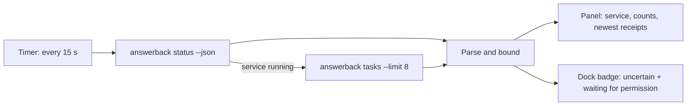

# See the fleet in the Herdr App

Answerback ships a side panel for the Herdr App, the fleet column, that shows the machines with the bridge's
verdict and their load and memory, each project's agents and lanes, and the receipts that need a person. It sits
beside Herdr's own spaces and agent board, reads files and the App's own lists, and sends no work.

It is for someone who runs the Herdr App on macOS or Linux next to a bridge. Install the bridge first
([Getting started](GETTING-STARTED.md)); the fleet document the column reads comes from `answerback fleet serve`
([Fleet](FLEET.md)).


*The fleet column on the right of the Herdr App. Names and the centre terminal are blanked, and two lane labels
and one receipt name in the column are blurred. Its status line shows an older bridge.*

## Install

```sh
answerback herdr-app status
answerback herdr-app install
answerback herdr-app install --apply
```

`status` reports each shipped file's `state`. `install` without `--apply` previews the `action` for each file, and
`--apply` does it. Here is `install --apply` into an empty App folder, trimmed to one of its ten `files` rows and
four of its other keys:

```json
{
  "directory": "<the App's folder>",
  "present": true,
  "files": [
    {
      "path": "mods/answerback-fleet/fleet.js",
      "kind": "mod",
      "written_by": "answerback",
      "state": "missing",
      "action": "installed"
    }
  ],
  "applied": true,
  "success": true
}
```

The command exits `0`, and `"success": true` with `"applied": true` shows the files were written. A later
`answerback herdr-app status` reports each of them as `"state": "installed"`. The App reloads the mod on its own,
and the first time it sees the folder it docks one copy on the right, 320 wide (`mod.json`). After that your layout
decides. To check the mod, run `herdr-app check ~/.config/herdr-app/mods/answerback-fleet`.

| Command | Does |
| --- | --- |
| `answerback herdr-app status` | Reports each shipped file: installed, outdated, differs, missing or symlink |
| `answerback herdr-app install` | Previews the installation |
| `answerback herdr-app install --apply` | Installs the column and the themes |
| `answerback herdr-app install --apply --replace` | Also replaces files you changed, after a backup |
| `answerback herdr-app uninstall [--apply]` | Previews, or with `--apply` removes, the column's files that are as shipped |

The App's folder is `--directory` when given, else `$HERDR_APP_CONFIG`, else `~/.config/herdr-app`. When that
folder is not there, nothing is installed or removed and the report says so: install the App first. The legacy
`answerback install` runs the same step after the bridge and reports it under `herdr_app`. A refusal there is
reported as `herdr_app.error`, because the bridge's own install has finished by then. `answerback uninstall` runs
the removal before `--remove-tool` removes the tool.

### Point the column at the fleet document

The column reads `~/.config/herdr-bridge/fleet/fleet.json` unless the layout block gives the prop `document`
(`fleet.js` `documentPath`). `answerback fleet serve` publishes into `fleet/` next to the bridge config, which is
`~/.config/answerback-bridge/fleet/fleet.json` on a fresh install (`fleet/publish.py` `default_folder`). On such an
install, give the column that path in a layout block of your own (duplicate a shipped layout first, because shipped
layouts are replaced on start):

```json
{ "type": "block", "content": { "mod": "answerback-fleet", "props": { "document": "~/.config/answerback-bridge/fleet/fleet.json" } } }
```

Until a document is there, the column shows `waiting for the bridge's fleet document`.

## What is shipped

The package carries the files under `answerback_bridge/data/herdr-app/` with `manifest.json`, which gives each file
its digest (`sha256:<hex>`), size, kind, licence and origin.

| Files | What they are | Licence |
| --- | --- | --- |
| `mods/answerback-fleet/main.js`, `fleet.js`, `fixtures.js`, `mod.json` | The fleet column | Apache-2.0, this project |
| `themes/catppuccin-frappe.json`, `-latte`, `-macchiato`, `-mocha` | Theme files on the Catppuccin palettes | the files: this project; the palettes: Catppuccin, MIT |
| `themes/rex-macchiato.json` | A variant of Catppuccin Macchiato | as above |
| `themes/zed-tokyo-night.json` | A theme file on the Tokyo Night palette | the file: this project; the palette: Tokyo Night, MIT |

Not shipped: the App's own helper files `gpui-kit.d.ts` and `jsconfig.json`, which it writes beside a mod; the
App's own themes; the look mods cloned from the App's shipped mods; and `better-sidebar-fleet`, whose origin and
licence are not recorded. The manifest lists these as `dependencies`, the installer reports each one as `present`
or `missing` and installs none of them, and the column needs none of them.

## What install does with each file

| Found | Install does | Report |
| --- | --- | --- |
| no file | writes it | `installed` |
| the shipped file | nothing | `unchanged` |
| an earlier shipped version (digest in the row's `previous_digests`) | backs it up, then writes the shipped file | `updated` |
| any other content | keeps it and names it in `notes`; with `--replace`, backs it up and writes the shipped file | `keep` / `replaced` |
| a symlink, or a symlinked folder between the App's folder and it | writes nothing anywhere and fails | `refuse` |

Every file is written to a temporary name in its folder and then renamed, so the App's hot reload never sees half
a file. Backups go to `~/.local/state/answerback-bridge/backups/herdr-app.herdr-bridge-backup-<random>/content/`,
mode 0700, with a `recovery.json` (mode 0600) that names the App's folder. That tree is made from your home down
without following a link, so a symlinked home, or a symlinked folder on the way, refuses the step before anything
in the App's folder changes. Every shipped file is checked against its manifest row before anything is planned,
and a mismatch stops the step.

**The older panel.** When `mods/answerback` holds only files this project shipped (by digest, the App's two helper
files aside), install removes it, keeps a copy in the backup and adds a line to `notes`. A copy with your changes,
or one that a file under `layouts/` still places, is left as it is and named. Any layout block whose `mod` is
`answerback` counts as placing it, and so does a layout that cannot be parsed.

**Uninstall** removes the column's files that are as shipped, or an earlier shipped version, and nothing else. The
folder, the App's helper files, any file of yours and files you changed stay, listed under `retained`. The themes
stay too, because a layout of yours may name one, and the report's `notes` say so.

### Links and races

When the App's folder is a symlink, or any folder on the way to it from your home is, every command refuses before
it reads anything. A folder named by `--directory` or `$HERDR_APP_CONFIG` outside your home is checked itself, and
its device and inode are compared before every change. Every write and removal is made through a descriptor of its
own folder opened without following links, so a folder swapped for a symlink after the check is refused.

A missing file is given its name with a hard link, which fails when anything appeared at the name. A file that is
updated is held open and compared by device and inode with the file just backed up, immediately before the rename
over it. The older panel is renamed to a private name (`mods/.answerback-remove-<random>`) and each child is
compared with what was listed before it is unlinked. Any failure names that private folder under `retained`.

What this does not defend against: a process of your own user replacing an entry in the instant between the last
comparison and the `rename`, `rmdir` or `unlink` of that entry. Python's `os` offers no rename that exchanges two
entries, which would close it. On a filesystem with no hard links the same instant is open for a missing file.
These are same-user races inside your own configuration folder, inside the account trust boundary
([SECURITY.md](../SECURITY.md)).

## The status line

The last line of the column reads, for example (the examples in `fleet.js` `footer`):

```text
bridge 0.12.0 · bus ok · data 40 s old
bridge data 3 min old
```

- `bridge X` is the bridge's version from the document's `health.service.version`.
- `writer Y` appears only when the writer's version differs from the bridge's, or the document gives no bridge
  version. Each version loses its `+…` part and is cut to 12 characters.
- `bus ok` or `bus down` is the bridge's connection to the agent bus.
- `data live` means the document is under 5 seconds old. After that the line says how old, and over 120 seconds it
  reads `bridge data N min old` only, even when the old document reported a stopped service.
- `bridge stopping`, `bridge not reached` and `bridge state not known` replace the versions when the service is not
  `running`, in the theme's `blocked` colour.

## What the column runs

It reads files and the App's own lists of terminals, machines, agents, panes and spaces. It runs three things,
each only from a click: `pane.focus` or `terminal.peek` on an address the App lists at the moment of the click,
and, only when the layout entry has the prop `"clear": "release"` and after a confirm step,
`answerback abandon <receipt-id> --reason "cleared by the owner from the Answerback column"` for one `uncertain`
receipt. The prop `command` names that program. With `checking()` true, or the prop `"sample": true`, it draws
the shipped sample and runs nothing.

## Tests

```sh
node --test tests/herdr-app/footer.test.mjs tests/herdr-app/receipt-detail.test.mjs
uv run pytest tests/test_herdr_app.py tests/test_packaging.py
python3 tools/herdr_app_manifest.py check
```

After a change to a shipped file, `python3 tools/herdr_app_manifest.py write` refreshes its row. Add the old
digest to `previous_digests` when the installer should update copies of the earlier version.

## The older status panel

`integrations/herdr-app/answerback/` is the panel the fleet column supersedes. It stays in the repository for
reference, is not shipped, and the installer does not install it.

| Part | Shows |
| --- | --- |
| Service | `running`, `stopping`, `not responding` (the service holds its lock but does not answer, and may still be starting) or `stopped`, and the bridge version |
| Receipt counts | Pending, Submitted, Uncertain, Waiting for permission (the bridge's `blocked` state) and Completed, plus an Other row when there are queued, running, failed, abandoned or cancelled receipts |
| Newest receipts | Peer, state and age, newest first, 8 rows by default |
| Dock badge (macOS) | The number of receipts that need a person, uncertain plus waiting for permission; no badge at zero |

While the service is not running, the panel shows the service state and no counts. If the CLI is missing, fails or
prints something that is not JSON, the panel shows one plain line saying so and tries again on the next interval.



*The older panel's read loop with the default props: two CLI calls per interval, nothing written.*

Every interval it runs `answerback [--config PATH] status --json` through the App's `exec`, with a fixed argument
list and a 10-second timeout. Only when that answer says the service is running does it run
`answerback [--config PATH] tasks --limit N`, which prints JSON without a `--json` flag. It never builds a shell
string, and nothing that came from a receipt is ever put into a command.

From the answers it keeps only the service flags, the version, the count per state, and each receipt's peer name
(`target`), state and creation time, never the `detail`, prompt or result. CLI text is untrusted display data:

- the peer name is cut to 40 characters and the version to 24;
- control characters and line breaks become spaces, and invisible and direction-changing characters are removed;
- a state outside the fixed list shows as `unknown`;
- everything is drawn as plain text, never as Markdown;
- output over 1 MiB is refused as invalid.

To install it by hand, read the files first, then copy (do not link) the folder and check it. The check renders the
panel once without running the CLI. To remove it, delete the folder.

```sh
cp -R integrations/herdr-app/answerback ~/.config/herdr-app/mods/answerback
herdr-app check ~/.config/herdr-app/mods/answerback
```

| Prop | Default | Meaning |
| --- | --- | --- |
| `command` | `~/.local/bin/answerback` | Path of the CLI: an absolute path or one starting with `~/` |
| `config` | not set | Bridge config, passed as `--config`; same path rule |
| `interval` | `15` | Seconds between reads, kept between 5 and 3600 |
| `limit` | `8` | Rows in the receipt list, 1 to 30 |
| `badge` | `true` | `false` leaves the Dock badge alone |

The path rule refuses a bare name (so `PATH` is never searched), a relative path, an option-like string, `~name/…`,
a control character, more than 1024 characters, and an empty or non-string value. A refused value shows one line
in the panel, and nothing is run.

The rule checks the form only, so whoever can set the props can make the panel run any program at an absolute path
with the two fixed argument tails above. That is the trust a Herdr App mod already has. Set props only from a
source you trust, and read a layout before you use it.

Its own tests run with `node --test integrations/herdr-app/answerback/*.test.mjs`. Name the files: some Node
releases load a directory given to `--test` as one module and fail.

## Herdr interfaces used

From the App's published mod interface (`herdr.d.ts`, `gpui-kit.d.ts` and the mod guide the App writes to
`~/.config/herdr-app/AGENTS.md`):

- `View` and `div` (`gpui-kit`); `h_flex` and `v_flex` (`gpui-base`);
- `exec`, `home`, `theme`, `setBadge` and `checking` (`herdr`);
- `cx.timer.every`, `cx.spawn`, `cx.notify` and the optional `close()`;
- `mod.json` with `place` and `size`.

Herdr (`hc`, `herdr`, `herdr-app`) is a separate project by its own authors under the Apache-2.0 licence. No Herdr
source, bundled mod, generated helper file or documentation text is included here.

## What it cannot do yet

- **Take action beyond the three clicks.** The column cannot approve, send, retry or start the bridge.
- **Find the writer's document on a fresh install without a prop.** Its default path is under `herdr-bridge`, and
  the writer publishes under the config folder (see above).
- **Talk to the bridge socket.** A mod can open only TCP and WebSocket connections, so the older panel runs the
  CLI, two short processes per interval.
- **Post notifications with actions.** The App's `notify()` does not hand action arguments back to the mod.
- **Older panel in a live window.** It was checked with `herdr-app check` and `node --test` only. The Dock badge is
  macOS only, and the last mod to set it wins.

## See also

- [Fleet](FLEET.md): the document the column reads and `answerback fleet serve`.
- [Herdr integration](HERDR-INTEGRATION.md): everything else Answerback uses from Herdr.
- [Receipts](RECEIPTS.md): what `uncertain` means before you clear one.
