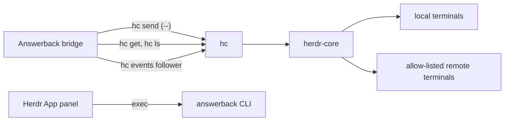

# Send work to agents in Herdr terminals

Hand an assignment to a coding agent that is running in a Herdr terminal, on this machine or on a machine you
list, and get back a receipt that completes only when that agent reports its result.

It is for a Herdr user setting up the `hc` route, or a Herdr maintainer reviewing how Answerback uses Herdr. Set up
the route first with [Recipients](RECIPIENTS.md#herdr-appcore-readiness).

Herdr is an independent project for running coding agents in terminals, and Answerback is an unofficial companion:
it is not part of Herdr, not endorsed by it, and usable without it.

## Shortest path

With the bridge running and an agent idle in a Herdr terminal on this machine:

```sh
answerback hc-configure
answerback find --provider hc
answerback read-hc hc:t7 --lines 40
answerback send hc:t7 --binding <binding> --request-id review-1 --message "Review src/app.py and report findings."
answerback task <task-id> --wait 30
```

`hc-configure` turns the route on in the running bridge, calling `hc` unless you pass `--binary`. `find` lists the
terminals: pick one with `send_ready: true` and copy its `peer_id` and `binding`. `read-hc` shows the terminal's
last lines (100 when `--lines` is left out). `send` types the brief and prints a receipt whose `id` is the
`<task-id>`. No output is shown here, because every one of these commands needs a live Herdr Core.

The agent reports with `task_complete` (or `answerback complete`). The hand-off is done when the last command,
`answerback task <task-id> --wait 30`, prints a receipt whose `status` is `completed` and exits `0`. It exits `3`
when the wait of at most 30 seconds runs out first, and `1` for a receipt that is `failed`, `cancelled`,
`abandoned` or `uncertain`.



*The bridge drives Herdr only through the `hc` program; the App panel reads through the `answerback` command.*

## What the bridge uses

| Capability | Herdr interface used | Default |
| --- | --- | --- |
| Read a terminal's identity, status and labels | `hc get <target> --json` | always on |
| List all terminals | `hc ls --json` | always on, polled per request |
| Send to a terminal reporting `idle` | `hc send --if idle --json -- <target> <text>` | always on |
| Send to a terminal reporting `done` | `hc send --json -- <target> <text>`, with the send receipt's status checked afterwards | off (`hc_send_to_done: false`) |
| Send to a terminal on another machine | the same `hc get` and `hc send`, against a `machine/tNN` address | off (`hc_send_machines: []`) |
| Collect a remote terminal's result | `hc file read --on <machine> --json <path>`, and `hc get <machine/tNN> --json` when no file is there | only for listed machines |
| Follow terminal changes without polling | `hc events --json`, plus `hc machine ls --json` per listing | off (`hc_events: false`) |
| Read a terminal's screen | `hc read --lines <n> --json <target>` | always on |
| Create and remove a managed worker | `hc run --bg --no-parent --json --name <name> --cwd <folder> <argv>`, `hc kill`, `hc rm`, with `hc ls` and `hc get` | only when `answerback route` or `answerback workers` runs |
| Measure another machine's capacity | `hc exec --on <machine> --timeout <seconds> sh -c <fixed script>` | only for a machine named on `answerback capacity --machine` |
| Read and write `answerback*` documents in Core | `hc connect` plain line mode: `hello`, `doc.get`, `doc.set` | in the code, not wired |
| Show the fleet in the Herdr App | the fleet column mod | installed by `answerback herdr-app install --apply` |
| Place a worker in the right App space and tab | the `herdr.space` and `herdr.tab` labels that `hc get` reports | always on |

The `hc_*` settings sit in the `providers.hc` block of `config.json` (`send_to_done`, `send_machines`, `events`,
`placement_policy`), and the flat names are read until 0.17. The bridge reads them once at start, so restart it
after a change. Routing is in [ROUTING.md](ROUTING.md) and capacity in [CAPACITY.md](CAPACITY.md).

Since 0.16 the Herdr code is one provider package, `src/answerback_bridge/providers/herdr/`, with two plugin
registrations in the `answerback.providers` entry-point group. `hc` owns the Herdr App/core route and `herdr` owns
the older TUI route. They share one package because the two transports share identity and task machinery, and
their config blocks (`providers.hc`, `providers.herdr`), RPC verbs, subcommands (`hc-configure`, `read-hc`,
`send-herdr`, `read-herdr`) and MCP tools stay separate. The package also owns the Herdr App installer
(`herdr_app.py`, behind `answerback herdr-app`) and the table of programs Core recognizes as agents: each provider
plugin declares its programs, and the kernel merges them. The kernel still imports this package directly in a few
places, pinned by `tests/test_provider_imports.py` and [deferred to 0.17](ADAPTERS.md#deferred-to-017).

## Sending to a terminal that reports `done`

On the App/core route the bridge sends by default only to a terminal whose agent reports `idle`. A terminal that
has finished a turn and reports `done` is read-only (`send_readiness_reason: done`). The older TUI route accepts
`done`.

A Herdr terminal takes one assignment per session; the next assignment goes to a new session of the same harness. `hc_send_to_done: true` lets a finished terminal take another. Core cannot refuse that send if the agent starts a turn first; the bridge then records the delivery as `uncertain`.

Herdr Core's `hc send --if` accepts only `idle` or `working`, and there is no `--if done`. So a send to a `done`
terminal goes out with no condition, and never with `--force`, which leaves Core's refusal of a blocked program in
place. Core cannot close the window between the bridge's identity check and its own keystrokes for a `done`
terminal, as `--if idle` closes it for an `idle` one. With `hc_send_to_done` on, the text can land in a turn the
agent has started in between, or in a program that has replaced the agent. The bridge sees that only afterwards.

The bridge narrows the window on its side:

1. It checks the terminal's identity (address, binding hash, agent, project) immediately before `hc send`.
2. After the send it reads the receipt's `status` word and checks the identity again.
3. When the same agent is still there and the status was neither `done` nor `idle`, the text landed in a turn the
   agent had started. The receipt is recorded as an uncertain delivery that the worker's result later completes,
   freeing the terminal: a `task_complete` on this machine, or the result file on another machine.
4. When the agent has changed, the submission is invalidated: a later `task_complete` is refused and no result file
   is read.

An `hc send --if idle` refusal with the error kind `status_mismatch` proves that nothing was typed, so the receipt
is `failed` and the terminal is free for a retry. Any other send error, timeout or unexpected response is recorded
as an uncertain delivery at once. Inspect the terminal and the receipt before you send again.

## Remote terminals

A terminal on another machine (address `machine/tNN`) is read-only by default, whatever its state. Its
`send_readiness_reason` is `remote_read_only` when the earlier identity checks pass, or `foreground_unknown` when it
has no foreground program. `hc_send_machines` names the machines, as `hc machine ls` prints them, whose terminals
may receive work.

- The machine part of an address is compared exactly with the configured names: no case folding, no trimming and no
  partial match. Before each remote send the bridge also reads `hc machine ls` for the machine's `state` and
  permanent `id`.
- Listing a machine means trusting the process identity that machine's Herdr Core reports (argv, pid, cwd,
  status), and that machine's OS user: any program of that user can write the result file that completes a task
  sent there. The bridge cannot see the remote machine's processes itself.
- `answerback route` reads `hc_send_machines` from the config file each time it runs, while the bridge reads it at
  start, so a machine is used only when both name it. Routing may reuse an idle `send_ready` terminal on a listed
  machine, puts local peers before remote ones within one harness, and never creates, removes or sends a gated
  class's brief to a remote terminal ([routing](ROUTING.md)).

### Guards before a remote send, and what a remote receipt says

A remote peer advertises `capabilities: ["read", "send", "result_file"]`, never `worker_report`, and every hc peer
carries `machine` (the `hc machine ls` name, `null` locally) and `cancel: false`. Before a receipt is reserved, the
bridge refuses with a fixed public diagnostic and no receipt:

| Refusal | When |
| --- | --- |
| `brief_secret_shape` | The brief holds a provider credential shape: the Bedrock and 1Password variable names followed by `=` or `:`, `op://`, an `ABSK…` key or an `ops_…` token. This applies to local terminals too |
| `machine_not_connected` | The machine is not `connected` |
| `machine_id_changed` | The machine's core `id` differs from the one pinned at its first send |
| `remote_project_outside_roots` | `hc_placement_policy` gives the machine a `project` folder and the terminal's `foreground.cwd` is not in it; a cwd with `..` never matches |
| `placement_policy_unreadable` / `placement_policy_invalid` | The policy file cannot be read, or its placement block is refused, including a `project` of `/` or one with a `..` part |

With no folder for the machine the send is allowed and the receipt records `project_roots: "unconfigured"`,
otherwise `"enforced"`. A failure before `hc send` runs settles the receipt `failed` with a detail that says
nothing was sent, and any doubt after it stays `uncertain`. The receipt keeps
`identity_guard: "observed_before_and_after"` and adds `identity_observer`: `core:<machine>` means both identity
reads came from that machine's own Herdr Core over the machine link.

A completed remote receipt proves that a program under that machine's OS account wrote a file holding the task's
token. It does not prove which agent wrote it, that the work was done, or that the agent stopped, and the bridge
cannot cancel it.

#### Machine identity pin

The first verified send to a machine stores its `hc machine ls` `id` in the table `hc_machine_pins` of
`tasks.sqlite`, next to the bridge config. A later send to that name with another id is refused as
`machine_id_changed`. During delivery the id is read as the last step before `hc send`, and an id that changed
since reservation fails the receipt unsent. `hc send` names the machine, not its id, so the id is read once more
after the send. An id that changed by then, or could not be read, settles the receipt `uncertain` and pins
nothing, because the text may have reached the other core.

Two first deliveries to one machine do not run together: the first holds a lock for that machine name across its
last pin check, send and pin, so the second meets the pin and fails unsent if its admitted id differs. The lock is
inside one bridge process; one bridge runs per config, and a second process on the same store is out of scope. A
delivery whose pin attempt finds another id already pinned is settled `uncertain` with `identity_invalidated`.

The bridge never replaces a pin. When the change is expected, because the host was rebuilt or the machine was
removed and added again, check the new id with `hc machine ls --json`, clear the pin and send again:

```sh
sqlite3 ~/.config/answerback-bridge/tasks.sqlite \
  "DELETE FROM hc_machine_pins WHERE machine = 'build-a';"
```

The next verified send pins the new id, and no restart is needed.

One race is accepted and not prevented: a core id change after the bridge's last pre-send `machine ls` and before
the remote core types the text. Core has no send that refuses a mismatched id, so the text reaches whichever core
holds the name at that moment. The post-send read sees the new id and settles the receipt `uncertain` with
`identity_invalidated`. An A to B to A change entirely inside the send is not seen at all. Closing it needs a Core
feature such as `hc send --machine-id <id>`.

### How a terminal on another machine reports

A terminal on another machine cannot run this bridge's `answerback complete` command or reach its `task_complete`
tool. Its brief names `task_complete` only to say not to call it, and asks for a result file on the agent's own
machine instead:

- The file is `$HOME/.answerback/results/<task_id>-<token>.txt`. The token is 32 hexadecimal characters, made once
  when the receipt is reserved. The brief writes `$HOME`, never `~`, because Herdr Core does not expand a tilde,
  and tells a tool that writes files without a shell to use the home folder's path without quotation marks.
- Its first line is exactly `answerback-result <task_id> <token>` and its last line exactly
  `answerback-end <token>`. The result is everything between them, 1 to 200,000 characters. `\r\n` counts as `\n`,
  and one final newline is optional.
- The brief gives three steps: make `$HOME/.answerback/results` at mode 0700; write a whole draft
  `<task_id>-<token>.draft` in that folder, replacing any earlier draft; set it to mode 0600 and rename it to the
  `.txt` name, so the name the bridge reads appears with the whole text. The last line excludes a half-written
  file if an agent writes in place anyway.

The sender's bridge reads `.answerback/results/<task_id>-<token>.txt`, relative to that machine's home, with
`hc file read --on <machine> --json` when the receipt is observed: `task_get`, `task_wait`, the 10-second reconcile
loop and `task_reconcile`. Ordinary observations of one receipt start at least 5 seconds apart. `task_reconcile`
reads at once, and the check of an ended terminal makes one immediate second read. The bridge reads only while the
machine is in `hc_send_machines`, takes the path and machine from the stored receipt, and refuses any other path
before it runs `hc`.

| Found | Outcome |
| --- | --- |
| A file whose first and last lines match | The receipt completes, if it is `submitted` or `uncertain` with a verified delivery |
| No file, or one without the matching lines | Not yet |
| A result that is empty, too long or not valid UTF-8 | Refused: the receipt's `detail` says so and nothing of it is stored |
| A read error (unknown machine, timeout, unexpected output) | Status and result unchanged, the time of the read recorded, and the reconcile log records it |
| No valid file, and Core reports the terminal `finished` or no longer there | One more read at once; then `uncertain` with a `detail` starting `terminal_ended_no_result`, never sent again |

A read never sends anything and never makes a receipt `failed`. After a refused file, ordinary observations skip
the file but still check the terminal until the receipt is classified `terminal_ended_no_result`, and the check that
finds the terminal ended reads the file once more. `task_reconcile` reads it at once.

A valid file that appears after `terminal_ended_no_result` still completes the receipt, because a program started
from that terminal may still be writing. After a refused file and an ended terminal, the later file is read only
on `task_reconcile`. A file is never read for a receipt whose delivery identity was invalidated, nor before the
delivery was verified. The bridge never writes or deletes a result file.

While the terminal lives, a remote receipt is `submitted` when the bridge saw the turn start, and `uncertain` when
the delivery was verified but no start was seen. Either way, a terminal that ends or is removed without a valid file
leaves the receipt `uncertain` with `terminal_ended_no_result`.

The trust rule: a result file on a listed machine is as trustworthy as that machine's OS user and its Herdr Core.
Any program of that user on that machine, or anything that can drive its Herdr Core, can write the file. Agents
under one account can read and write each other's files.

The brief's commands set mode 0700 on the results folder and 0600 on the file, and none on `$HOME/.answerback`:
`mkdir -p` makes that parent folder when it is missing and leaves an existing one as it is. Where another account
can write that parent folder, it can replace the results folder, whatever the modes below it. The bridge does not
check modes or owners, so the modes hold only when the agent runs the commands.

The token ties a file to one receipt and is not a secret. It is in the brief typed into the remote terminal, so
anyone who can read that terminal's screen or history can read it, through `hc read` or the bridge's `hc_read`
tool. It is also in the arguments of the sender's `hc send` while that command runs. The bridge leaves it out of
the receipt's public form (`task_get`, `task_wait`, `task_for_peer`, `task_reconcile`), out of `task_list` and out
of its search.

## The `hc events` follower

With `"hc_events": true`, the bridge starts one follower of `hc events --json` when it starts and stops it when it
stops (`providers/herdr/core_events.py`). Listing peers then reads the follower's view plus one
`hc machine ls --json` for machine availability. With it off, which is the default, the bridge polls
`hc ls --json` and one `hc get` per terminal on every listing. [ADAPTERS.md](ADAPTERS.md) has the fallback rules.

- **Same answer either way.** Records from the view go through the same readiness code as `hc get` rows, so peer
  ids, `binding`, `send_ready` and `send_readiness_reason` match the polling path. A view with no line for 45
  seconds makes that listing poll instead, and a `truncated` record, or one missing a field the readiness decision
  needs, is read with `hc get`.
- **`title` events cost one field update.** They wake no waiter, trigger no listing and write no log line. A test
  feeds 10,000 of them and checks that the number of `hc` calls does not change.
- **The per-send identity checks stay.** An event view is what the bridge last saw, not a send token, so the send
  path calls `hc get` itself before a send and after an accepted one.
- **Strings are untrusted.** Titles, labels, argv, cwd and status text in the view are not stripped of control or
  escape sequences by the follower. Sanitize them before display.

## `--` before the terminal and text in `hc send`

Without `--`, `hc send --json <target> "--force"` fails: Core reads `--force` as an option and then reports that
the message argument is missing. The bridge always puts `--` immediately before the terminal address and the
message, for example `hc send --if idle --json -- t7 "some text"`, so a message that starts with a dash is always
sent as text.

The text typed into a Core terminal is at most 131,071 bytes of UTF-8, checked before a receipt is reserved and
again by the send. The fixed part of a brief to a remote terminal is 1,805 bytes, which leaves 129,266 bytes for
the message (`tests/test_core_result_file_modes.py`). The message also has a limit of 1 to 100,000 characters at
reservation, so for an ASCII message the character limit binds first. The fixed part of a local brief holds the
path of the bridge configuration, so its size differs between installations.

## The Herdr App panel

The package ships one Herdr App side panel, the fleet column (`answerback-fleet`), and six theme files.
`answerback herdr-app install --apply` puts them in the App's folder, and `answerback install` runs the same step
after the bridge. The older read-only status panel, `integrations/herdr-app/answerback/`, is superseded by the
column and not shipped. [Herdr App panel](HERDR-APP-MOD.md) describes what is shipped, how the installer treats
files you changed, and the older panel.

## What it cannot do yet

- **A long-lived `hc connect` session** is in the code (`providers/herdr/core_rpc.py`) and not wired: nothing in the
  bridge calls it, and it has no config field. It speaks JSON-RPC 2.0 in plain line mode after
  `hello {"generation": 1, "framed": false}`, and only reads and writes document names that start with `answerback`
  on the local core. The framed mode is not used because its binary layout is not in `hc schema` or the help text,
  and a `hello` reply that does not confirm `framed: false` closes the session. Observed on hc 0.1.21, `doc.get` of
  a name never written returns version 0, a stale `doc.set` fails with `data.kind: conflict`, and writing `null`
  deletes the value while the version keeps counting.
- **A send conditional on identity.** Core has no such send, so a replacement during a send can leave an
  `uncertain` receipt.
- **Remote cancellation and failure.** A remote terminal cannot be cancelled, cannot carry a permission request
  back and cannot report `failed`. A harness whose sandbox cannot write under the home folder cannot complete its
  receipt this way.
- **A real `missed` message** of `hc events` has not been observed. The schema says it carries a fresh snapshot.
- **Herdr TUI agent reporting** (`pane report-agent`) belongs to the older TUI and is not built.

## Open questions for the Herdr maintainers

1. Is there, or could there be, a send that is conditional on terminal identity (generation) and state?
2. Could `hc send --if` accept `done`?
3. Is `--` the supported way to pass message text that starts with dashes to `hc send`?
4. For a remote terminal, is the send receipt's status read on the remote machine at the moment of typing, or
   relayed from something cached?
5. What is the exact shape of a `missed` message, and of each event type's `data`, under `hc events --json`?
6. Does `seq` stay consecutive when `hc events` is run with a filter, if one exists?
7. Is the plain line mode of `hc connect`, with `doc.get` and `doc.set`, a supported interface for an outside
   program? Are document names meant to be namespaced per program, and can a deleted document's name be removed?
8. Are the names `herdr-bridge` and `herdr-collaboration` acceptable for an unofficial companion project?

## Attribution

Herdr (`hc`, `herdr`, `herdr-app`) is a separate project by the Herdr project and its contributors (herdr.dev,
github.com/herdrdev), licensed under Apache-2.0. Answerback is an unofficial companion. It has not been reviewed or
approved by the Herdr project. It calls the installed `hc`, `herdr` and `herdr-app` programs as separate processes
over their own command-line and mod interfaces, and it contains no Herdr source code.

## See also

- [Recipients](RECIPIENTS.md): set up the `hc` route and what listing a machine trusts.
- [Herdr App panel](HERDR-APP-MOD.md): the fleet column and its installer.
- [Routing](ROUTING.md): `answerback route` and managed workers.
- [Live test](LIVE-TEST.md): the attended checklist, including remote qualification.
