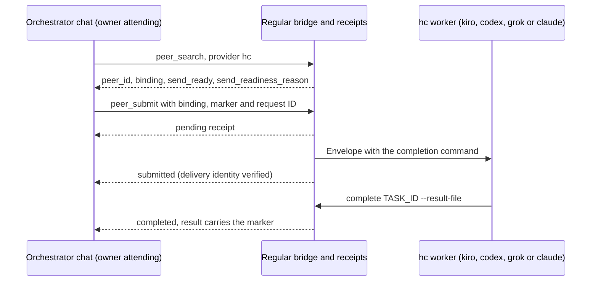

# Check a route with a live model

Send a few real tasks to one recipient and read the receipts back: a round trip, a cancel
and a repeat. The automated tests and `answerback self-test` use scripted agents and prove
the plumbing; only a run like this one shows that a particular CLI, at a particular version,
completes a hand-off on your machine.

This page is for a user checking a worker they have just registered, and for the maintainer
running release acceptance. You need a running bridge ([OPERATIONS.md](OPERATIONS.md)) and
the recipient's CLI with its own sign-in. The [owned worker check](#owned-worker-live-check)
covers a worker you have just registered; the three checklists after it are release
acceptance for the maintainer.

## Live-run records

Every live-run claim must read: live run on `<date>`, `<client version>`, `<commit>`;
record: `<path>`. A record is a committed, redacted folder under `docs/evidence/`. The
runs recorded so far are under [Recorded runs](#recorded-runs); a claim without such a
record says "no committed record".

## Owned worker live check

This check sends real tasks to one worker the bridge starts itself: `codex_cli`,
`claude_code`, `grok` or a managed `kiro` worker. Run it after registering a worker for the
first time and after a change of its binary or home, because `doctor` starts no worker: it
reports Codex CLI, Claude Code and Grok Build as registered (`configured`), not as able to
start ([what a worker needs to start](NATIVE-CLI.md#what-a-worker-needs-to-start)). For
Kiro it probes the CLI and reports `cli_available` or `unavailable`.

`KIND` is the provider name. `ALIAS` is a name this bridge has not used before, so that no
saved session and no earlier receipt belong to it. `RUN` is a marker no earlier run used,
for example the date and time (`1120-1814`).

```sh
mkdir -p /tmp/answerback-live
printf 'plover\n' > /tmp/answerback-live/note.txt
answerback workspace add ALIAS --provider KIND --cwd /tmp/answerback-live
answerback find ALIAS --provider KIND
```

`workspace add` answers with the peer it registered, and `find` lists it. Real output of
`find`, trimmed to one row and three of its fields, for `KIND` `codex_cli` and `ALIAS`
`reviewer`:

```json
{
  "peers": [
    {
      "kind": "bridge_managed",
      "peer_id": "codex_cli:reviewer",
      "capabilities": ["send", "result", "permissions", "cancel"]
    }
  ],
  "complete": true
}
```

Look for the row whose `peer_id` is exactly `KIND:ALIAS`; the search matches parts of names
and paths and can return other rows too. `complete: true` means no provider failed, timed
out or was excluded, so a missing row is a missing registration, not a lost answer. An alias is lowercase and at most 32 characters, or `workspace add` is refused.

Three rules hold in every step:

- **A request ID names one piece of work for good.** Sent again with the same message to
  the same worker, it returns the earlier receipt and starts nothing. Sent with another
  message, or to another worker, it is refused with the general
  `Bridge request failed; inspect service logs and the task receipt.` That is why every
  request ID below contains `RUN`.
- **An alias takes one task at a time.** Send the next task only when the one before has a
  final status. An earlier `send` is refused with
  `Target already has task TASK_ID (…); inspect its receipt first`.
- **A wait ends in one of four ways.** `task TASK_ID --wait 30` waits at most 30 seconds,
  the longest the command accepts. Exit `3`: the wait ran out; run it again, up to a limit
  you set (for example five minutes). Exit `0` with the status the step names: go on. Exit
  `2` after the full 30 seconds with `blocked`: the worker asks for a permission (step 1
  shows the two ways on). Exit `1`: `cancelled` where the step expects it, otherwise a
  final status or `uncertain` that fails the step; read the receipt's `detail`
  ([RECEIPTS.md](RECEIPTS.md)). A task still `pending` after about a minute waits for a
  worker slot or a slow start: cancel it, find the cause, and repeat under another request
  ID.

1. **Round trip.** `send` prints the receipt; its `id` is the `TASK_ID` of the wait.

   ```sh
   answerback send KIND:ALIAS --request-id live-RUN-rt \
     --message "Read note.txt in this folder and reply with the word in it, nothing else."
   answerback task TASK_ID --wait 30
   ```

   Pass: exit code `0`, `"status": "completed"` and `"result": "plover"`.

   A worker whose own permissions ask before reading a file pauses instead: the receipt
   reads `blocked` and the wait exits `2`. Either answer the request
   ([permissions](NATIVE-CLI.md#permissions-and-result-evidence)) and wait again, or replace
   the task with one that needs no tool:

   ```sh
   answerback cancel TASK_ID
   answerback task TASK_ID --wait 30          # go on when it prints "status": "cancelled"
   answerback send KIND:ALIAS --request-id live-RUN-rt2 \
     --message "Reply with the single word plover, nothing else. Do not use any tool."
   answerback task SECOND_TASK_ID --wait 30   # the id that the second send printed
   ```

   `cancel` prints the receipt as it is at that moment, which may not read `cancelled` yet.

2. **Cancel.** Send a task that takes a while and read its receipt every second or two:

   ```sh
   answerback send KIND:ALIAS --request-id live-RUN-cancel \
     --message "Count slowly from 1 to 200, one number per line."
   answerback task TASK_ID
   ```

   When it reads `running`, cancel and wait:

   ```sh
   answerback cancel TASK_ID
   answerback task TASK_ID --wait 30
   ```

   Pass: the wait exits `1` and prints `"status": "cancelled"` with a `detail` that says the
   worker confirmed it: `KIND confirmed cancelled` for Codex CLI, Claude Code and Grok
   Build (for example `codex_cli confirmed cancelled`), `Kiro confirmed cancellation` for a
   Kiro worker. `completed` proves nothing about cancellation: the task was too short.
   Repeat with a longer task under another request ID (`live-RUN-cancel2`). A `detail` of
   `Cancelled before prompt submission` means the task was never sent, so the step says
   nothing about the worker. `blocked`: answer the permission and read again.

3. **Repeat.** Run again, unchanged and with the same `RUN`, the `send` of step 1 whose task
   completed. Pass: exit code `0`, the same `id` and `"status": "completed"`, and
   `answerback tasks ALIAS` shows no new task.

Receipts of owned workers use other statuses than those of `hc` terminals; `submitted` does
not occur.

| Status | Meaning for an owned worker |
| --- | --- |
| `pending` | Receipt reserved. The task waits for a free worker slot of that provider, or for the worker to start |
| `running` | The worker's session is open, and the task is being sent to it or is with it |
| `blocked` | The worker waits for a permission decision |
| `completed` | Final. The worker's own terminal event confirmed the result |
| `cancelled` | Final. The `detail` says who confirmed it: the worker, or only the bridge (`Cancelled before prompt submission`) |
| `failed` | Final. Codex CLI, Claude Code and Grok Build: `ErrorName: text` means the task was never sent, as in a refusal at start; `KIND confirmed failed` means the worker reported a failed turn. Kiro: `Kiro stopped:` followed by the reason |
| `uncertain` | Not final: the bridge could not settle the receipt. The alias stays reserved. Inspect the receipt and the worker; do not send the same work again under another request ID ([receipts that do not complete](TROUBLESHOOTING.md#receipts-that-do-not-complete)) |
| `abandoned` | Final. A person released an unfinished receipt with `abandon`. That frees the alias; it does not cancel the work |

A completed round trip took between 4 and 11 seconds in the recorded run. When you have
finished, remove the alias; receipts and native history are kept:

```sh
answerback workspace remove ALIAS --provider KIND --apply
```

## Attended hc acceptance (integration build)

This checklist is the attended acceptance for the `hc` provider on a release candidate. The
owner runs it from an orchestrator chat that has the regular `answerback_bridge` MCP
connection; it takes about 15 minutes. Every send is a reply-only probe: no file edits, no
further delegation. `just live-test` from a checkout prints the pointer to this section and
runs no probe.



*One probe: find the terminal, send with its binding, watch the receipt go `pending`,
`submitted`, `completed`. The message texts are examples.*

### Preconditions

Tick each one before the first send. Stop on a mismatch.

- [ ] `BRIDGE_CONFIG` is the regular bridge's configuration path:

  ```sh
  export BRIDGE_CONFIG="$HOME/.config/answerback-bridge/config.json"
  ```

- [ ] You know the tag and commit the candidate was built from:

  ```sh
  git tag -l --sort=-creatordate | head -5
  git rev-parse 'CANDIDATE_TAG^{commit}'
  ```

- [ ] The installed build is that commit. A local-path install records no commit, so compare
      the installed package with the tagged source; an empty `diff` means the running code is
      the tagged code:

  ```sh
  answerback --version
  PKG="$HOME/.local/share/uv/tools/answerback/lib/python3.13/site-packages"
  cat "$PKG"/answerback-*.dist-info/direct_url.json
  mkdir /tmp/candidate-export
  git archive CANDIDATE_TAG src/answerback_bridge | tar -x -C /tmp/candidate-export
  diff -rq -x __pycache__ /tmp/candidate-export/src/answerback_bridge "$PKG/answerback_bridge"
  ```

- [ ] The regular bridge runs that package: `answerback --config "$BRIDGE_CONFIG" status`
      shows `running` and `accepting` both `true`, and `started` later than the install
      time. Record `pid`, `instance_id` and `runtime.package_path`.
- [ ] A run ID, for example `T05-20261117-1530`, which every marker and request ID uses.
- [ ] One worker of each kind is open in the Herdr App, in this project directory, idle.

| Field | Value |
| --- | --- |
| Candidate tag | |
| Tag commit sha | |
| Installed version | |
| `diff` against the tag empty | |
| Bridge pid | |
| Bridge `instance_id` | |
| Run ID | |

### One round trip per agent kind

Repeat steps 1 to 5 for `kiro`, `codex`, `grok` and `claude`. `AGENT` is that word; `RUN`
is the run ID.

1. `peer_search` with `query` `herdr_bridge` and `provider` `hc`; select the row whose
   `agent_kind` is `AGENT`. It must have `project` equal to this repository's absolute path,
   `send_ready: true` and `send_readiness_reason: ready`. Two rows of one kind is an
   ambiguity: pick by `peer_id`, never by guessing. Keep `peer_id` and the exact `binding`.
   CLI equivalent: `answerback --config "$BRIDGE_CONFIG" find herdr_bridge --provider hc`.
2. `hc_read` the terminal (`target` is the `t…` address, 40 lines) and confirm it is the
   agent you expect, at an empty prompt.
3. `peer_submit`: `selector` is the `peer_id`, `provider` is `hc`, `binding` is the string
   from step 1, `request_id` is `t05-RUN-AGENT`, and `message` is exactly:

   ```text
   Attended acceptance probe RUN. Reply only: do not edit, create or delete
   any file other than the result file, and do not delegate. Write the single
   line
   BRIDGE-OK RUN AGENT
   to a new UTF-8 file under /tmp, then run the completion command below with
   that file. Report a blocker instead if you cannot.
   ```

   Note the time and the returned task ID.
4. Follow the receipt with `task_wait` (30 seconds per call) or `task_get`:

   | Status | Meaning | Typical time |
   | --- | --- | --- |
   | `pending` | Receipt reserved; delivery running in the background | under 5 s |
   | `submitted` | Recipient identity verified and `hc` reported `started: true` | until the agent answers |
   | `completed` | Worker report accepted; `result` is the marker line | 1 to 3 min |

   `failed` means the peer stopped being ready before delivery. `uncertain` means delivery
   could not be verified (`started: false` or `null` with no provisional result): inspect
   the receipt and the terminal, and do not resend. A worker report that arrives before
   delivery is verified is held as provisional until the identity check finishes.
5. The worker runs the completion command the bridge appended to its assignment; an approval
   prompt for it is yours to answer in the worker's terminal:

   ```sh
   "$HOME/.local/share/uv/tools/answerback/bin/python" -m answerback_bridge \
     --config "$BRIDGE_CONFIG" \
     complete TASK_ID --result-file /tmp/t05-RUN-AGENT.txt
   ```

   `task_complete` with the same task ID is equivalent. Pass: `completed` and `result` equal
   to `BRIDGE-OK RUN AGENT`. A marker from another run or agent is a fail.

### Negative check: a peer that is not ready is refused

Run once, against a peer whose `state` is `working`, for example straight after step 3
while that worker is still answering. A worker that has finished reports `done` and is
refused by default, so `done` serves too unless the config sets `hc_send_to_done`.

1. `peer_search` (`herdr_bridge`, `hc`): the row shows `send_ready: false`,
   `send_readiness_reason` `working` (or `done`), and `capabilities` of `read` only. Keep
   its `binding`.
2. `peer_submit` to that `peer_id` with that `binding`, `request_id` `t05-RUN-negative` and
   the message `Negative check RUN; this must be refused.`
3. Pass: an error and no task ID, and `task_list` with query `t05-RUN-negative` shows no
   receipt. The error is the general
   `Bridge request failed; inspect service logs and the task receipt.`; the reason is the
   `send_readiness_reason` of step 1. `hc_read` the terminal: the message must not appear.

### Crew gateway check

1. `registered_clients`: the `kiro-crew` row has `registered: true`, `available: true`,
   `live_instances` of at least 1 and a `last_heartbeat_age` under 30 seconds (three missed
   10-second heartbeats mark a client unavailable). A lease shows that the client can call
   tools, not that the bridge can reach a Crew chat.
2. `answerback --config "$BRIDGE_CONFIG" status`: under `providers`, `kirocrew` reports
   `connected` or `configured`. `unavailable`, `unconfigured` or a missing entry fails the
   check.
3. Send nothing to Crew here. A Crew round trip is a separate observation.

### Results

One row per send, refusal or check. Elapsed runs from `peer_submit` to the `completed`
receipt. For the negative check the status column holds the refusal text and the task ID
stays `none`.

| Run ID | Agent | Peer ID | Task ID | Status | Elapsed | Notes |
| --- | --- | --- | --- | --- | --- | --- |
| | kiro | | | | | |
| | codex | | | | | |
| | grok | | | | | |
| | claude | | | | | |
| | negative | | none | | | `send_readiness_reason`: |
| | crew gateway | n/a | n/a | | n/a | `live_instances`, heartbeat age, provider state: |

Acceptance needs four `completed` rows whose results carry this run's markers, one refusal
with no receipt, and an available `kiro-crew` lease with the `kirocrew` provider configured.
Record a failed or uncertain row as it happened; a rerun gets its own run ID and rows.

## Remote result-file qualification

A terminal on a machine listed in `hc_send_machines` completes its task by writing a
result file on its own machine, which the bridge reads through Herdr Core
([recipients](RECIPIENTS.md#remote-results-what-listing-a-machine-trusts)). The file
protocol is the same for every harness, but each harness's sandbox and approval
policy decides whether its agent can write the file, so each pair of operating system
and harness is qualified on its own. Today one pair is qualified: Linux to Linux with
Codex CLI. Run this checklist once per remaining pair (macOS and Linux, each with Kiro
CLI, Grok Build, Claude Code and Codex CLI). A pair that does not pass is excluded
from the initial release, not partly supported. This is an attended run: a person
answers every approval prompt in the remote terminal.

Names used below: `SENDER` is this machine, `MACHINE` the remote machine's name
exactly as `hc machine ls` prints it, `AGENT` the harness word (`kiro`, `grok`,
`claude`, `codex`), `OS` `linux` or `macos`, and `RUN` a run ID such as
`R1-20261124-1530`.

### Evidence bundle

Save one folder per pair, `docs/evidence/remote-OS-AGENT-RUN/` (or under
`status/handoff/` for a run that is not published). Before publishing a folder,
replace hostnames, user names and home directories with neutral values
(`example-host`, `/home/user`); an unredacted run stays under `status/`. It holds:

| File | Content |
| --- | --- |
| `config.json` | The sender's `hc_send_machines` value and the bridge version (`answerback --version`); no other settings |
| `machine.txt` | `hc machine ls --json` on SENDER, and on MACHINE: `uname -a`, `id -un`, the harness version, the Herdr version |
| `discovery.json` | The `peer_search` row that was selected: `peer_id`, `binding`, `project`, `send_ready`, `send_readiness_reason` |
| `doctor.json` | `answerback doctor` with its `remote_trust` line |
| `receipts.json` | `task_get` of every receipt in this run, first and final state |
| `result-file.txt` | `stat` of the result folder and file on MACHINE (modes 0700 and 0600) and the file's text |
| `permissions.md` | Which tool approval the harness asked for, for each of the three file steps, and what the person answered |
| `negatives.md` | One line per negative case: what was written, the receipt status after it |

### Preconditions

- [ ] The sender's bridge runs the candidate build; record `answerback --version`.
- [ ] On MACHINE, Herdr is installed and connected: `hc machine ls --json` on SENDER
      shows MACHINE with `"state": "connected"`.
- [ ] `$HOME/.answerback/results` on MACHINE either does not exist or is a folder of
      mode 0700 owned by the remote account, and holds no file of this run.
- [ ] The sender's configuration lists MACHINE exactly in `hc_send_machines`, and
      the bridge was restarted after the edit. `answerback doctor` prints a
      `remote_trust` line that names MACHINE.
- [ ] On MACHINE, a fresh temporary project folder `PROJECT` exists (an absolute
      path). Do not weaken the harness's sandbox or approval defaults; record whatever
      it asks in `permissions.md`.

### Starting a fresh idle terminal

With the default configuration a terminal takes one assignment: it reports `idle`
only until it has answered a turn, then `done`, and `hc_send_to_done` (off by
default) refuses a `done` terminal. So every send in this checklist goes to a
terminal started for it. Each time a step says "start a fresh idle terminal `NAME`",
do this:

1. On SENDER, run
   `hc run --on MACHINE --bg --no-parent --json --name NAME --cwd PROJECT LAUNCH`,
   where `LAUNCH` is AGENT's launch command (the `launch` argv of its harness in the
   routing policy, such as `codex` or `kiro-cli chat`) and `NAME` is the lower-case
   name the step gives. Record the printed address (`MACHINE/tNN`) in
   `discovery.json` under `NAME`.
2. Wait until the agent's prompt is shown, answering any start-up prompt in the
   remote terminal (record it in `permissions.md`).
3. Run `peer_search` with `provider` `hc` and the folder name of `PROJECT` as
   `query`. Select the row whose `peer_id` is `hc:MACHINE/tNN` for that address and
   whose `agent_kind` is AGENT. It must have `send_ready: true`; record the row in
   `discovery.json` under `NAME`. A row with `send_readiness_reason:
   remote_read_only` means MACHINE is not listed or the bridge was not restarted:
   stop.
4. Keep its `peer_id` and exact `binding` for the step's send. A binding from an
   earlier terminal is never reused for a new request.

### 1. Discovery

Start a fresh idle terminal `rq-probe`. Pass: its row has `send_ready: true` and
`agent_kind` AGENT. This row is the step-2 target.

### 2. One harmless request

Send with `peer_submit`: the `rq-probe` `peer_id` and `binding`, `request_id`
`remote-RUN-AGENT`, and this message:

```text
Remote qualification probe RUN. Do not edit any project file and do not delegate.
The result is the single line
REMOTE-OK RUN AGENT
```

Follow the receipt with `answerback task TASK_ID --wait 30` until it is `completed`.
Pass: `result` is `REMOTE-OK RUN AGENT`, and the receipt's metadata holds
`"result_authentication": "trusted_os_account"` and `"result_machine": "MACHINE"`.
Save `stat` and the text of the file named in the brief to `result-file.txt`, and
the receipt to `receipts.json`. `rq-probe` now reports `done`; record that state
from `hc get MACHINE/tNN --json` in `discovery.json`.

### 3. Repeat request

Replay the identical `peer_submit` of step 2: the same `rq-probe` `peer_id`,
`binding`, `request_id` and message. This is the one call that reuses a terminal,
because a replayed `request_id` returns its receipt before readiness is checked and
types nothing. Pass: the same task ID comes back, its status is still `completed`,
and `answerback read-hc MACHINE/tNN --lines 60` on `rq-probe` shows no second brief.
Record the returned receipt in `receipts.json`.

### 4. Negative cases

Start a fresh idle terminal `rq-negative`. Send with `peer_submit`: its `peer_id`
and `binding`, `request_id` `remote-RUN-AGENT-neg`, and this message:

```text
Remote qualification probe RUN, negative cases. Do not write any result file and
do not run the three steps below. Reply DONE in this terminal and stop.
```

Record the receipt in `receipts.json`. Read the brief with
`answerback read-hc MACHINE/tNN --lines 60` (the `rq-negative` address): it names
the result file and its token. Then, as the remote account (`hc exec --on MACHINE
--timeout 10 sh -c '...'`, or a shell on MACHINE), write each file below in turn at
the name the brief gives, and run `answerback task TASK_ID --reconcile` after each
one. Every one must leave the receipt not `completed` and without
`result_authentication`; record one line per case in `negatives.md`:

- [ ] wrong token: the brief's first and last lines with 32 zeros in place of the
      token;
- [ ] wrong task ID: the first line with another task's ID;
- [ ] partial: the first line and a body, with no last line;
- [ ] empty body: the first and last lines only;
- [ ] non-UTF-8: the correct framing around a body that holds the byte `0xff`
      (`printf`).

Then write the correct file and reconcile once more: it must complete. Record the
final receipt in `receipts.json`.

### 5. Removing the machine during a task

The agent writes this result itself, after the machine is removed, so its terminal
must stay at its prompt until then.

- [ ] Start a fresh idle terminal `rq-delist`. Send with `peer_submit`: its
      `peer_id` and `binding`, `request_id` `remote-RUN-AGENT-delist`, and this
      message:

      ```text
      Remote qualification probe RUN, delist. Do not write the result file yet.
      Reply WAITING, then wait at your prompt. When the person types GO in this
      terminal, do the three steps of the brief with the result line
      REMOTE-DELIST RUN AGENT
      ```

      Pass: `answerback read-hc MACHINE/tNN --lines 60` (the `rq-delist` address)
      shows `WAITING`, no result file exists on MACHINE, and the receipt is not
      `completed`. Record the receipt in `receipts.json`.
- [ ] Remove MACHINE from `hc_send_machines` and restart the bridge. Pass:
      `answerback doctor` lists the task under `remote_unlisted_receipts`, the
      bridge log has a `remote_unlisted_receipts` event, and `remote_trust` no
      longer names MACHINE. Save the `doctor` output to `doctor.json`.
- [ ] In the `rq-delist` terminal on MACHINE, type `GO` (directly, not through the
      bridge). Pass: the result file appears on MACHINE,
      `answerback task TASK_ID --wait 10` stays not `completed`, and
      `answerback task TASK_ID --reconcile` refuses with "its machine is not in
      hc_send_machines". Record both outputs in `receipts.json`.
- [ ] Put MACHINE back, restart the bridge, and run
      `answerback task TASK_ID --wait 30`. Pass: the receipt completes with
      `REMOTE-DELIST RUN AGENT` and `"result_authentication": "trusted_os_account"`.
      Record the final receipt in `receipts.json`.

After the run, end the three terminals with `hc kill MACHINE/tNN` and `hc rm
MACHINE/tNN` for each recorded address.

### Result

The pair is qualified when steps 1 to 5 all pass and the evidence bundle is saved.
Add the pair, with the run ID, the harness version and the bundle path, to the
support statement in [recipients](RECIPIENTS.md#remote-results-what-listing-a-machine-trusts)
and [harnesses](HARNESSES.md). A failure that a harness's own approval policy causes
is recorded in `permissions.md` and excludes the pair; do not change that policy to
make it pass.

## Recorded runs

Dated history, newest first. Each row names its date, client version and commit, and links
a record where one is committed.

### Claude Code and Kiro CLI gate, 24 November 2026

Live runs on 24 November 2026 on macOS and Linux through a standalone bridge in a detached
worktree: Kiro CLI 3.5.0 at `4a03461b` (no-tool task, blocked-then-answered read, repeat
and cancel all passed on both OSes); Claude Code 2.1.330, round trip and repeat at
`4a03461b`, cancel of a running task at `5c8995a5` (the earlier candidate left that cancel
`uncertain`). No committed record: the run's receipts, `doctor.json` and transcripts name
the maintainers' hosts and home directories, so they are kept in the project's private
ledger and not in the public tree.

Two things that run taught. Sync the extras in the worktree the gate runs from
(`uv sync --all-extras`); syncing the clone does not give that worktree the Claude SDK. Start
the standalone bridge from a shell that already holds the provider credential, and never
write that credential to a file, command argument or evidence bundle: a credential injected
by a shell wrapper is invisible to an owned worker. The passing cancel sequence first leaves
a permission-blocked Claude task unanswered and cancels it, then submits a task with a
foreground Bash command, grants that permission once, waits until the task is `running`, and
cancels it; the second ends `cancelled` only after the `task_notification`/`stopped` witness
for the Bash tool arrives.

The same day's run did not reach a KiroCrew chat: the installed KiroCrew was 0.13.0 and the
Crew provider plugin of that commit accepted 0.12.2 releases only. A later version takes 0.12.2 and every
release after it ([Crew contract](PROTOCOLS.md#crew-contract)).

### Recorded run, 20 November 2026

Two unattended runs on version `0.12.0+internal` (commit `5c135ad`): one on macOS for Codex
CLI, Claude Code and Grok Build, and one on Linux for Kiro CLI. Each used a bridge of its
own, started with `start --standalone`, and sent at most three one-line tasks per worker. No
permission request was answered and no receipt was `uncertain`. No committed record; the
reports are in the project's private ledger.

| Worker | CLI version | Round trip | Cancel | Repeat | What happened |
| --- | --- | --- | --- | --- | --- |
| Codex CLI | 0.170.0 | pass | pass | pass | Normal home, as documented |
| Claude Code: installed CLI, normal home | 2.1.292 | fail | not run | pass | Refused at start: `settings.json` larger than 256 KiB. The CLI was also older than the 2.1.322 minimum |
| Claude Code: the SDK's own CLI, empty home | 2.1.325 | pass | not seen | pass | The task finished before the cancel went out |
| Grok Build: normal home | 1.0.89 | fail | not run | pass | Refused at start: the home defines MCP servers |
| Grok Build: empty home | 1.0.89 | fail | not run | not run | Failed at start: Grok answered `Authentication required`; a later version shows the bridge's own words instead ([what a worker needs to start](NATIVE-CLI.md#what-a-worker-needs-to-start)) |
| Kiro CLI | 3.5.0 | blocked | pass | pass | The file read asked for a permission, which the run did not answer. A task that needs no tool then completed |

So a live model turn through an owned worker is recorded for Codex CLI, Claude Code and Kiro
CLI, and not for Grok Build. "Repeat: pass" on a failed row means that the same request ID
returned the same failed receipt and started nothing.

Later that day a script ran the check twice for Codex CLI 0.170.0 on macOS and three times
for Kiro CLI 3.5.0 on Linux, each with a bridge of its own; the three later runs recorded
the digest of the source at `5c135ad`. The script took each next move from the receipt and
answered no permission request. In every run the round trip, the cancel and the repeat
passed; the Kiro worker asked for a permission in step 1, so its runs took the second way.
The script also saw the refusal of a busy alias, the general refusal for a reused request ID
and for a wait longer than 30 seconds, exit code `3` for a wait that ran out, and a cancel
that only the bridge made. No receipt it read was `failed` or `uncertain`.

### Real-work sends, 17 November 2026

The first real assignments sent to `hc` workers in this project through `peer_submit`, on
the build installed that day (the receipts do not record which). They are work, not marker
probes, so their results are hand-off notes and branches rather than a `BRIDGE-OK` line.
All four receipts were created between 13:21 and 13:23 UTC and read `completed`; elapsed is
from `created` to the last update. No committed record; the hand-offs are in the project's
private ledger.

| Agent | Peer ID | Status | Elapsed | Work |
| --- | --- | --- | --- | --- |
| kiro | `hc:t55` | completed | 3m38s | Ledger reconciliation |
| codex | `hc:t5b` | completed | 10m32s | Release preparation |
| grok | `hc:t5c` | completed | 5m21s | Report on the three development lines |
| claude | `hc:t5d` | completed | 3m00s | The attended checklist above |

### Legacy TUI run, 13 November 2026

An attended run of `answerback live-test` on 13 November 2026 passed both directions through
the installed 0.3.0 package, with four matching completed receipts; the person authorised one
bridge send and two receipt reads. No committed record; the report is in the test
environment's `reports/` directory. It is the only run of the legacy harness recorded, and
it is older than the current package.

## Legacy Herdr TUI test

`answerback live-test` is the older harness for a Herdr **TUI** session with Codex CLI inside
it and a Kiro worker over ACP. It is not for Herdr App tabs: it nests a separate `herdr` TUI
inside the App instead of testing the `hc` provider. Use the attended checklist above for
the App. The command uses a configuration directory of its own, so the normal `--config` is
not used.

```sh
answerback live-test
```

`--directory /short/absolute/path` selects another test environment, `--timeout 300` bounds
a run to five minutes (maximum ten), and `--report-dir /short/absolute/path` chooses where
a refused run's report is saved. Both directions require matching parent and child results:
Codex inside Herdr submits over the CLI and Kiro answers over ACP with this run's nonce, then
Kiro submits over MCP and Codex completes explicitly. A send acknowledgement, an idle
terminal or an earlier report cannot pass the current run. The run uses real Codex and Kiro
model turns with their existing sign-in; it was exercised with Herdr 0.9.5, Codex 0.167.0 and
Kiro 3.3.1-nightly.1 on 14 November 2026 and records no run with later releases.

### Saved environment

By default `~/.config/herdr-bridge-test/` holds `environment.json` (ownership, the named
Herdr session, pane and agent identities), a `config.json` dedicated to the test,
`workspace/`, `tasks.sqlite`, `reports/` (one JSON report per run, failures included) and
`runtime/`. The command keeps its Herdr session and bridge after the run. It never deletes
provider conversations, answers approval prompts or chooses a focused agent. A directory
without its ownership record is refused, concurrent runs are refused by a lock, and a
refusal report is saved under `--report-dir` or, failing that, under the normal bridge's
`runtime/` directory.

The preflight refuses a stale `config.json` before contacting any peer. Its report names the
changed fields without their values and offers `--reset-test-env`, which verifies ownership,
takes both service locks, saves a `config.before-reset-*.json` backup, restores defaults
with the owned session and executable paths, and exits with `reset_only: true`. Reset
success is not live acceptance. On first start-up an update notice, workspace trust question
or login can need a person: open the named session with `herdr session attach SESSION_NAME`,
resolve it and rerun. An approval during a probe leaves the receipt unfinished (`blocked`
for the Kiro worker, `submitted` for the Codex pane); resolve it before another probe.

### Stop it between test runs

```sh
answerback --config "$HOME/.config/herdr-bridge-test/config.json" stop
answerback --config "$HOME/.config/herdr-bridge-test/config.json" status
```

This stops only the test bridge and keeps its configuration, receipts, reports and
conversations; the regular bridge keeps running. Read-only inspection of leftover work uses
the same `--config` with `tasks`, `permissions --peer kiro:test-worker` and `task TASK_ID`.
If investigation establishes that an assignment cannot complete, `abandon TASK_ID --reason
"what was verified"`; abandoning does not stop an agent.

## What it cannot do yet

- No live-model proof for Grok Build as an owned worker: both recorded attempts failed at
  start.
- The remote result-file protocol is qualified for one pair only, Linux to Linux with Codex
  CLI; the other seven pairs have no run.
- A KiroCrew round trip has no recorded live run; the Crew check above verifies the gateway
  lease only.
- The legacy TUI harness records one run, on 0.3.0, and none with current releases.

## See also

- [TESTING-HARNESSES.md](TESTING-HARNESSES.md#choose-a-test-layer): the scripted layers to
  run before a live check.
- [NATIVE-CLI.md](NATIVE-CLI.md): what an owned worker needs to start, and its exit codes.
- [RECIPIENTS.md](RECIPIENTS.md#remote-results-what-listing-a-machine-trusts): what listing a
  remote machine trusts.
- [HARNESSES.md](HARNESSES.md): the release status of each route.
- [RECEIPTS.md](RECEIPTS.md): every receipt state and exit code.
