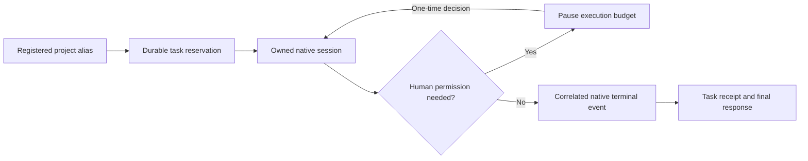

# Hand work to a CLI worker

Answerback can start a separate Codex CLI, Claude Code or Grok Build session for one assignment, own that
process, and return a receipt that reads `completed` only when the session's final answer for that request has
come back. Your interactive terminals stay with their current owners, and nothing is typed into them.

You need one of these three CLIs installed and signed in, and a running bridge
([Getting started](GETTING-STARTED.md)). Kiro CLI workers are owned the same way and registered with the same
`workspace add` command; their setup is under [managed Kiro workers](RECIPIENTS.md#managed-kiro-workers).



*The path of one assignment to an owned worker. A permission request pauses the budget until a person answers.*

The separate session does not see your conversation with the agent that sent the work, so the brief has to carry
what it needs. If the worker needs a permission, it pauses and asks you.

## Register and submit

The bridge must be running: `workspace add` against a stopped bridge fails with
`Bridge is stopped. Run answerback start first.`

```sh
answerback workspace add implementation --provider codex_cli --cwd /absolute/project
answerback workspace add review --provider claude_code --cwd /absolute/project
answerback workspace add analysis --provider grok --cwd /absolute/project
```

Each `workspace add` exits `0` and prints the registered peer. The first prints this, with your project path:

```json
{
  "peer_id": "codex_cli:implementation",
  "project": "/absolute/project",
  "kind": "bridge_managed"
}
```

`answerback workspace list --provider codex_cli` then lists the alias with `"exists": true` and
`"saved_session": false`, and `answerback status` reports each of the three providers as `"state": "configured"`.
Registration starts no worker, so the next step is the test.

```sh
answerback send codex_cli:implementation --request-id change-001 --message "Review the parser"
answerback task <task-id> --wait 30
```

These two start a real model turn, so no output is shown here. `send` prints the task receipt with
`"status": "pending"` and its `id`, which is the `<task-id>` the later commands take. Success is
`task <task-id> --wait 30` exiting `0` with `"status": "completed"` and the worker's final answer in `"result"`.
`--wait` takes 1 to 30 seconds, so repeat it while the exit code is `3`. A repeat of the same `send` with the same
`--request-id` returns the same receipt and runs nothing twice.

Use the installed native CLI with its normal sign-in. The bridge uses the native configuration home in place. It
does not copy credentials or start a login flow.

Claude Code needs the optional `claude` package extra, which installs the pinned official SDK. Install the tool
with it (`uv tool install '.[claude]'` from the source tree), or run `uv sync --extra claude` in a checkout. Codex
CLI and Grok Build need no extra. Each `uv tool install` replaces the earlier set of extras, so a tool that already
has the `bus` extra needs `'.[claude,bus]'`.

### Binary, home and changes

`--binary` selects an executable and `--home` the exact native configuration directory (`CODEX_HOME`,
`CLAUDE_CONFIG_DIR` or `GROK_HOME`). Both are stored once per provider, so they apply to every alias of that
provider. While no home is stored, the bridge uses the matching environment variable of its own process, then the
native default directory.

The bridge checks a changed project, binary or home at three points:

- `workspace add` refuses an existing alias with another project, and refuses a new binary or home while that
  provider has unfinished work.
- Each receipt records the project, binary and home its task ran with, as one `profile` digest in its metadata.
- Codex CLI resumes its owned session. After a change of binary or home, the next send to an alias with a saved
  session is refused and no task is created. Remove the idle alias with
  `answerback workspace remove <alias> --provider codex_cli --apply` and add it again: the next task starts a new
  session, and old history is never reused with a different configuration.

Claude Code and Grok Build start a new session for every task, so after an accepted change their next task runs
with the new binary and home.

These refusals do not say which rule applied. The reply is the general
`Bridge request failed; inspect service logs and the task receipt.`, and the service log records only the
operation and the kind of error. When `workspace add` answers that way, check that:

- the alias starts with a lower-case letter, uses only lower-case letters, digits, `-` and `_`, and has at most
  32 characters;
- the executable is on the bridge's `PATH`, or `--binary` gives its path;
- the project directory exists, or the command has `--create`;
- the alias is not already registered for another project;
- the provider has no unfinished task, if the binary or home is new.

When `send` to a Codex CLI alias answers that way after a change of binary or home, the saved session is one
possible cause. The reply is the same when the project directory no longer exists and when the request ID was
already used for other work.

`workspace list` and `workspace remove` default to Kiro. Use `--provider` to select another provider. Removing an
alias keeps native history, ownership records and task receipts.

### What reaches the worker's environment

A credential that an interactive shell wrapper exports is invisible to an owned Claude worker. The worker is a
child of the bridge process, not of your shell. The pinned SDK gives it the bridge's own environment, plus the
allowlisted `settings.json` `env` names that the bridge's environment does not already hold
(`AWS_BEARER_TOKEN_BEDROCK`, `AWS_REGION`, `ANTHROPIC_API_KEY`, `ANTHROPIC_MODEL`, `CLAUDE_CODE_USE_BEDROCK` and
the rest of `PROVIDER_ENV_KEYS` in `providers/native/claude.py`). The file is read up to 8 MiB and only its `env`
member is used. Process environment values take precedence, and other settings gain no authority over the
worker's tools or approvals.

So a `claude` shell function that mints a Bedrock token and exports it works in your terminal and does nothing for
the bridge: the worker starts without the token, and Claude asks for a sign-in or fails its first model call. Put
non-secret settings such as `CLAUDE_CODE_USE_BEDROCK` and `AWS_REGION` in the home's `settings.json` `env`. For the
token, start the bridge from a shell that already holds it with `answerback start --standalone`, which inherits
that shell's environment. Resolve the value in memory and never write it to a file.

The default supervised start does not inherit the token: the launchd or systemd unit is written with `PATH`,
`XDG_CONFIG_HOME`, `XDG_STATE_HOME` and `HERDR_CONFIG_PATH` only, so that no token is persisted in a unit. A worker
under that bridge has only what the native home provides: its own sign-in or its `settings.json` `env`.

Codex CLI and Grok Build children get an explicit allowlist. Both keep `PATH`, `HOME`, `SHELL`, `TERM`, `TMPDIR`,
`TMP`, `TEMP`, `LANG`, `LANGUAGE` and the `LC_*` names `LC_ALL`, `LC_CTYPE`, `LC_COLLATE`, `LC_MESSAGES`,
`LC_MONETARY`, `LC_NUMERIC` and `LC_TIME` when present. Codex also keeps `CODEX_HOME`, `OPENAI_API_KEY`,
`CODEX_API_KEY` and `CODEX_CA_CERTIFICATE`, and an explicit home overrides the inherited `CODEX_HOME`. The same
Codex filtering applies to the `codex` children of the legacy Codex Desktop route. Grok keeps
`XAI_API_KEY`, sets the selected `GROK_HOME`, disables its updater and keeps its Cursor and Claude extension flags
off.

Both also keep the proxy names `HTTPS_PROXY`, `HTTP_PROXY`, `NO_PROXY`, `ALL_PROXY` and their lower-case forms,
and the certificate names `SSL_CERT_FILE`, `SSL_CERT_DIR` and `NODE_EXTRA_CA_CERTS`. A proxy URL that contains a
password reaches the child. Every other name is dropped, including unrelated provider credentials,
`REQUESTS_CA_BUNDLE`, `CURL_CA_BUNDLE`, base-URL names such as `OPENAI_BASE_URL` and interpreter injection
settings. These are POSIX names: the bridge is tested on Linux and macOS, and a Windows child would also need
Windows system names, which the allowlists do not hold.

## What a worker needs to start

Registration checks the alias, the project directory and that the executable exists, and starts no worker.
`doctor` and `status` then report the provider as `configured`, which means registered, not able to start. The
first task is the test: send a small one and read its receipt. A worker that cannot start fails that task at once,
before any model call, with `"status": "failed"` and the reason in `"detail"`, and `task <task-id> --wait <seconds>`
exits `1`.

The `detail` is the error class, a colon and the bridge's message. The table shows each message's fixed text, with
`<...>` where the bridge fills in a value.

| Provider | The worker starts only when | Otherwise `detail` reads |
| --- | --- | --- |
| `claude_code` | the Claude Code CLI is 2.1.322 or newer | `BridgeError: Claude CLI <minimum> or newer is required for this protocol`, where `<minimum>` is `2.1.322` |
| `claude_code` | `settings.json` in the selected home is no larger than 8 MiB | `BridgeError: Claude native provider settings exceed the supported bound of <bound> bytes (<observed>); ...`, where `<bound>` is `8388608` |
| `grok` | the selected home defines no MCP server | `BridgeError: Grok inherited MCP servers; use an authenticated dedicated GROK_HOME profile`, or `BridgeError: Grok MCP server definitions were discarded by schema validation` |
| `grok` | Grok can sign in without a browser | `BridgeError: ACP authenticate failed: <cause>` or `BridgeError: ACP session/new failed: <cause>` |

- **Claude Code CLI too old.** Install a `claude` command at 2.1.322 or later. The CLI bundled inside the Claude
  SDK is not a supported configuration.
- **Claude Code `settings.json` too large.** Select a home whose `settings.json` is smaller or absent. An empty
  directory is enough when the bridge's own environment holds the variables Claude Code reads.
- **Grok home with MCP servers.** Create a separate Grok home that defines no MCP server and select it with
  `--home`. Both texts in that row mean the home defines at least one MCP server.
- **Grok cannot sign in.** Sign the selected home in with Grok itself. The bridge starts no login flow and picks
  no sign-in method that can open a browser. It uses Grok's cached sign-in, or Grok's API-key method when the
  bridge's own environment holds `XAI_API_KEY`. Grok's own text is not shown: when Grok asks for a sign-in,
  `<cause>` is `RequestError -32000 (in ACP this code means that authentication is required: sign in with the
  provider's own CLI, then check this receipt before you retry)`. For another ACP request error it is
  `RequestError <code>`.

For the first three rows the way out is the same: register the provider again with another `--binary` or `--home`.
Codex CLI has no such condition. In a live run on 20 November 2026 it started with its normal home, while Claude
Code and Grok Build met the settings-size, MCP-server and sign-in refusals
([recorded run](LIVE-TEST.md#recorded-run-20-november-2026)).

## The Kiro agent file

Kiro CLI's v3 engine, the default for managed Kiro workers, takes the worker's
agent inline: the bridge sends its `answerback_bridge` profile in the session
request and checks that Kiro selected it. Kiro CLI 3.5.0's v2 engine ignores that
inline form and selects an agent only from a file named at launch by `--agent`.
So when `kiro_acp_engine` is `"v2"`, the bridge writes
`~/.kiro/agents/answerback_bridge.json` under the HOME the worker is launched
with, before every launch, and starts Kiro with `--agent answerback_bridge`. The
file holds the same profile as the inline form in Kiro's on-disk format: the
prompt, `tools` `read`, `write`, `shell` and `@answerback_bridge`, no
`allowedTools`, `mcpServers` empty and `useLegacyMcpJson` false, so no global MCP
server or power reaches the worker. The write is idempotent: the file is
replaced only when its content or its mode differs, and nothing else under
`~/.kiro/agents/` is read or changed. It is made at mode 0600 through a
descriptor of its folder opened without following links, as a new file renamed
over the entry: an existing file there is never written to or chmod'ed, so a
0644 file with the right content is replaced by a 0600 one rather than
tightened. The v3 route writes no file.

What is refused, before anything is written: a symlink anywhere on the way
(`~`, `.kiro`, `agents` or the file itself), a folder or file owned by another
user, a file with a second hard link (it also lives under another name), a FIFO
or anything else that is not a regular file, and a file over 1 MiB. The entry
is inspected again on a descriptor opened just before the rename (device and
inode, owner and link count), so a file put there since the first check is
refused too. Every refusal fails the launch and the receipt ends `uncertain`
with the reason in `detail`. What this does not defend against: a process of
your own user swapping the entry in the very instant between that last check
and the rename of that one entry, which the rename then overwrites. That is a
same-user race inside your own home folder, inside the account trust boundary
this project defends ([SECURITY.md](../SECURITY.md)); a process of your user
can equally rewrite the agent file after it is installed.

The v2 engine reports the bridge MCP server as `server_initialized` without a
tool list, so the bridge cannot verify the required tools there as it does on
v3; the receipt says so (`"mcp_readiness": "server_initialized"`,
`"unverified_mcp_tools": ["answerback_bridge"]`). The trust mode that ran is on
the receipt as `kiro_trust`: `"ask"` (every tool use waits for a person),
`"all"` (`kiro_trust_all_tools`, Kiro's `-a`) or the `kiro_trust_tools` list
(Kiro's `--trust-tools`). `answerback task TASK_ID` shows all of these under
`metadata`.

## Exit codes

For `answerback capacity` exit codes, see [Machine capacity](CAPACITY.md).

`task <task-id> --wait <seconds>` prints the receipt and exits with a code a script can act on without parsing it.
Only a completed task exits `0`. A wait that ran out and a task waiting on a person are distinct non-zero outcomes.

| Exit code | Meaning | Receipt |
| --- | --- | --- |
| `0` | Completed task, or any other command that succeeded | `status: completed` |
| `1` | Failed, cancelled, abandoned or uncertain task; an ambiguous selection; most other errors | `status: failed`/`cancelled`/`abandoned`/`uncertain`, or an `error` on stderr |
| `2` | Task blocked on a pending permission request; answer it with `permission-answer` | `status: blocked` |
| `3` | The `--wait` deadline expired; wait again or inspect | `wait_timed_out: true`, with a non-terminal `status`, or `completed` when the task ended in the last two seconds of the wait |
| `130` | Interrupted with Ctrl-C | none |

A task that is blocked and also outlived the wait exits `2`, because the next step is the permission answer. Over
MCP, `task_wait` returns the same `status` and `wait_timed_out` fields.

Two errors exit differently. A command line that cannot be parsed, such as `--wait` with a value that is not a
number, exits `2` with a usage message on stderr and no receipt, so a script that reads `2` as "blocked" should
check that a receipt was printed. And `serve`, the command behind the service, exits `0` once its start has
failed repeatedly, so that launchd or systemd stops restarting it
([troubleshooting](TROUBLESHOOTING.md)).

An ambiguous selection is not a receipt. When a name matches more than one peer, the reply is
`{"status": "needs_selection", …}` with the candidate `matches`, and no task is created. Choose one returned peer
and send again. A `provider_backoff` reply is not a receipt either
([provider backoff](RECIPIENTS.md#provider-backoff)), and `answerback send` exits `1` on it.

## Provider backoff: the queued wait and one relaunch

While the bridge has seen a provider account rate-limited (`kiro` for Kiro workers, `bedrock` for Codex CLI,
Claude Code and Grok Build), a bridge-launched worker does not start. Its receipt reads `queued` with the detail
`provider backoff until HH:MM:SS (level N)` and the metadata `provider_backoff_until` (wall-clock seconds). The
wait holds one of the runtime's two slots and no execution budget: the budget starts when the wait ends. Nothing
already running is cancelled, stopped or messaged.

The prompt sent while the account is still under pressure starts with one line,
`Provider under rate pressure: fewer, larger tool calls; no parallel sub-agents.` Only the text sent carries it,
and the receipt's `message` is the caller's.

A turn that ends with a throttle signature (in its terminal evidence, in the bridge's error, or in a Kiro answer
that is the limiter's own message) first raises the account's pressure, then is relaunched once after the
pause, by resuming the same owned session in the same workspace with the same task ID and request ID
([tracing](TRACING.md)). Between the two attempts the receipt reads `queued` with the detail
`provider backoff; one relaunch after HH:MM:SS` and `resumed_after_backoff: false`, which becomes `true` when the
second prompt is sent. A native receipt keeps the first turn's identity as `throttled_turn_id`.

- A second throttle ends the receipt `failed` with `Provider throttled twice; no further relaunch`. There is no
  third launch, and each throttled launch counts as one signal.
- Cancelling during the wait settles `cancelled` (`Cancelled during provider backoff; the throttled attempt had
  ended`). A bridge stop settles `uncertain`.
- After a restart, a receipt left `queued` this way is recovered as `uncertain`, like `running`.
- Terminals the bridge did not launch (hc, Codex Desktop) are never relaunched.

## Permissions and result evidence

When a worker pauses on a one-time approval, `answerback permissions <task-id>` lists the pending request and
`answerback permission-answer <task-id> --permission-id <permission-id> --option <option-id>` answers it
(`--decision allow-once` or `--decision reject-once` instead of `--option`). The native session and the worker's
paused budget resume as soon as the answer is recorded. MCP can list pending requests and cannot answer them.

The CLI's normal permissions stay active. Requests that reach Answerback offer only the one-time choices the
harness supplied. Tools that the harness allows on its own may not ask Answerback at all, and native policy can
deny a call before any request reaches the bridge, so not every tool call pauses. When no request appears, check
the native result and policy.

Waiting for a person pauses the active execution budget (`kiro_active_budget` for Kiro, and the per-provider
fields in [active execution budget](HARNESSES.md#active-execution-budget)). Each defaults to 600 seconds and
accepts 60–14400. It does not extend the harness's own timeouts.

`answerback cancel <task-id>` on a task whose session is still open retires pending decisions and requests native
cancellation. When the worker has already closed its session, usually because the turn just finished, `cancel`
does neither and returns the receipt as it stands. For a sent task, only a matching native cancelled or
interrupted event confirms cancellation. A task cancelled before it was sent reads `cancelled` with the detail
`Cancelled before prompt submission`, which the bridge alone confirms.

Claude Code waits up to 25 seconds for the native interrupt acknowledgement. A timeout fails the connection,
retires pending decisions and wakes the waiting prompt with an error, and a later cancel fails at once. If the
turn's terminal result has not arrived by the end of the bound, the task ends `uncertain`, not `cancelled`. A
terminal result that arrives within the bound is recorded as usual. If the
interrupt stays unacknowledged after a result that did arrive, the cancel caller still waits out the bound and gets
`Claude interrupt was not acknowledged; connection is now failed` for a task that already finished.

An interrupted connection, a contradictory event, a wrong identity or a missing final response leaves the receipt
`uncertain`. The target stays reserved for investigation, and a service restart never replays that prompt.

## Provider boundaries

Codex CLI runs over `codex app-server` and Claude Code over the official SDK. Grok Build runs over ACP (Agent
Client Protocol, [glossary](GLOSSARY.md)), the protocol managed Kiro workers use.

| Provider | Execution and scope | Limits |
| --- | --- | --- |
| `codex_cli` | Owned stdio app-server; explicit workspace sandbox and human approval policy | Only owned sessions resume; broad permission grants and unsupported forms are refused; the final-answer phase must be identifiable |
| `claude_code` | Pinned official SDK with an installed CLI 2.1.322 or newer; native provider and auth environment, strict MCP configuration, foreground coding tools | Ambient settings and skills are excluded; background and subagent work are refused; native idle is required after the result; each task uses a new session |
| `grok` | ACP v1 with a private no-leader socket; explicit normal mode and a supplied MCP list | Inherited MCP discovery must be empty; saved-session resume is off |

A session the bridge starts as a Codex CLI worker is identified by retained ownership (the bridge's record of
the sessions it started) and by the session's native originator (Codex's mark of which program created it). A
native source label such as `vscode` does not establish ownership. A Codex worker can use only the MCP servers the
bridge configures for its thread. Codex's global MCP status list is used only to check that a requested server is
ready. Legacy Codex Desktop/IDE configuration is present and is not part of the initial release.

Claude Code's built-in tools are Read, Write, Edit, Glob, Grep and Bash, plus the MCP tools supplied explicitly.
Disabling ambient settings also stops automatic project `CLAUDE.md` loading, and the normal Claude Code system
prompt stays on. This is a scoped coding-worker configuration, not an operating-system sandbox. The SDK loads only
when a Claude Code worker starts. Startup requires
`hook_on_failure_supported` and `hooks_applied` to be literal `true`, and other hook evidence is refused.

Grok Build needs a separate profile whenever the usual home defines an MCP server
([what a worker needs to start](#what-a-worker-needs-to-start)). Create it with Grok and select it with `--home`.
An empty inherited-server list does not prove that the supplied Answerback MCP server is connected.

Grok's folder trust also gates project permission settings. Before registering a project, run
`grok inspect --json` from that folder with the same `GROK_HOME` and check `cwd`, `projectRoot` and
`projectTrusted`. The bridge does not run this check, `doctor` does not report it, and Answerback does not grant
trust. A different trusted checkout does not qualify a new worktree. An untrusted project's normal-ask override
may be ignored while a global `dontAsk` policy denies tools without producing a bridge approval request.

## What it cannot do yet

- **A supervised bridge has no credential source for Claude Code.** Start the bridge with
  `answerback start --standalone` from a shell that holds the token, or use the home's own sign-in.
- **Saved sessions for Claude Code and Grok Build.** Each task starts a new session until resume is qualified.
- **A start check without a task.** The first task is the only test that a worker can start.
- **Attach to a CLI you already have open.** Owned workers never take over an interactive session.
- **Windows.** The environment allowlists use POSIX names, and Windows is not documented.

## See also

- [Choose which worker takes the work](HARNESSES.md): owned workers next to the other routes.
- [Recipients](RECIPIENTS.md): Kiro CLI, KiroCrew and Herdr routes.
- [Receipts](RECEIPTS.md): every state and how to wait for one.
- [Troubleshooting](TROUBLESHOOTING.md): when a worker fails to start or a receipt stays open.
- [Validation](../VALIDATION.md): tested versions, and fixtures against live runs.
