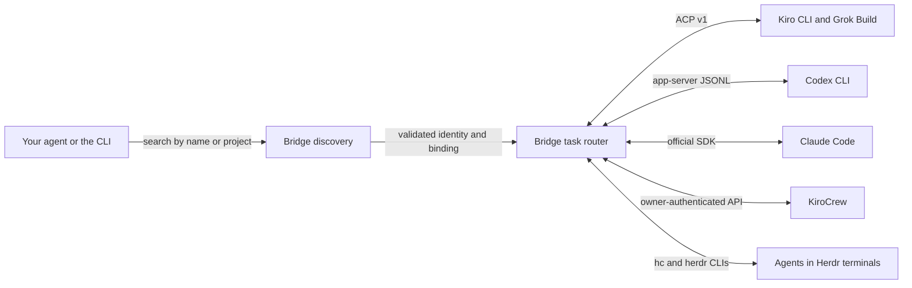
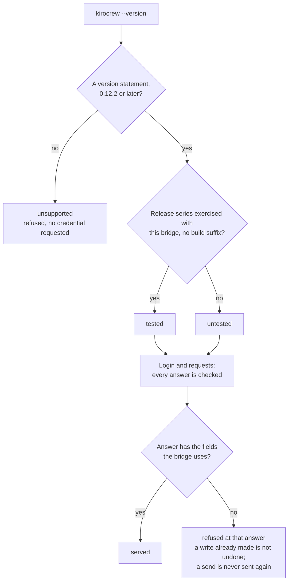

# Understand how the bridge talks to each agent

The bridge reaches each kind of agent through that agent's own protocol: ACP v1 for Kiro CLI and Grok Build,
`codex app-server` for Codex CLI, the official SDK for Claude Code, and an owner-authenticated local API for
KiroCrew. A name you search for becomes one bound recipient, the bridge refuses a changed recipient before it
sends, and an error reply tells you which kind of failure happened.

It is for someone asking "why ACP", or debugging a refusal, with a running bridge
([Getting started](GETTING-STARTED.md)). The routes themselves are in
[Choose which worker takes the work](HARNESSES.md).

## From a name to one recipient

With one owned Codex CLI worker registered as `implementation` ([Hand work to a CLI worker](NATIVE-CLI.md)):

```sh
answerback find "implementation"
answerback send implementation --request-id check-1 --message "Review the parser"
answerback send codex_cli:implementation --request-id check-1 --message "Review the parser"
answerback task <task-id> --wait 30
```

`find` exits `0` with the match. Trimmed to four of each peer's fields:

```json
{
  "peers": [
    {
      "kind": "bridge_managed",
      "name": "implementation",
      "peer_id": "codex_cli:implementation",
      "provider": "codex_cli"
    }
  ],
  "complete": true,
  "errors": {}
}
```

The free-text `send` exits `1` and creates no task, because an owned worker's peer carries no `binding`. Trimmed
to two fields of the match:

```json
{
  "status": "needs_selection",
  "matches": [
    {
      "peer_id": "codex_cli:implementation",
      "provider": "codex_cli"
    }
  ],
  "errors": {}
}
```

The send with the canonical `peer_id` from `matches` starts a real model turn, so its output is not shown. It
prints a receipt whose `id` is the `<task-id>`, and success is `task <task-id> --wait 30` exiting `0` with
`"status": "completed"`.



*Discovery binds a name to one identity; the router reaches each agent over its own protocol.*

## How this differs from MCP, ACP and A2A

- **MCP** is how your agent calls the bridge. The bridge's tools (`peer_search`, `peer_submit`, `task_wait` and the
  rest) are MCP tools, each with a command-line twin. An MCP connection lets a client call them. It does not make
  that client a recipient.
- **ACP** (Agent Client Protocol) is how the bridge drives a Kiro CLI or Grok Build worker it owns: it opens a
  session, sends a prompt and reads the matching response. The older, unrelated Agent Communication Protocol was
  also called ACP and is not what the bridge implements.
- **A2A** is a protocol between independent agent services. The bridge does not use it. It could be a future
  interface for a remote orchestrator to discover and delegate to the bridge.

None of these protocols supplies a generic wake-up for an arbitrary Desktop chat, and none of them gives a receipt
that ties one request to one result. The receipt is what the bridge adds.

## Why ACP now

[Kiro's v3 migration guide](https://kiro.dev/docs/cli/v3/acp-migration/) documents `kiro-cli acp --agent-engine=v3`,
ACP protocol version 1, `session/prompt`, `session/update`, permission requests and capability-gated session
operations. The bridge uses the [official Python SDK](https://agentclientprotocol.com/libraries/python), pinned to
1.0.0 (`pyproject.toml`), with bounded framing and explicit process ownership. Grok Build workers use the same
protocol ([provider boundaries](NATIVE-CLI.md#provider-boundaries)).

Turn completion comes from the matching prompt response. A `turn_end` metadata hint, a generic idle status or an
earlier assistant message is not enough. Loading a session reuses a saved conversation but does not attach to a
GUI or TUI process that is already running. The bridge loads only sessions it created, and interactive Herdr
agents keep their own execution owner.

### Kiro child environment

A Kiro ACP session gets an explicit environment with only these names, when present. Empty values are kept and
missing ones are left out. Each launch reads the current settings without changing the bridge's own environment
(`providers/kiro/acp.py`).

| Purpose | Forwarded names |
| --- | --- |
| Executable, home and shell lookup | `PATH`, `HOME`, `SHELL` |
| Native configuration and storage | `XDG_CONFIG_HOME`, `XDG_DATA_HOME`, `XDG_STATE_HOME`, `XDG_CACHE_HOME`, `XDG_RUNTIME_DIR` |
| Locale | `LANG`, `LANGUAGE`, `LC_ALL`, `LC_CTYPE`, `LC_COLLATE`, `LC_MESSAGES`, `LC_MONETARY`, `LC_NUMERIC`, `LC_TIME` |
| Terminal and temporary files | `TERM`, `TMPDIR`, `TMP`, `TEMP` |
| Network proxies | `HTTPS_PROXY`, `HTTP_PROXY`, `NO_PROXY`, `ALL_PROXY`, `https_proxy`, `http_proxy`, `no_proxy`, `all_proxy` |
| Certificate configuration | `SSL_CERT_FILE`, `SSL_CERT_DIR`, `NODE_EXTRA_CA_CERTS` |

Proxy URLs can hold a user name and password. They are forwarded because the provider cannot reach its service
without them on a network that needs a proxy. No `KIRO_`, `Q_`, `LC_` or `XDG_` prefix is forwarded as a whole.
AWS credentials and selectors (including `AWS_CA_BUNDLE`), `USER`, `LOGNAME`, `SSH_AUTH_SOCK`, other providers'
credentials and any other setting are left out. A setup that needs another inherited variable needs a reviewed
change to the Kiro provider plugin's environment policy.

This covers ACP session startup only. The `doctor` probes (`<kiro binary> --version` and `<kiro binary> acp --help`)
inherit the bridge's full environment, and so do commands you run from your shell.

A provider plugin installed alongside the kernel builds its own ACP child environment. It takes the same proxy and
certificate names from the kernel (`acp_environment.py`), and its package lists the rest under an "ACP child
environment" heading in the provider's guide, including any profile selector of its harness.

### Kiro MCP readiness

The Kiro v3 engine can return from session loading before its supplied MCP servers connect. In one live session
the bridge's MCP server connected well after loading had returned, and an agent prompted earlier reported that the
bridge tools were unavailable (no committed record).

So the supplied bridge server asks for Kiro's `waitForReady` metadata, and the Kiro provider plugin checks the
session's `_kiro/mcp/status` notification for `connected` and the required tools before it prompts. A failed
connection also ends the wait. Readiness is bounded, no tool approval is granted and no MCP configuration is
edited. This notification is a Kiro extension to ACP.

On the opt-in v2 engine Kiro reports only that the bridge server initialized, so the receipt records
`"mcp_readiness": "server_initialized"` and the tools stay unverified until the first call
([managed Kiro workers](RECIPIENTS.md#managed-kiro-workers)).

### Scoped worker profile

Kiro's MCP startup queue can delay a required server behind unrelated global ones. On v3 the worker supplies
`_meta.kiro.modeId` and `customAgents` on new and load, selecting the inline `answerback_bridge` profile. Its tool
tags are `read`, `write`, `shell` and `@answerback_bridge`, with `includeMcpJson` and `includePowers` false. The
profile avoids `*` and `@mcp`, which broaden MCP selection. These extensions grant no tool permission and change
no user configuration.

The Kiro provider plugin requires `modes.currentModeId` in the session response to confirm the selection before
prompting. On v3 the `--agent` launch flag is not used. On v2, which ignores inline agents, the bridge writes the
same profile to a file and passes `--agent answerback_bridge`
([the Kiro agent file](NATIVE-CLI.md#the-kiro-agent-file)).

A saved default session keeps its mode even when `session/load` names another `modeId`. The bridge records the
profile with its local session binding. A binding without a profile creates a fresh scoped session on its next
assignment, and the new receipt keeps `previous_session_id`. The binding changes only after the profile and MCP
readiness checks pass. Native history is not deleted or replayed, and uncertain assignments are never retried.

### Permission requests without a file path

A Kiro `'Read File'` permission request has reached the bridge with only a title and no path, so `task_permissions`
could show a person only the tool name. The bridge's own path forwards a populated `locations` or `rawInput`
unchanged (`tests/test_acp_client.py::test_request_permission_forwards_locations_and_raw_input_unchanged`). Whether
Kiro sends either field for this tool is open until a live session captures a real `session/request_permission`
payload for a file read.

## Names for discovery, IDs for delivery

```sh
answerback find "payments review"
answerback send "payments review" --binding <binding-from-find> --request-id review-7 --message "Review the changes"
answerback task --peer "payments review" --wait 30
```

The bridge resolves the words into one peer and keeps its provider identity internally. Ambiguous matches return
candidates, and a provider that did not answer stays named, so the remaining match does not look unique. The
selected Herdr terminal or Crew chat is rechecked before dispatch and its acknowledgement is checked afterwards.
For a Herdr terminal the bridge fetches it again after delivery and compares the terminal ID and agent kind with
the pre-send observation, and the agent session when that observation reported one. A replacement by an agent of
the same kind in the same terminal, whose only sign is a session appearing where none was reported, cannot be
seen.

A changed or unavailable identity leaves an `uncertain` receipt marked `identity_invalidated`, also when a worker
reported completion during the send. So does a failed or cancelled second lookup, or an unreadable prompt
acknowledgement. An invalidated receipt refuses the worker's later result and keeps the target busy until the
receipt is abandoned. Read any work the agent did from the agent itself. These checks are observations: neither
provider offers an atomic conditional send.

### What `binding` is

`peer_search` returns a `binding` for hc, Herdr and Crew peers, and for the peers of a provider plugin that declares
one. It is a digest of the identity found at search time: for hc the core agent's own binding; for Herdr
`terminal_id`, `agent_session` and `agent_kind`; for Crew the origin, slot key, created stamp, project and agent;
for a plugin the identity fields its package documents. Pass that exact string back as MCP `peer_submit.binding`,
CLI `send --binding` or legacy `send-herdr --binding`. A missing or different binding is refused before reservation
or admission, and nothing is delivered.

That refusal crosses the RPC boundary as the general
`Bridge request failed; inspect service logs and the task receipt.`: its "search again" text is not a reviewed
public message, so the caller never sees it. The command line prints the general text and exits `1`, and the MCP
tool call fails without the refusal's own words. Search again and review the selected occupant before
submitting new work. Admission refusals, actor errors and timeouts keep a public text of their own
([error contract](#local-rpc-error-contract)).

Routing and the collaboration harness carry the selected peer's binding for you. A unique free-text match selects
only a peer that carries a string binding. For Desktop chats and other unbound peers, `peer_submit` and
`task_for_peer` return `needs_selection`, and you repeat the call with the canonical `peer_id` from `matches`. A
chat-controlled title or preview therefore cannot become routing authority.

Providers without a string discovery binding keep their own identity checks. Rex uses an immutable enrollment ID
with a stored identity that its resolver checks against the native terminal ([Rex](REX.md)). For a `provider:target`
selector, an unpruned receipt that the provider plugin recovers for the same request ID and message is returned
before discovery runs, without another delivery.

### Discovery bounds

| Bound | Value | Source |
| --- | --- | --- |
| Time per provider, run concurrently | 25 seconds | `discovery.py` `PROVIDER_SECONDS` |
| Service request deadline | 31 seconds | `transport.py` `REQUEST_SECONDS` |
| Search terms in a query | 32 | `discovery.py` `MAX_QUERY_TERMS` |
| Peers kept by a global search | 1,000 | `discovery.py` `MAX_DISCOVERY_PEERS` |
| Characters per searchable field | 4,096 | `discovery.py` `MAX_SEARCH_FIELD_CHARS` |
| Haystack per peer | 48 KiB | `discovery.py` `MAX_SEARCH_HAYSTACK_CHARS` |

A stalled provider is named in `errors` and makes `complete` false, while the other providers' results and cursors
stay available. Cancelling the call cancels the whole search. An incomplete global search, or one cut at 1,000
peers (reported as a `directory` error), never authorizes a seemingly unique match. The term limit applies to
`tasks`, `kiro-sessions`, `peer_search`, free-text resolution and `desktop_sessions`, and an oversized query is
refused before anything is read. Matching is case-insensitive, and an empty query returns the current window.

Discovery and Crew-read MCP failures carry public diagnostic text with the MCP error flag set. Read timeouts name
the operation and can be retried, and they do not imply that anything was sent. A send timeout still needs the
existing receipt inspected before any retry.

### What gets refused, and why

Herdr messages are validated before the readiness probes or the task reservation. The text must be non-blank,
valid UTF-8 without NUL, at most 131,071 bytes encoded and at most 100,000 characters. An exception from the
prompt call is recorded as `uncertain` with a fixed explanation and the exception type, never the exception's
response text.

Receipt lookup through `task_for_peer` also checks the stored identity. Herdr needs a matching agent kind and the
same non-empty terminal ID, plus the same session when the pre-send observation reported one, and these fields
appear in `task_get` metadata as `terminal_id`, `agent_kind` and `agent_session`. Crew needs the same non-empty
chat binding.

`peer_submit` (CLI `send`, and the legacy `send-herdr` alias that routes through it) is the only delivery path a
client can reach for `herdr` and `crew`. There is no `herdr_submit` or `crew_submit` tool or RPC method. The
internal methods with those names require an explicit `expected` identity, and the Herdr and Crew provider
plugins refuse a missing one
before any lookup, reservation or send (`... identity is missing; search again`). A Crew `expected` that does not
match the live chat (another slot, a missing `created`, `project` or `agent`, or another origin) is refused with
`Selected Crew identity changed or is unavailable; search again`, with no receipt and no delivery. Tests pin both
refusals (`tests/test_expected_identity_required.py`, `tests/test_crew_identity_before_reservation.py`).

## Local RPC error contract

Every reply keeps the mandatory `version`, `ok`, `result` and `error` fields. An error reply also carries
`error_info`:

| Kind | Meaning |
| --- | --- |
| `public` | A reviewed fixed diagnostic code, rendered from the client's local catalogue |
| `admission_refused` | A validated blocking receipt UUID and target; this attempt was refused before reservation |
| `actor` | A fixed refusal code of [actor messaging](ACTOR-MESSAGES.md), rendered from the client's local catalogue |
| `timeout` | The client renders a timeout message for the operation it requested |
| `internal` | Unexpected failure; the exception text is withheld |

The server also sends a safe mandatory error string for older clients. A client masks unclassified, malformed or
unknown error metadata rather than publishing a remote string, so an unexpected provider or storage exception
cannot become public text. A known admission refusal exposes the blocking receipt and target through MCP: inspect
that receipt, and do not submit through another route to get around its reservation. Missing classification from
an older server does not prove that a submission was refused before execution.

The task ID names one assignment, not a session. The sending agent keeps it to correlate results and deduplicate
retries, and a person uses names, titles and project paths. Receipt summaries for a fleet view are in the
[fleet snapshot contract](FLEET-SNAPSHOT.md).

## Desktop route release boundary

Codex Desktop support is present, not part of the initial release.

## Crew contract

Crew documents `kirocrew token` as a machine interface. Its dashboard chat API supports session discovery and
sends, with `turn_origin: agent` for automated requests. The bridge follows that interface and never forges the
internal MCP session-control caller identity. It needs an explicit result report from the chat: persisted history
has message identifiers but no durable task-success verdict. Stopping a Crew chat targets its current work and
could interrupt a later human turn, so that operation is not offered as cancellation of a bridge task.

### Which Crew releases are served

Crew is released far more often than the bridge, so the Crew provider plugin keeps a minimum instead of a list, and
checks every answer.



*How a Crew release is classified and then checked answer by answer.*

**The minimum.** `kirocrew --version` must state 0.12.2 or later (`providers/crew/client.py` `MINIMUM_VERSION`).
An older release, or output with no version statement, is refused before `kirocrew token` runs: no credential is
requested, nothing is sent to the gateway, and the refusal names what was printed.

**Reading the version.** The Crew client reads the first 20 lines and expects one version statement. A statement is a
whole line of at most 200 characters: an optional product name, an optional `version` or `v`, two to eight dotted
numbers of at most 12 digits, and an optional build suffix of at most 33 characters such as `rc1`,
`.dev3`, `-nightly.5` or `+g1a2b3c`. Other lines are ignored, and a longer line is never cut to fit.

Numbers are compared as numbers and reported as printed. Output with no statement, or two statements that differ, is
unreadable. A suffixed build of exactly 0.12.2 is refused, because it may predate that release.

**Every answer is checked.**

| Step | Refused unless |
| --- | --- |
| `kirocrew token` | It prints an HTTP URL on a loopback address with exactly one `token` parameter, on the selected port and the same gateway as the previous login |
| Login | The gateway sets a session cookie `mc_token_<port>` whose value differs from the token |
| Chat list | Every chat has a string `key`, `title`, `project` and `agent`, a `created` stamp and a boolean `running`; other state flags are booleans; no key occurs twice |
| History | The answer names the requested chat, has at most 200 `messages` and 200 `queue` rows, an integer `total` and a boolean `has_more`, and each row has the expected string fields |
| Send | The chat's identity (`created`, `project`, `agent`, gateway) is the same before and after; the receipt says `ok: true`, is not `steered` and names no other chat |
| Create | The new chat has the requested title, was not listed before, and reads back with the requested project |

At any step, a redirect to another origin, an encoded body or an answer over 4 MiB is refused. A created chat's
slot, gateway, creation stamp, project and agent are kept in the receipt database (table
`crew_creation_receipts`), which retention never prunes. A retry after a client replacement or restart must match
that identity. An occupied slot with no such row is returned as `needs_selection`, never adopted.

A check cannot undo a write. When the check after a send fails, the message may have been delivered: the bridge
does not send it again, and the receipt becomes `uncertain` unless the chat's own report completes it. A changed
chat identity invalidates the submission. When a check fails during a chat creation, the chat may exist: the
creation is reported as failed, and a retry never changes the project of a chat that exists.

**What is reported.** `doctor` and the runtime status show, under `providers.kirocrew`, what the latest login read:
`version` as printed, `version_checked_at` and `version_status`. All three are empty before a first attempt. A
login lasts up to 55 minutes, so after a Crew update the reported release is the previous one until the next
login.

| `version_status` | Meaning | Served |
| --- | --- | --- |
| `tested` | The release series (first three numbers) was exercised end to end: login, discovery, history, a send and a chat creation | yes |
| `untested` | A later series, or a build with a suffix; the answer checks are the only protection against a changed release | yes |
| `unsupported` | Older than 0.12.2, or no version statement | no |

A refusal reaches a caller in two forms. Discovery and `doctor` carry the full sentence with the version read. An
error that crosses the bridge's socket carries only the fixed diagnostic `crew_version_unsupported`, because text
printed by an executable is never passed on as an error.

**What was exercised.** With Crew 0.13.0.4, a login, the chat list and chat histories passed every check. In
other runs against the 0.13 series a chat creation, its project assignment and sends passed them, and one chat
answered more than one assignment. A report through `task_complete` completed a receipt only in the macOS run
described under [KiroCrew](RECIPIENTS.md#kirocrew). There is no committed record of these runs.

`TESTED_SERIES` in `providers/crew/client.py` holds 0.12.2 only, so 0.13 reads `untested`. A series moves to
`tested` when an assignment in a scratch chat ends with a completed receipt and the series is added there.

## What it cannot do yet

- **A2A.** The bridge offers no A2A interface for a remote orchestrator.
- **Atomic conditional sends.** Neither Herdr nor Crew can refuse a send when the occupant changed, so the bridge
  observes before and after and records `uncertain` when it cannot tell.
- **Crew cancellation.** A bridge task in a Crew chat cannot be cancelled.
- **Codex Desktop and Claude Desktop routes.** They are present and not part of the initial release.

## See also

- [Choose which worker takes the work](HARNESSES.md): each route's interface and evidence.
- [Owned native CLI workers](NATIVE-CLI.md): Codex CLI, Claude Code and Grok Build boundaries.
- [Recipients](RECIPIENTS.md): Kiro CLI and KiroCrew setup.
- [Glossary](GLOSSARY.md): ACP, binding and the other terms here.
