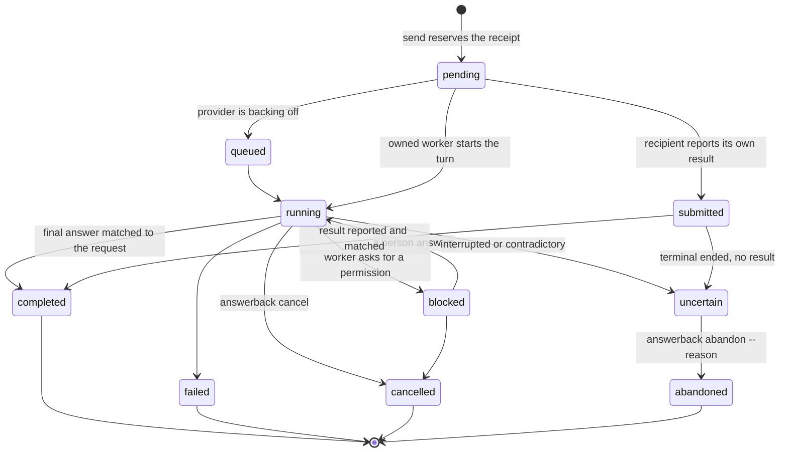

# Read a receipt: is it done?

Every hand-off leaves one receipt, and the receipt reads `completed` only when the recipient's
own result for that exact request came back. This page lists the ten states a receipt can be
in, the exit codes a script can branch on, and what a receipt does not tell you.

This page is for anyone asking "is it done?" after a `send`, a `peer_submit` or a
`bus_submit`. It assumes a running bridge and one hand-off made
([Install the bridge](GETTING-STARTED.md)).

## Ask the receipt, not the agent

```sh
answerback task <task-id> --wait 30
```

`task` prints the receipt and exits with a code a script can act on without parsing it. The
receipt below is trimmed to three of its fields:

```json
{
  "request_key": "hello-1",
  "status": "completed",
  "result": "ANSWERBACK_OK"
}
```

`status: completed` is the proof. The exit code says the same thing:

| Exit code | Meaning | Receipt |
| --- | --- | --- |
| `0` | Completed | `status: completed` |
| `1` | Failed, cancelled, abandoned or uncertain; an ambiguous selection; most other errors | `status: failed`, `cancelled`, `abandoned` or `uncertain`, or an `error` on stderr |
| `2` | The worker is waiting for a permission decision | `status: blocked` |
| `3` | The wait ran out; the task may still be running | `wait_timed_out: true` |

`--wait` takes 1 to 30 seconds. A wait that runs out cancels nothing: run the same command
again, or use `--peer <address>` to find that peer's latest receipt without its ID. Over MCP,
`task_wait` returns the same `status` and `wait_timed_out` fields, and `task_get` reads the
receipt without waiting.

## "Done" is not evidence

An agent saying it has finished, an accepted message, an idle-looking terminal and a delivery
confirmation all look like done. None of them completes a receipt. These are the states a
receipt can be in:



*The ten receipt states, with the four terminal ones (`completed`, `failed`, `abandoned`,
`cancelled`) leading to the end marker; the diagram omits some cancellation edges, such as
cancelling a `blocked` or `submitted` task.*

| State | What it means |
| --- | --- |
| `pending` | The receipt is reserved. Nothing has been delivered yet. |
| `queued` | The bridge holds the task back, for example while a provider account is rate-limited. |
| `submitted` | Delivered to a recipient that reports its own result (an agent in a Herdr terminal or a KiroCrew chat), and the recipient's turn was seen to start. |
| `running` | An owned worker, a session the bridge starts and owns, is on the task. |
| `blocked` | The worker asked for a permission. A person answers it at the command line; no MCP tool can. |
| `uncertain` | The bridge could not settle the receipt: an interrupted connection, a contradictory event or a missing final response. |
| `completed` | The recipient's own result came back and matched this request. The only state that means done. |
| `failed` | The recipient reported a failed turn, or a Codex CLI, Claude Code or Grok Build worker could not start. A Kiro worker that cannot start ends `uncertain` instead. |
| `cancelled` | `answerback cancel` stopped an owned worker, confirmed by a matching native cancelled or interrupted event. |
| `abandoned` | A person released an `uncertain` receipt with `answerback abandon <task-id> --reason "<what you verified>"`. |

Four guarantees hold on every route:

- **Never silently re-sent.** An interrupted or ambiguous outcome is recorded as `uncertain` and
  is never re-sent automatically. The recipient stays reserved until a person releases it with
  `abandon --reason`, which does not cancel execution and keeps the earlier outcome in an audit
  record. Where the recipient reports its own result, matching evidence can also settle it.
- **One receipt per request ID.** Sending the same request ID again with the same message and
  subject to the same peer returns the existing receipt and runs nothing twice. The same ID with
  a different message, a different peer or a different subject (one present and one absent
  counts as different) is refused with `request_id already describes different work`.
  A request ID is 1 to 128 characters from letters, digits, `.`, `:`, `_` and `-`.
- **Right recipient.** For a terminal or chat, discovery returns a binding, a fingerprint of who is
  there. Send with it, and the bridge refuses if someone else is there now. An owned worker has
  no binding.
- **Permissions stay with you.** A worker's permission request pauses the task in `blocked` until
  a person answers with `answerback permission-answer`. No MCP tool can answer one.

## Name what a hand-off is about

`send --subject <text>` (the `subject` argument of `peer_submit` over MCP) stores a subject on
the receipt: what you say the work concerns, such as the commit SHA a review is of, an artifact
digest, a release tag or a document ID.

```sh
answerback send codex_cli:reviewer --request-id review-1 --subject "$(git rev-parse HEAD)" \
  --message-file brief.md
answerback tasks --subject "$(git rev-parse HEAD)"
```

A subject is 1 to 256 printable characters, with no newline, tab or other control character
and no leading or trailing space. It is shown as the receipt's top-level `subject` field by
`task`, `tasks`, `task_get` and `task_list`, and is `null` on a receipt sent without one or
from a bridge older than this field. Once stored it never changes.

`tasks --subject <text>` and `task_list` with `subject` return the receipts whose subject is
exactly that text, newest first, from every receipt in the store rather than only the latest
100; a keyword query still narrows them. The result's `subject_matches` counts every receipt
with that subject before the keyword query and the limit, so you can tell when some were left
out. The match is exact and case-sensitive: a short SHA does not find a full one, so expand it
first with `git rev-parse`.

The bridge never checks a subject. It is not added to the message, so the recipient does not
see it unless your message says it, and nothing compares it with a repository, a file or a
digest. A `completed` receipt with subject `abc123` proves only that the recipient's result came
back for a request you labelled `abc123`. A subject is kept as long as the receipt, also after
maintenance prunes the message and result, so do not put a secret in it. Hand-offs through the
bus carry no subject yet.

## Two receipts on the bus

The optional bus adds a second, separate receipt. The command receipt tracks delivery: whether a
queued command was accepted, claimed and bound to a task. The task receipt tracks execution.
`delivery: "bound"` means only that the command now has a task receipt; read `task.status` to
know whether the recipient finished. Keep the words apart: "accepted", "delivered" and "bound"
describe the command receipt, and only a task receipt in `completed` means done
([Agent bus](AGENT-BUS.md#delivery-and-execution-have-different-receipts)).

## What a receipt holds, and what it leaves out

The printed receipt carries the request key, the subject, the target, the status, the result, a `detail`
field with the reason for a failure or an uncertain end, and a `metadata` block. It never
includes the message you sent, and for a remote result file it leaves out the file's path and
token. Remote result files come from machines listed in `hc_send_machines`, an Experimental
setting that is off by default; they are qualified for Linux with Codex CLI only
([Harnesses](HARNESSES.md)).

Since 0.16 a receipt records the bridge version that created it and, once it ends, the version
that ended it. They are shown together as `bridge_versions`; the store writes both itself and
refuses a metadata write that names either. A receipt from a bridge older than that records no
versions. Counting the hand-offs of one version from these stamps, and the two limits of that
count, is in [Maintenance](MAINTENANCE.md#counting-the-hand-offs-of-one-bridge-version).

## What it cannot tell you

A receipt in `completed` proves that the recipient's own result for this request came back. It
does not show that the result is right. Checking that is still your job, or an independent
reviewer's.

On the routes where the recipient reports its own result (agents in Herdr terminals, KiroCrew
chats), any program running under your OS user can report a result for a task: the bridge
checks the task, not the caller. A result file from a machine listed in `hc_send_machines`
proves only that the brief reached that machine's user account; such a receipt records
`"result_authentication": "trusted_os_account"`. The trust model is in
[SECURITY.md](../SECURITY.md).

## See also

- [Install the bridge](GETTING-STARTED.md): the first hand-off these receipts come from.
- [Owned native CLI workers](NATIVE-CLI.md#exit-codes): the full exit-code table, `130` and the
  two errors that exit differently.
- [Agent bus](AGENT-BUS.md): the command receipt, its delivery states and recovery.
- [Troubleshooting](TROUBLESHOOTING.md#receipts-that-do-not-complete): a receipt that stays
  `uncertain`, exits `3` or fails at once.
- [Glossary](GLOSSARY.md): receipt, command receipt, request ID, binding and uncertain.
