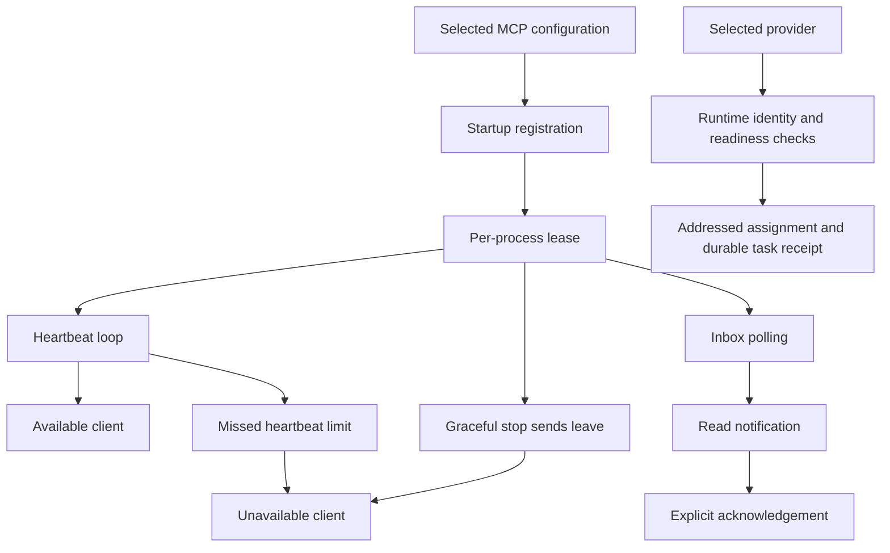

# Limit what a client sees: providers, presence and inboxes

The bridge discovers only the providers you register and reports presence only for the clients
you connect. You decide both with two short commands, and nothing turns on by itself.

This page is for someone with a connected client ([Connect a client](CLIENT-SETUP.md)) who wants
to control which runtimes the bridge may reach, how a client's presence is tracked and how an
addressed notice reaches a client's inbox.

## Two registrations, two facts

```sh
answerback providers list
answerback clients list
```

| Registration | What it controls |
| --- | --- |
| Provider, such as `hc` or `crew` | Which runtime the bridge may discover and hand work to |
| MCP client, such as `codex` or `claude` | One application's connection, its heartbeat leases and its notification inbox |

An available MCP connection does not prove that a chat is idle, that a gateway is running or
that an incoming route can wake the application's agent.



*A client registration (top) tracks presence and an inbox, a provider registration (bottom) gates
discovery and delivery, and the labels are stages rather than message texts.*

## Select providers

A fresh `configure` creates an empty provider selection; an older configuration keeps its
selections. Neither installing a client nor a client heartbeat enables a provider.

```sh
answerback providers list
answerback providers register codex_cli     # owned Codex CLI workers
answerback providers register hc            # agents in Herdr App/core terminals
answerback providers unregister crew
```

`register` takes one of `hc`, `herdr`, `codex`, `kiro`, `crew`, `rex`, `codex_cli`,
`claude_code` and `grok`. Any other name is refused, including the name of a provider plugin
that is not installed; a saved configuration that names one is kept and reported as `disabled`
instead ([Provider and module plugins](TROUBLESHOOTING.md#provider-and-module-plugins)).

`register` accepts `--binary`; the older Herdr TUI (`herdr`) requires `--session`, and `crew`
accepts `--port` (default 5476). It records a selection and launches nothing. Owned Kiro
workers also need a workspace (`workspace add`); Rex needs a verified local endpoint and an
enrolled conversation ([Rex](REX.md)). `hc-configure`, `crew-configure` and `workspace add`
remain the explicit setup commands for their routes.

`unregister` keeps connection settings, projects, history and receipts. Unfinished work must be
completed or reconciled first.

For Crew, register the gateway's actual port. The bridge probes that loopback endpoint with a
half-second limit before each search; when it is unavailable, Crew is excluded from discovery
with the reason `excluded`, no version or login call is made, and the next search tries again.
The bridge does not start the gateway. Coverage is then partial, so an unavailable provider
cannot make an ambiguous name look unique.

## Install only selected MCP clients

```sh
answerback clients install --client codex
answerback clients install --client codex --apply
```

`--all` is an explicit bulk choice, not a default. Each generated entry names its client:

```json
{
  "command": "/absolute/path/to/answerback",
  "args": [
    "--config", "/absolute/path/to/config.json",
    "mcp", "--client", "codex"
  ]
}
```

The MCP server's lifespan starts registration, heartbeat and polling tasks. A graceful stop
cancels them and sends a leave message. Each process has its own instance UUID, so one process
leaving does not invalidate another from the same application.

The `--client` value names a client family, not a chat: `codex`, `claude`, `grok`, `kiro`,
`crew` or `kiro-crew`. Kiro CLI and Crew share one global MCP configuration, so that entry
reports `kiro-crew`. Claude Code uses the `claude` family, with separate instance leases and one
shared inbox. A legacy entry without `--client` still serves the tools and reports no heartbeat;
upgrade only entries you selected, keep their restrictions and reconnect the application.

## Heartbeats and reconnection

```sh
answerback clients list
answerback clients policy --interval 10 --misses 3
```

Each process sends a heartbeat every 10 seconds by default; after 3 missed heartbeats, 30
seconds, its lease is unavailable. `--interval` takes 1 to 3600 seconds and `--misses` 1 to 100.
A clean leave removes the lease at once. An application stays available while at least one
instance holds a live lease. Registered client names are durable; live leases are not restored
after a bridge restart, and connected MCP processes re-register themselves.

Each client family may hold 64 connection leases, with a global backstop of 512. At either
ceiling, registration first removes leases that have reached the heartbeat timeout.
Re-registering the same live instance UUID renews its lease without taking another slot.
Heartbeats and inbox polling run as separate bounded tasks, so slow polling does not stop a
heartbeat. Neither a leave nor an expiry cancels a task, deletes a receipt or authorises a
resend.

## Polling and addressed notifications

```sh
answerback notify codex \
  --topic bridge.status \
  --message "The bridge update is ready." \
  --request-id bridge-update-notice
```

This queues a notification in a registered application's inbox, including when that application
is offline. It does not address one chat and does not launch the application's agent. Reusing
the request ID with identical content returns the same receipt; different content under that ID
is refused.

Each client family may hold 150 unacknowledged notifications, with a global backstop of 1000.
A full inbox does not spend another family's allowance. At the ceiling, identical retries still
return their original receipt and new notices are refused until the backlog falls below it;
acknowledging a notification frees its slot.

The named MCP frontend polls its inbox in the background. The host's agent then uses
`read_inbox` to read pending messages and `acknowledge_inbox` with the IDs it has read. Polling
and reading leave a message pending; acknowledgement records consumption, not execution or task
completion. A notification can be observed more than once, so deduplicate by ID. Inboxes belong
to applications, not to conversations: for a chat-specific assignment use the exact provider
identity with `peer_submit`, or `bus_submit` when the bus is configured.

The sender can read a notice's state without its content:

```sh
answerback notification-status codex --request-id bridge-update-notice
```

The MCP equivalent is `notification_status(client, request_id)`. `queued` means no
acknowledgement has been recorded; it does not say whether a person or model saw the notice.
`acknowledged` carries the original `client_acknowledged_at`, which repeat acknowledgements
keep.

`delivery_mode: passive_inbox`, `acknowledgement_scope: client_inbox`,
`wakes_agent: false` and `task_id: null` mark the evidence boundary. An unknown client and
request pair returns `found: false`, `status: not_found`. Neither outcome shows that an agent
replied or that work completed.

## Private local stores

`tasks.sqlite` and `client-mailbox.sqlite` live beside the selected `config.json`. Each store
checks its parent directory when it opens: a real directory owned by the current OS user, set to
mode `0700`. An owned directory with looser permissions is tightened on the first start after
an upgrade, and existing receipts and notifications are kept.

A parent owned by another user, an unresolved symlink parent or a symlink at either database
path is refused before the database opens. The files stay mode `0600`. These checks run at
startup and do not pin directory
descriptors for later connections, so keep the configuration directory where only you can write.

## What it cannot do yet

- Topic labels only categorise a notice. Wildcard subscriptions and broadcast routing are not
  implemented, and no polling loop runs message text, calls a model or bypasses a host's approval
  controls.
- A notification does not wake an agent. Waking one needs a route for that harness
  ([Which worker for what](HARNESSES.md)).
- The Codex Desktop/IDE route (`codex`, legacy alias `desktop`) is present and not part of this
  release.

## See also

- [Connect a client](CLIENT-SETUP.md): the installer, its destinations and reload steps.
- [Recipients](RECIPIENTS.md): what each provider needs before it can be handed work.
- [Which worker for what](HARNESSES.md): which harness can be woken and what counts as
  completion.
- [Troubleshooting](TROUBLESHOOTING.md#provider-and-module-plugins): a provider that reads
  `disabled`.
- [Glossary](GLOSSARY.md): provider plugin, peer and receipt.
