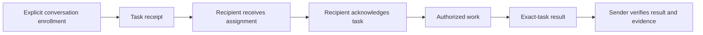

# Hand work to an enrolled Rex conversation

Rex gives a terminal conversation that is already running an address the bridge can send to. The conversation
enrolls itself once, then polls for its assignment, acknowledges it and reports the result, and its receipt
completes only on that report for that exact task.

It is for someone running agents in Rex who wants them to take bridge assignments. It assumes a running bridge
([Getting started](GETTING-STARTED.md)). Choose Rex when the recipient is willing to poll, acknowledge and
complete its own work: Rex cannot wake a dormant agent. [Choose which worker takes the work](HARNESSES.md)
compares it with the other routes.



*One assignment on the Rex route: nothing reaches the conversation until it asks for it.*

## Configure, enroll and complete

For an existing bridge:

```sh
answerback rex-configure --binary /absolute/path/to/rex
```

`rex-configure` and `rex-enroll` probe a running Rex, so this section shows no output. Success here is exit `0`
with `"configured": true` and the saved absolute path in `binary`.

For a new bridge, `answerback configure --runtime rex` probes and records the local endpoint, and enables no other
provider. Rex is not an MCP client-install target: register the agent's own harness with the bridge as usual and
reload its tools.

Enroll from the intended conversation. `--here` uses the caller's `REX_SESSION` and `REX_BLOCK`; otherwise pass
the verified full `--session` and `--block` IDs, which `answerback find --provider rex` shows:

```sh
answerback rex-enroll reviewer --here --request-id review-conversation-1
```

The result's `peer_id` is the enrollment's address, `rex:<enrollment-id>`, and its `state` reads `active`. Keep
that ID. A new conversation needs a new enrollment, even in the same foreground process. The recipient then runs
this sequence with the IDs it was given:

```sh
answerback rex-receive rex:<enrollment-id> --wait 10
answerback rex-ack rex:<enrollment-id> <task-id>
# Do and verify the authorized assignment.
answerback rex-complete rex:<enrollment-id> <task-id> --result-file /absolute/path/to/result.txt
answerback rex-retire rex:<enrollment-id>
```

`rex-receive` lists the waiting assignments under `tasks`, and `rex-complete` returns the task receipt with
`status` `completed`. The sender reads the receipt with `answerback task <task-id> --wait 30`, which exits `0`
only when it reads `completed` ([receipts](RECEIPTS.md)).

MCP offers the same steps as `rex_read`, `rex_enroll`, `rex_receive`, `rex_ack`, `rex_complete` and
`rex_retire`. A configured [bus](AGENT-BUS.md) is the durable sender route, and direct `peer_submit` also works.
Neither route wakes the recipient. The generic `task_complete` cannot complete a Rex task.

## Limits and identity checks

- One unfinished task is allowed per enrollment.
- `rex-receive --wait` takes whole seconds from 0 to 15, with one waiter per enrollment and eight in total.
- Receiving does not acknowledge. Completion needs the acknowledged task. Exact retries keep the same identities.
- Retirement refuses unfinished work.

Enrollment records the conversation's native identity: its Rex session and terminal block, the Rex endpoint and
host ID, and the foreground process with its PID, name and working directory (and its path and script when Rex
reports them). The bridge refuses to enroll a conversation whose foreground process is not local, is not owned by
the bridge's OS user, or has no absolute working directory. That working directory becomes the enrollment's
project, which a prepared submission must still match.

A new submission, a receive, an acknowledgement and a completion each recheck the conversation's native identity.
Three paths skip that check: an exact retry of a submission that already has a receipt, a repeated completion of a
completed task, and retirement, which looks only for unfinished work. Identity fields that are missing for a
moment withhold authority and keep the enrollment. A known change invalidates the binding and makes unfinished
work `uncertain`, so investigate those receipts before any retry. The provider never types into a terminal, takes
over another process, or grants work authority from message text.

## The executable path

Both configuration commands resolve the executable once and save its absolute path, which the result's `binary`
field shows. A missing executable is refused before the probe, and a later `PATH` change cannot select another
binary. An older configuration with a bare name such as `rex` or a relative path cannot launch Rex: the bridge
still starts, other providers keep working, and Rex discovery reports incomplete coverage. Run
`answerback rex-configure --binary /absolute/path/to/rex` to pin it.

When that first pin probes the saved endpoint and host ID, unfinished tasks and enrollments are kept, and
recipients can go on receiving, acknowledging and completing them. A changed endpoint or host ID, or a new path
in place of an absolute one, is a binding change: unfinished tasks prevent it, and otherwise enrollments go stale
and must be made again.

## Ownership and reading

The local Unix endpoint and the same OS user govern access. An enrollment ID is a cooperative identity, not
authentication against another process of the same account.

Native terminal metadata is listed only when the foreground UID is an integer that matches the bridge's OS user.
A foreign or unknown owner omits the native row and marks discovery incomplete, with a diagnostic that holds no
terminal identifiers. A same-user terminal is also omitted when Rex reports no foreground process, including when
the server lacks the process capability. Stored enrollments stay available as history: a changed owner invalidates
an enrollment, and missing evidence leaves it unverified with an incomplete-identity diagnostic.

`read-rex --session <id> --block <id> --max-bytes <n>` returns a bounded prefix of 1 to 65,536 bytes (default
16,384), with explicit truncation. It needs the same foreground ownership evidence before it asks for content, so
a terminal with no foreground record cannot be read. An owned terminal can be read without enrollment.

## What it cannot do yet

- **Wake a dormant agent.** The conversation must poll for its own work.
- **Enroll a conversation on another machine.** Remote enrollment is not supported.
- **Live model qualification.** A scripted native smoke test proves only the protocol paths it exercises. Recent-tail
  reads, snapshot continuity and compatibility with each harness are not verified
  ([validation](../VALIDATION.md#preserved-public-baseline)).

## See also

- [Choose which worker takes the work](HARNESSES.md): Rex next to the other routes.
- [Receipts](RECEIPTS.md): what `completed` and `uncertain` mean.
- [Agent bus](AGENT-BUS.md): queued delivery that survives a restart.
- [Actor messages](ACTOR-MESSAGES.md): direct exchanges between enrolled agents.
