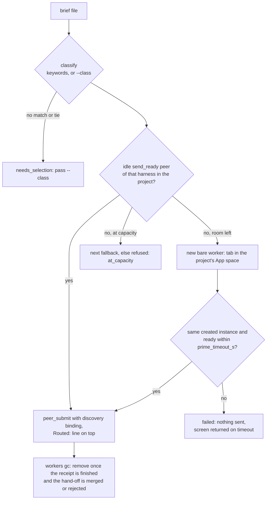

# Dispatch by policy

`answerback route` reads a brief, classifies it against a policy file you keep in your
project, and sends it to an agent in a Herdr App/core terminal: an idle one it can reuse,
or a managed worker it creates for the purpose. You get the receipt of one `peer_submit`,
with a `Routed:` line on top of the brief that says which class, harness and reason chose
the recipient.

This page is for someone who wants the recipient chosen by a rule rather than by hand. You
need a running bridge with the `hc` provider configured
([RECIPIENTS.md](RECIPIENTS.md#herdr-appcore-readiness)) and the Herdr App or core
running; without a terminal to work with, neither `route` nor `workers` can do anything.
`route` never dispatches to an owned worker registered with `workspace add` (`codex_cli`,
`claude_code`, `grok`, managed `kiro`); send to one of those directly.

## The shortest path

Put a policy at `status/routing.json` in your project (an example is below), then preview
from the project root. `<task-id>` is your own ledger's name for the work; it labels the
request ID and the worker, and is not a receipt.

```sh
answerback route brief.md --task <task-id> --dry-run
```

Real output, trimmed to the fields that decide the route, for a brief that matched the
`port-fix` class of the example policy with no idle peer in the project:

```json
{
  "status": "planned",
  "classification": {
    "class": "port-fix",
    "source": "keyword",
    "matched": ["port", "bugfix"]
  },
  "harness": "codex",
  "action": "create",
  "peer": null
}
```

`status: "planned"` with `action` `reuse` (and a `peer`) or `create` is a route that would
go; the plan changes nothing. Drop `--dry-run` to route. The command exits `1` on
`refused`, `failed`, `uncertain` or `needs_selection`. Otherwise its result carries the
`peer_submit` receipt under `receipt` and that receipt's ID under `receipt_id`: copy
`receipt_id` and follow it with `answerback task <receipt-id> --wait 30`
([RECEIPTS.md](RECEIPTS.md)). The ledger task ID does not name the receipt.



*One route: classify, reuse or create, wait for readiness, send once. The labels are the
result values the command prints.*

## Commands

```sh
answerback route brief.md --task <task-id> --dry-run
answerback route brief.md --task <task-id>
answerback route brief.md --task <task-id> --class port-fix --lane b
answerback route review.md --task <task-id> --author claude   # review: not the author
answerback route brief.md --task <task-id> --new              # ignore idle peers

answerback workers create --class analysis    # bare worker, waits until ready
answerback workers list                       # managed workers and their gc verdict
answerback workers gc                         # preview
answerback workers gc --apply                 # tear down what the preview listed
```

`--task` is your own task identifier; it goes into the request ID. `--lane` defaults to
`a`. `--routing /absolute/path/routing.json` names a policy file elsewhere than
`./status/routing.json`; `--herdr-app` names the Herdr App executable.

The policy file must be a regular file, not a symlink, of at most 256 KiB; the reader takes
at most 256 KiB and one byte before refusing a larger one. A brief must be UTF-8 and at most
96 KiB (98,304 bytes); a larger one is refused with `Brief exceeds 98304 bytes` before it
is decoded.

## The policy file

The file is yours and lives in your project, not in this repository. Classes, keyword
lists, caps and teardown rules come from it; the executables and launch arguments it may
name are restricted by the installed package. A key the code does not understand stops the
command rather than being guessed at, and so does a `lifecycle` key it has never heard of.
Four lifecycle entries are text for people (`gate_note`, `hung_action`, `make_visible`,
`prime`): `workers list` names them under `unenforced_lifecycle` so nobody reads them as
rules the code applies.

This policy loads under the current loader. Its `review` class is the line this project
runs on, independence beats skill match: a review goes to any creatable harness except the
one named with `--author`.

```json
{
  "version": 1,
  "project": "/absolute/path/to/project",
  "harnesses": {
    "codex": {
      "provider": "hc",
      "agent_kind": "codex",
      "launch": ["/absolute/path/to/project/tools/harness_launch.sh", "codex", "--yolo"],
      "max_workers": 2
    },
    "claude": {
      "provider": "hc",
      "agent_kind": "claude",
      "launch": ["/absolute/path/to/project/tools/harness_launch.sh", "claude"],
      "max_workers": 2
    }
  },
  "classes": {
    "port-fix": {"primary": "codex", "fallback": ["claude"], "match": ["port", "bugfix"]},
    "review": {"primary": "not-author", "fallback": [], "match": ["review branch", "second opinion"]}
  },
  "tie_breaks": ["existing_idle_peer_same_project", "not_author_of_touched_files", "cheaper_seat"],
  "lifecycle": {
    "name_pattern": "{class}-{harness}-{yymmdd}-{n}",
    "request_id_pattern": "ab-{yyyymmdd}-{task}-{lane}-{address}",
    "prime_timeout_s": 120,
    "keep_idle_min": 20,
    "max_total": 4,
    "teardown_after": "handoff_merged_or_rejected",
    "never_kill": ["state=working", "receipt in pending|submitted"]
  }
}
```

| Key | Meaning |
| --- | --- |
| `harnesses.<h>.provider` | Required. `hc` is the only provider workers are created for |
| `harnesses.<h>.agent_kind` | The agent the bridge must recognise in the terminal; must match the tool name in `launch` |
| `harnesses.<h>.launch` | The launch argv (next section). Omit it and the harness is reusable but not creatable |
| `harnesses.<h>.max_workers` | Live managed workers of this harness, at most |
| `harnesses.<h>.seat_cost` | Optional number for the `cheaper_seat` tie-break; otherwise declaration order decides |
| `classes.<c>.primary`, `fallback` | Harness names in rank order, or `not-author`. A class whose primary is `owner` or `conductor` is refused; `crew` and `council-litellm` are skipped with the reason |
| `classes.<c>.match` | Phrases counted in the brief on word edges (`port` does not match `report`) |
| `tie_breaks` | Any of the three names shown, in the order they apply |
| `lifecycle.prime_timeout_s` | Seconds to wait for a new worker to become `send_ready` |
| `lifecycle.keep_idle_min` | Minutes a finished or never-dispatched worker is kept |
| `lifecycle.max_total` | Live managed workers in the project, all harnesses together |
| `lifecycle.warm_pool` | Optional: `{"<class>": N}` idle workers to hold while that class has queued work |
| `lifecycle.gate_classes`, `max_concurrent_gates` | Optional, together: the classes whose briefs end in a full test gate, and how many such assignments may be unfinished at once |

`teardown_after` must be `handoff_merged_or_rejected`. `prime_text` must be absent or
`null`, and `accepts_initial_prompt` must not be `true`: a worker that answers a priming
message reports `done` and cannot be delivered to, so workers launch bare and the brief is
the first thing they receive.

### Launch commands

A harness that needs a model-provider token starts through the package's
`answerback_bridge/data/harness_launch.sh`, which resolves the token inside the new terminal
and `exec`s the binary, so the token is never in argv, a file or a log. `launch` names
either the absolute packaged path or `<project>/tools/harness_launch.sh`; the loader always
uses the packaged copy and never reads or executes the project one, so editing `project`
and `launch` together cannot select another executable.

| Mode | Agent kind | Command after the script, or the whole direct command |
|---|---|---|
| script | `claude` | `claude`, optionally followed by `--dangerously-skip-permissions` |
| script | `codex` | `codex`, optionally followed by `--yolo`, optionally then `--no-daemon` |
| script | `grok` | `grok`, optionally followed by `--yolo` |
| direct (`launch_via: "direct"`) | `kiro` | exactly `kiro-cli chat -a --v3 --agent=default` |

Every other executable or argument form is refused. Harness binaries are found on your
`PATH`.

## What a route does

1. **Classify.** Each class's `match` phrases are counted in the brief. Most distinct
   phrases wins, then most hits. No match or a tie returns `needs_selection`; `--class`
   overrides. Above 32,768 candidate matches classification returns no selection rather than
   an incomplete score. No model is consulted.
2. **Pick.** Primary harness first, then each fallback. For a `not-author` class every
   creatable harness except `--author` is a candidate and `tie_breaks` order them.
3. **Reuse or create.** A peer is reused only when the bridge would deliver to it now: the
   right `agent_kind`, taken from the terminal's foreground command and not only from a
   reported name; in this project; local, or on a machine listed in `hc_send_machines`
   ([Limits](#limits)); `send_ready`; no unfinished receipt. `send_ready` covers an agent
   that reports `idle` and, with `hc_send_to_done` on, one that reports `done`. Managed
   workers come first, then other local terminals, then remote ones. Otherwise a worker is
   created if `max_workers` and `max_total` allow.
4. **Create.** `herdr-app do tab.new` in `project_space` with the harness's `launch` argv,
   or `hc run --bg --no-parent` then `terminal.keep --place tab` if the App refuses. The
   pane's right-clicks are sent to the App menu so pointer reports do not reach the prompt
   as text. A worker that did not land in the project's space (`visible: false`) is not
   waited for: the route returns `failed` at stage `placement`, and `workers gc` removes
   the worker after `keep_idle_min`.
5. **Wait.** The peer scanner is polled until the worker is `send_ready` with the expected
   `agent_kind`, for at most `prime_timeout_s`. The terminal's `created_ms` must still match
   the creation timestamp in the registry; a replaced or missing terminal returns
   `identity_mismatch` with `terminal instance changed or could not be verified; nothing
   was sent`. On timeout the screen is read once and returned; nothing is sent.
6. **Dispatch.** One `peer_submit` with the request ID from `request_id_pattern` and the
   brief under `Routed: <class> -> <harness>/<model>, <reason>`. The peer's discovered
   binding goes with the call, so an instance changed since discovery is refused before the
   brief is typed. The receipt status is the command's status. An `uncertain` submission is
   never retried.

A second route for the same task and lane is refused while its receipt is unfinished.
Another lane on the same task is allowed and reported as a warning.

### The gate cap

Several full test gates at once can overload one host. With `lifecycle.gate_classes` and
`max_concurrent_gates` set, `route` (also `--dry-run`) and `workers create` for a gate class
are refused, naming the holders, while that many gate assignments are unfinished. A hold is
taken just before the submit and recorded in the `gates` section of the worker registry; it
ends when the holder's receipt finishes or its terminal is gone. The count covers routes
made through this tool for this project; a gate started by hand is not seen. The cap decides
what is routed. Keeping two gates from running at once is the
[suite lock](TESTING-HARNESSES.md#suite-lock).

## Which terminals `gc` may remove

Only managed workers. A terminal is managed when the registry (`routing-workers.json` beside
the bridge config, mode 0600) has a row for its address with the same `created_ms`, or when
it is a bare `hc run` terminal launched in the project whose name fits `name_pattern` and
that has no `herdr.tab` label. Every other terminal is yours: not listed, counted or
touched, whatever its name. This rule is in the code, not the policy file.

For each managed worker, the first matching rule decides:

| Rule | Result |
|---|---|
| state is in `never_kill` (`state=working`) | keep |
| any receipt for the peer is in `never_kill` (`pending`, `submitted`), unfinished in any other way, or unreadable | keep |
| receipt `completed`, no valid settlement record in `apply-queue/done` or `rejected` | keep |
| never dispatched, or receipt `failed`, `cancelled` or `abandoned`, younger than `keep_idle_min` | keep |
| reusable (idle, `send_ready`), younger than `keep_idle_min`, its class has queued work | hold |
| among the newest `warm_pool[class]` reusable workers while the class has queued work | hold |
| anything else | remove |

Holds are released oldest first when the project is over `max_workers` or `max_total`;
`never_kill` rules never are. `gc` reports a warm-pool shortfall and creates nothing.
Receipts are asked of the bridge on every run from the newest 100 receipts of every peer: a
worker missing from a shorter list was never dispatched, and a worker missing from a full
list has an unknown receipt and is kept. Teardown re-reads the terminal and its receipts
first and skips it if the address changed, it started working, a receipt is unfinished or
the receipts cannot be read. It closes the App tab when the tab holds only that worker and
its space has another tab; otherwise it runs `hc kill` then `hc rm` and leaves the tab. The
registry row is dropped only after `hc get` shows the terminal gone.

A settlement record is a file in your project's `status/apply-queue/done/` or `rejected/`
whose `task` field matches the task (or its hyphenated suffix) and whose contract fields
(`task`, `root`, `branch`, `handoff`, `reviewer`, `reviewer_verdict`, `review_evidence`,
`expected_shape`, `requested_at`, `state`) are nonempty text: `done/` needs
`state: applied`, a `PASS` or `PASS_WITH_FINDINGS` verdict and `apply_result`; `rejected/`
needs `state: rejected`, a recognised verdict and a `reason`. The hand-off note must be a
readable file beneath the project. Reads are bounded (no symlinks in untrusted path
components, files up to 4 MiB, 64 JSON levels) and confined to the project. Conflicting
valid records, or an unreadable one, leave the task open and its worker kept. The record
does not authenticate the reviewer against another process running as you.

## Limits

- `crew:` chats are not created, messaged or removed here.
- An idle remote peer (`machine/tNN`) is reused only when its machine is exactly in the
  config's `hc_send_machines` and the running bridge reports it `send_ready`; restart the
  bridge after changing that setting, or the plan's `warnings` say the terminals are still
  `remote_read_only`. Local peers of the same harness are preferred. A remote terminal is
  never a managed worker: never created, counted, registered or removed.
- A gated brief is never sent to a remote terminal; each one passed over is named in
  `skipped`. A remote terminal reports through a result file only
  ([HERDR-INTEGRATION.md](HERDR-INTEGRATION.md)): it cannot be cancelled, cannot carry a
  permission request back and cannot report `failed`, and a terminal that ended without a
  valid file leaves its receipt `uncertain`, which would hold a gate slot until a person
  settles it.
- A Herdr terminal takes one assignment per session; the next goes to a new session of the
  same harness. `hc_send_to_done: true` lets a finished terminal take another, and the
  bridge records the delivery as `uncertain` if the agent starts a turn first.
- The bridge cannot choose a model; the harness launch does. A model change is a new
  worker.
- Only the first 4,096 characters of each queued task note are classified for warm-pool
  accounting.

## What it cannot do yet

- `route` reaches Herdr App/core terminals only. An owned worker or a KiroCrew chat is
  sent to directly, not through a policy.
- A hung worker is not re-routed by the code. The policy's `hung_action` text is advice for
  a person.
- Capacity measurements (`answerback capacity`) are not read by `route` or the worker pool.

## See also

- [RECIPIENTS.md](RECIPIENTS.md#herdr-appcore-readiness): who can receive work in a Herdr
  terminal, and the `hc_send_to_done` and `hc_send_machines` settings.
- [HARNESSES.md](HARNESSES.md): which worker for what, including `route`'s managed worker.
- [TRACING.md](TRACING.md): how a managed worker's resource and activity state is observed.
- [EVENTS.md](EVENTS.md): the board that shows the peers and runs this policy dispatches to.
- [RECEIPTS.md](RECEIPTS.md): reading the receipt a route returns.
