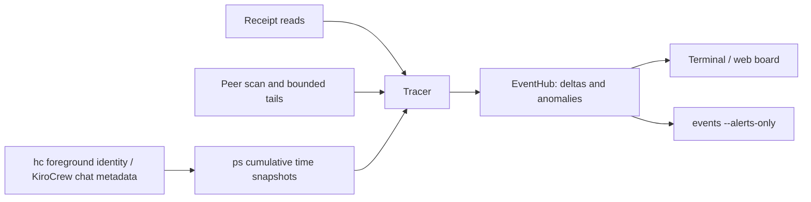

# Tune the alerts for stuck, hung and hot workers

The bridge watches each worker and raises one of five anomaly flags when something looks wrong: `hung`,
`stuck`, `undelivered`, `orphan` or `hot`. It also notices provider rate limits and holds dispatch to a
throttled account. This page tells you what raises each flag, how to change the thresholds and how to
look closer at one worker for a while.

It is for someone who already follows the event stream ([EVENTS.md](EVENTS.md)) and wants fewer false
alarms or earlier ones.

## See the current state

```sh
answerback pressure
answerback events --alerts-only --sse
```

Real output of the first command on a machine with no rate-limit signal (an empty value prints as `—`):

```text
account                   level  held  until     last signal
bedrock:default               0  no    —         —
kiro:default                  0  no    —         —
enabled True; base 60 s, cap 480 s, clean window 600 s (events.json pressure)
```

Level 0 and `held no` for both accounts means dispatch waits for neither. The second command prints
nothing until an anomaly, a rate-limit signal or an overdue decision arrives, and then one SSE frame each.

## How the tracer works

Every `scan_seconds` (15 seconds by default) the bridge samples each worker's state, a bounded tail of its
terminal and its foreground process tree, also when no viewer is connected. It publishes `CUSTOM` events
named `answerback.anomaly` and updates `peers/<id>/metrics` and `peers/<id>/trace` with `STATE_DELTA`.

The tracer only observes. It never changes a receipt, sends input, signals a worker or runs
`routing.json`'s `lifecycle.hung_action`; lifecycle handling belongs to [ROUTING.md](ROUTING.md).



*What the tracer reads and where its findings go. Nothing flows back to a worker.*

| Flag | Raised when |
| --- | --- |
| `hung` | a receipt has been `submitted` for longer than `hung_seconds`, whatever the peer's state, also if the peer disappeared |
| `stuck` | a receipt is `submitted`, its peer reads working, the run is older than `stuck_seconds`, and the activity tail stays unchanged over repeated samples |
| `undelivered` | a receipt older than `undelivered_seconds` is `pending` or `submitted` while its peer reads idle or done |
| `orphan` | a peer stays working for `orphan_seconds` with no open receipt |
| `hot` | the worker's process tree is over `cpu_percent` for `cpu_seconds`, over `rss_bytes`, or has more than `children` descendants |

## Settings

Put an optional `tracing` object in `events.json` beside the bridge config. It is read when the bridge
starts. Every key is optional, and invalid settings fall back to the defaults and show as
`bridge.sourceErrors.settings`.

```json
{
  "scan_seconds": 15,
  "tracing": {
    "stuck_seconds": 600,
    "hung_seconds": 3600,
    "cpu_percent": 80,
    "cpu_seconds": 300,
    "rss_bytes": 4294967296,
    "children": 20
  }
}
```

The keys below sit inside `tracing`. Anomaly messages use their full names.

| Key | Default | Meaning |
| --- | ---: | --- |
| `enabled` | `true` | Detection, resources, timelines and scans without a viewer |
| `stuck_seconds` | `600` | Age of a submitted run on a working peer before unchanged activity counts as stuck |
| `hung_seconds` | `3600` | Submitted age, whatever the peer's state |
| `undelivered_seconds` | `30` | Receipt age before `pending`/`submitted` with an idle or done peer is suspect |
| `orphan_seconds` | `30` | Time working without an open receipt |
| `cpu_percent` | `80` | Sum of CPU percentages of comparable pids; can exceed 100 on several cores |
| `cpu_seconds` | `300` | How long CPU must stay over the threshold |
| `rss_bytes` | `4294967296` | Sum of resident bytes of the foreground tree (4 GiB) |
| `children` | `20` | All descendants, not counting the foreground root |
| `confirm_samples` | `2` | Consecutive suspect samples to raise an alert; 2 to 100 |
| `recovery_samples` | `2` | Consecutive healthy samples to clear and rearm, except stuck; 1 to 100 |
| `max_sample_gap_seconds` | `45` | A longer gap breaks continuous durations, confirmation and CPU deltas |
| `source_timeout_seconds` | `5` | Deadline per tail or identity probe and per ps read; at most 60 |
| `probe_concurrency` | `8` | Concurrent identity and tail probes; 1 to 32 |
| `timeline_limit` | `64` | State transitions kept per current peer; 1 to 1000 |
| `tail_bytes` | `8192` | Largest terminal suffix hashed; 256 to 65536 |

Thresholds are strict `>` comparisons, and durations and counts also need sample confirmation. A slow,
unavailable or failed sample breaks continuity, and unknown data never proves recovery. If you raise
`scan_seconds`, raise `max_sample_gap_seconds` with it. Source latency can stretch a pass: these are
observation intervals, not real-time deadlines.

### When stuck starts and clears

The stuck guard starts at the observed submitted time. At bridge start that is the receipt's last update
time, since the store keeps no submission time, so the age can be underestimated. Model text changes the
activity hash but never resets the guard's age. Changing text alone cannot confirm stuck; the hung guard
still applies.

A stuck alert stays latched until the receipt closes. A decision file, including an `answered_by` line that
names the OS login, is advisory and never clears it. The `human_aliases` setting is still accepted for
existing configurations and has no effect.

## Provider pressure

The bridge senses provider rate limits where it already holds text:

- the terminal screen it reads for an open run or a working peer (`hc` terminals only);
- the evidence of a native CLI turn (Claude `api_error_status` and `errors`, Codex `error`);
- the text of a reviewed `BridgeError` that ended a turn;
- the answer of a Kiro ACP turn: any signature when the turn did not end normally, and Kiro's own limiter
  message when it is nearly the whole answer, at most 1000 characters.

Each line is matched on its first 400 characters against one versioned table (`SIGNATURES_V1` in
`pressure/signatures.py`):

| Signature | Matches | Account |
| --- | --- | --- |
| `kiro.rate_limit` | `faster than your rate limit`, `run fewer sessions at the same time` (Kiro, Crew or unknown terminals) | `kiro` |
| `mantle.stream_error` | `stream error (invalid_request_error): Mantle` (Claude, Codex, Grok or unknown) | `bedrock` |
| `bedrock.throttling` | `ThrottlingException`, `TooManyRequestsException` | the harness's |
| `bedrock.http_429` | `429` as a word, only with `status`, `HTTP`, `error` or `too many` on the line; or `api_error_status` 429 | the harness's |
| `codex.rate_limit` | `rate_limit`, `rate limit`, `rate limited` (Codex only) | `bedrock` |

"The harness's" account is `kiro` for Kiro and Crew and `bedrock` for Claude, Codex and Grok. A line that
appears verbatim in the receipt's brief never counts, so a brief that quotes a signature does not pause
dispatch. Matching keeps no text, only the class and a SHA-256 of the line, so an unchanged screen line
counts once.

### Levels and holds

Each `(provider, account_hint)` pair has a level and a hold, kept in `pressure.sqlite` beside
`tasks.sqlite` (mode 0600, a symlink is refused, survives a restart). A signal while the account is held
raises the level by one. A signal after the hold ended keeps the level. The hold is
`min(cap_seconds, base_seconds * 2**(level-1))` from the signal: 60, 120, 240, 480, 480 seconds with the
defaults.

With no signal for `clean_seconds` and the hold over, the level drops one step, and at level 0 the hold is
cleared. The hold runs on the monotonic clock. After a restart the rest of it is rebased from the stored
wall time and never exceeds one capped delay, so a wall-clock jump cannot lengthen it.

Put an optional `pressure` object in `events.json`. Unknown keys are refused, as in `tracing`.

```json
{"pressure": {"enabled": true, "base_seconds": 60, "cap_seconds": 480, "clean_seconds": 600,
  "notice": "Provider under rate pressure: fewer, larger tool calls; no parallel sub-agents.",
  "providers": {"kiro": {"account_hint": "default"}, "bedrock": {"account_hint": "default"}}}}
```

| Key | Default | Meaning |
| --- | ---: | --- |
| `enabled` | `true` | `false` records no signal; every account stays at level 0 |
| `base_seconds` | `60` | Hold at level 1; 1 to 3600 |
| `cap_seconds` | `480` | Longest hold; 1 to 86400, not below `base_seconds` |
| `clean_seconds` | `600` | Signal-free time per step down; 30 to 86400 |
| `notice` | the line above | One printable line (1 to 200 characters) that dispatch prepends to a brief |
| `providers.<kiro\|bedrock>.account_hint` | `default` | A label for the account, 1 to 64 of `A-Za-z0-9_.-`; never a credential |
| `providers.<kiro\|bedrock>.base_seconds`, `.cap_seconds` | the top-level values | Per-provider overrides |

`answerback pressure` prints the table shown at the top. `answerback pressure --json` prints the
`pressure_status` answer: the snapshot with `held` and `retry_after_s` per account, the effective settings
and the last 20 signal records, class only. `answerback pressure --clear kiro [--account HINT]` is the
operator override: the account goes to level 0 at once. Only `kiro` and `bedrock` are accepted. What
dispatch does during a hold is in [RECIPIENTS.md](RECIPIENTS.md#provider-backoff).

## Resource and token sources

`ps(1)` is the default sampler, also when psutil is installed. `psutil` is optional in the
`answerback[debug]` extra and is used only for manual debug scopes.

For an `hc` terminal the tracer reads `foreground.pid` only for a local, live, recognised foreground whose
binding still matches the peer scan. For KiroCrew it uses the gateway's chat detail `process.pid` only when
given; the shared gateway parent is never attributed to a chat. PIDs stay inside the sampler and never
enter board state.

On macOS and Linux one `ps -A -o pid=,ppid=,time=,rss=,lstart=` snapshot supplies the process forest. CPU
is the difference in cumulative CPU time between snapshots, and RSS is converted from KiB to bytes. CPU is
`null` on the first sample, when no selected pid is comparable with the previous snapshot, or when the gap
is outside (0, `max_sample_gap_seconds`]. A pid is comparable when it was there before with the same
`lstart` and a cumulative CPU time that did not go down. New, restarted and backwards-counting pids are left
out of that interval's CPU, while `rssBytes` and `children` still cover the whole tree.

These are estimates. Processes that exit between samples are lost, RSS sums can count shared pages twice,
`lstart` has one-second resolution, and the `hc` identity and the process table are not read atomically. A
ps read that times out stays single-flight until it exits; its late output is discarded and no signal is
sent. Missing PIDs, unsupported output or failed probes give `null`.

Tokens are optional. KiroCrew `turn_stats` gives them when it has a non-negative integer `total_tokens`, or
both `input_tokens` and `output_tokens`; a list is summed only when every entry is complete. The count
describes the stats returned, and does not show that a run's lifetime billing is complete. Otherwise
`metrics.tokens` is `null`, with no warning. There is no cost cap. An opt-in LiteLLM `spend_logs` source is
an extension hook at `Sources.resources`; no database, gateway or credential is discovered for you.

## Manual debug

To watch one worker more closely for a while, turn on a debug scope:

```sh
answerback debug on hc:t61                     # default: 10 minutes
answerback debug on <task-id> --for 10m        # resolves the receipt's peer
answerback debug on all --for 60m              # hard maximum: 60 minutes
answerback debug status                        # scopes, UTC deadlines, drawer path
answerback debug off hc:t61                    # also excludes this peer from "all"
answerback debug off                           # end every scope
```

A selected peer gets resource samples every 2 seconds (through psutil when it can be imported, else ps) and
activity-tail reads every 5 seconds; other peers keep `scan_seconds`. Debug also samples an idle selected
peer. It works without a board viewer and with anomaly detection off, but `events.enabled` must be true.
Both boards mark selected peers and runs **DEBUG**.

### Scopes

`--for` takes positive whole minutes (`10m`) or seconds (`30s`), up to `60m` or `3600s`. A scope is checked
in this order:

1. A bridge receipt ID or exact request key names that receipt, even one that looks like an address
   (`kiro:debug1`).
2. `all` always keeps its keyword meaning. It covers current and newly discovered peers whose address names
   no other machine.
3. Anything else must be a local `provider:peer` address.

Machine-prefixed addresses are refused until node ownership routing exists. Only Herdr Core names a machine,
as `<machine>/<terminal>`, so the refused forms are `hc:node1/t61`, the receipt target Core stores for such a
terminal (`hc:<session>:node1/t61`) whether typed or reached through its receipt, a provider part that
holds `/` or `@`, and an `hc:` terminal part with an `@` (`hc:t61@node1`). A `/` or `@` anywhere else names
no machine: in a Crew key (`crew:team/alpha`, `crew:ops@night`), in a Core session name before a local
terminal (`hc:team/alpha:t61`), in a receipt target's path (`kiro:work:/tmp/me@corp`), and in a Rex
terminal id (`rex:terminal:<session>/<block>`).

A receipt's own stored target is trusted. It is not refused for holding a space in its path or running past
256 characters. Such a local target is refused only when it is not a `provider:peer` address at all, or is
longer than 8,192 characters (`Debug scope is longer than 8192 characters`). That number is a chosen limit
on what is stored, not the length of the longest target: a Herdr target takes its terminal id without a
length bound, and one past the limit gets no lease.

A typed scope must pass a stricter rule: its provider is one of the bridge's built-in providers, every
character is printable, it holds no whitespace, and it is at most 256 characters long. `debug status`
prints each scope as stored, so a stored scope that fails this rule (a space or a zero-width space in its
path, more than 256 characters, a provider the bridge no longer recognises) cannot be typed back. Grant or
remove such a lease by its receipt ID or request key, or end every lease with a plain `debug off`.

`debug on` is never refused because of the peer scan, which is a capped board projection and not a record
of what exists. A scope counts as observed when it is in the current peer list or a retained receipt names
it as target or peer, so a scope reached through a receipt is always observed. Otherwise the answer carries
`observed: false` and a warning that the list can be incomplete, and the lease still takes effect if a run
of that peer appears. `debug status` computes `observed` afresh for each lease; `all` has none. The copy of
the debug status in the event stream drops `observed` at the next poll and never holds the warning.

### Leases

The command reports an absolute UTC deadline, kept in `<config-directory>/runtime/debug/leases.json`. A
restart keeps only unexpired leases and grants no new time. Manual off, expiry and a malformed saved file
can never leave a flag on indefinitely. The scheduler checks deadlines at most one second apart, and a debug
result that arrives after its lease expired is discarded.

At start the file must be an object with exactly the keys `leases` and `excluded`. `leases` holds at most
200 scopes, each with exactly the finite numbers `started` and `until`, a start not in the future and a
length of at most 60 minutes. `excluded` is a list of at most 200 scopes. Any other file, including one
that cannot be parsed or is nested too deeply, starts the bridge with no lease and no exclusion and names
the error class in `debug status` (`ValueError` for a wrong shape). The file is not rewritten at start; the
next accepted `debug on` or `debug off` saves over it. The check is of shape: whole numbers, exclusions in
any order or repeated, and a key written twice (the last one counts) load too.

### The debug drawer

The drawer is local evidence at `<config-directory>/runtime/debug/trace.ndjson`, with the older segment at
`trace.1.ndjson`; `debug status` prints the actual path. Each segment holds at most 4 MiB (8 MiB in all),
files are mode 0600 in a mode 0700 directory, and rotation drops the oldest segment. An oversized event is
left out and reported in the `error` field of `debug status`. Write failures show there without stopping
dispatch. Admission limits are in [EVENTS.md](EVENTS.md#debug-drawer-admission).

Each NDJSON record has `id`, `peerIds`, `runIds` and `event`. The drawer records a scoped state baseline,
state changes, activity digests, lifecycle and anomaly events, and `RAW` bus events attributable to the
scope. It starts when enabled, cannot rebuild earlier events, and rotation can remove the start of a long
trace. To read one run from the retained window:

```sh
cat <runtime>/debug/trace.1.ndjson <runtime>/debug/trace.ndjson |
  jq --arg run '<task-id>' 'select(.runIds | index($run))'
```

`RAW` is an event type, never a way around redaction. The drawer receives the projected stream, in which
screen and chat text are already replaced by a SHA-256, counts and times. Bus events pass the same field
allowlist again, so payload, prompt, result, screen, environment and tool-output fields are left out, and
bus events that cannot be attributed are dropped. State patches are recomputed from the selected peers and
runs only. The event HTTP endpoints stay read-only; debug controls use the local command socket.

## Board and alerts

Both boards show tokens, CPU %, RSS MiB, children, the time in the current state and the current anomaly
reasons. The terminal board also prints recent guard messages in full, and the web table shows them as text.
Unknown values show as a dash. When the state has a `pressure` section the terminal board adds a PRESSURE
table (account, level, until, last signal) and lists each `answerback.provider_throttled` under ALERTS.

The stream carries a bounded `trace.timeline` of `{state, sinceMs}` transitions, the current
`activityHash`, `sampledMs`, `fresh` and active `anomalies`. Tracer state is in memory and restarts with the
bridge.

`answerback events --alerts-only` selects only fresh `answerback.anomaly`, `answerback.provider_throttled`
and `RUN_FINISHED` interrupt events, and skips replayed ones. `--count` counts matching alerts and `--after`
resumes from a saved cursor. On a resync, old alerts are skipped on purpose; read the board snapshot to
reconcile. `--alerts-only` cannot be combined with `--run` or `--serve`.

An anomaly value has `reason`, `peerId`, `runId`, `observed`, `threshold`, `configKey`, `sinceMs` and
`message`, and its metadata links run, thread and peer. One event is emitted per active guard episode.
Different `hot` guards can each emit one, naming the resource threshold.

## What it cannot do yet

- Nothing acts on an alert. The alert feed is input for an external consumer, such as a Slack DM bot that
  you run; it sends no message and configures no destination.
- A stuck alert cannot be acknowledged by a person. There is no authenticated acknowledgement path yet, so
  only the run's end clears it.
- A Rex terminal is not checked for its host. Its id does not say which host it is on, and the debug toggle
  does not read the Rex inventory. A Rex terminal shown with `local: false` therefore gets a lease, is
  selected by `all` and can be excluded. It reads nothing remote: a Rex read of a terminal on another host is
  refused with `Rex terminal lacks local bounded-read capability`.
- The lease file is read and parsed whole before its limits apply; the read has no byte budget yet.
- Debug scopes for terminals on other machines are refused.
- There is no dollar cap, and token counts come only from KiroCrew.

## See also

- [EVENTS.md](EVENTS.md): the stream these flags travel on, and its privacy rules.
- [RECIPIENTS.md](RECIPIENTS.md#provider-backoff): what dispatch does while an account is held.
- [ROUTING.md](ROUTING.md): lifecycle actions for hung workers, which the tracer never takes.
- [CAPACITY.md](CAPACITY.md): load and memory per machine, as opposed to per worker.
