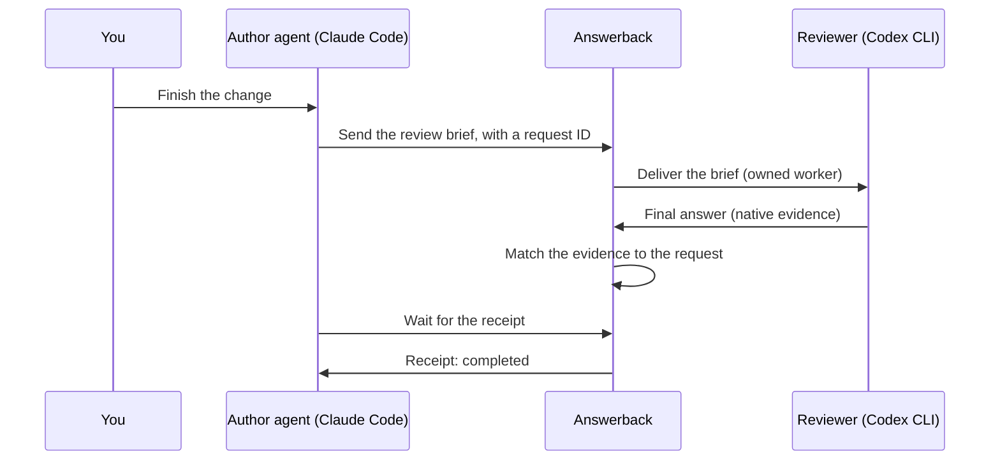

# What people do with Answerback

Seven situations a developer running more than one coding agent meets in an ordinary week, the
commands for each, and what comes back. Each scenario ends with its limits and with what the
project's own record shows.

This page is for someone deciding whether the tool fits. Every scenario assumes a bridge that is
installed, configured and started ([Install the bridge](GETTING-STARTED.md)), and names what else
it needs. A harness is the CLI or app an agent runs in: Claude Code, Codex CLI, Grok Build or
Kiro CLI.

## Get an independent review from a different agent

Today, "review" means pasting a diff out of one agent's chat into another by hand, and nothing
stops the same agent reviewing its own work.

Needs: a second harness, installed and logged in, that the bridge can run as an owned worker
(Codex CLI here). A second session of the harness you already use also works, but then the
reviewer is the same model as the author.

**What you type**

A review brief is a plain-text file: what changed, and what to check. `--message-file` sends it
as the task's message.

```sh
answerback workspace add reviewer --provider codex_cli --cwd /absolute/path/to/project
answerback send codex_cli:reviewer --request-id review-42 --message-file review-brief.md
answerback task --peer codex_cli:reviewer --wait 30
```

`--wait` takes 1 to 30 seconds. If the receipt is still open when the wait ends (exit code `3`),
run the same `task` command again.

An agent does this over MCP: `peer_search(query)` finds the reviewer,
`peer_submit(selector, message, request_id)` delivers the work, and `task_wait(task_id, seconds)`
collects the receipt. An owned worker has no binding, so none is passed.



*One hand-off, in which the author sends the brief, the bridge drives a separate reviewer session
and matches its final answer to the request; the message texts are examples.*

**With a routing policy (Herdr App/core)**

With Herdr App/core and a routing policy file (default `./status/routing.json` in your project),
`route` can pick the reviewer instead of a registered alias:

```sh
answerback route review-brief.md --task <task-id> --author claude --dry-run
answerback route review-brief.md --task <task-id> --author claude
```

`--author` names the harness that wrote the change. `route` counts keywords against the policy
file and picks a different, idle or newly created Herdr App/core terminal, never the author. It
needs the Herdr App and never touches the owned worker registered above
([Routing](ROUTING.md)).

**What you get**

A receipt that reads `completed` only once the reviewer's own final answer matches the request.
`task --wait` exits `0` only for a completed receipt, `2` if the worker waits for a permission,
`3` if the wait ran out and `1` otherwise ([Receipts](RECEIPTS.md)). Trimmed to three fields:

```json
{
  "request_key": "review-42",
  "status": "completed",
  "result": "<the review text>"
}
```

The printed receipt never includes the brief you sent.

**Limits**

`completed` requires the reviewer's own matching evidence, not an idle screen or a plausible
reply ([Which worker for what](HARNESSES.md)). A receipt does not show that the review is right.

In this project's record: this is how it reviews its own changes
([the record below](#in-this-projects-own-record)).

## Ask your own agent to delegate

Finding who else is free, picking one and tracking the reply by hand is the copy-paste relay
this tool exists to remove, and there is no way to do it from inside a chat.

Needs: a client with its own harness installed and logged in (Codex CLI here).

**What you type**

Install the bridge's MCP connection and the two bundled skills once per client
([Connect a client](CLIENT-SETUP.md) has every client and its reload step):

```sh
answerback clients install --client codex --apply
answerback skill install --client codex --apply
```

Then open a project chat and say:

> Use answerback-collaboration for /absolute/path/to/project. Reuse the configured Answerback
> connection, find the current project's agents across providers, and delegate the requested
> work to the appropriate available peers.

Your agent calls `peer_search(query)` to find candidates across providers,
`peer_submit(selector, message, request_id, binding)` (or `bus_submit` on a configured bus) to
hand off the task, then `task_wait(task_id, seconds)` or `task_get(task_id)` for the receipt.

**What you get**

The same receipt as the first scenario, back inside the chat that asked for it.

**Limits**

Discovery is not authorisation. The bridge's own instructions to every connected agent say to
send work only when a person has authorised it, and the collaboration skill repeats it. This
works only once the client has reloaded, or started a new session, after the connection and the
skills are installed.

In this project's record: by design. The prompt above is the one the skill documents; no dated
log records a person running it this way.

## See what every agent is doing

With agents in separate windows there is no one place to see "started, changed, finished": you
poll each window by hand and miss the one that stalled.

Needs: nothing beyond the installed bridge.

**What you type**

```sh
answerback events --count 1                 # one snapshot: runs, peers, decisions, heads
answerback events --sse --run <task-id>     # one run's lifecycle, live
answerback bus monitor --board --once       # the board as terminal tables
answerback bus monitor --web                # the dashboard, on a private 127.0.0.1 address
answerback events --alerts-only --sse       # anomalies only, for an external alert feed
answerback debug on <peer-id> --for 10m     # closer look: 2 s and 5 s sampling, 10-minute lease
answerback debug status
answerback debug off
```

**What you get**

IDs, states, peer names, project paths and a SHA-256 digest of each worker's terminal tail;
never prompt, result or screen text. This is the bridge's observe-only AG-UI stream (an open
event format for agent activity): the board, the dashboard and `answerback events` are views
over it. Five detectors (stuck, hung, undelivered, orphan, hot) publish `answerback.anomaly`
events once confirmed.

**Limits**

Observe-only: nothing on this stream accepts a command ([Events](EVENTS.md)); work still goes
through `peer_submit` or `bus_submit`. The board needs no bus; the dashboard's other panels
report on the optional bus and show "Bus not configured" or "Ledger unavailable" without one
([Agent bus](AGENT-BUS.md#live-monitor)). The scan runs every 15 seconds, so a change can take
that long to show; `debug on` tightens it to 2-second and 5-second sampling for at most 60
minutes per scope.

In this project's record: by design, covered by the test suite. The event stream and the tracer
shipped in the 0.12 line ([CHANGELOG.md](../CHANGELOG.md)); no dated log shows an alert raised
during real work. The worker that ran unseen for about forty minutes
([below](#in-this-projects-own-record)) was fixed by changing where its terminal opens, not by
this tracer.

## Hand off work that must survive a restart

If the producer, the broker or the coordinator dies mid hand-off, you cannot tell whether the
message arrived, and resending blind risks running the task twice.

Needs: the `bus` extra in the installed tool, and a `nats-server` binary.

**What you type**

```sh
brew install nats-server
answerback stop                  # only if the bridge is running: the next line replaces its environment
uv tool install '.[bus]'         # from the source tree; with Claude Code too: '.[claude,bus]'
agent-bus configure --server /opt/homebrew/bin/nats-server
agent-bus start                  # starts the broker, then the bridge
agent-bus submit <peer-id> --project /absolute/path/to/project \
  --message-file /absolute/path/to/authorised-assignment.txt \
  --request-id review-42 --ttl 3600
agent-bus result <command-id>    # command-id is what submit returned
agent-bus events --after 0 --limit 50
```

Each `uv tool install` replaces the earlier set of extras, so name every extra you use in one
command: `'.[bus]'` on its own removes the `claude` extra
([Install and enable](AGENT-BUS.md#install-and-enable)). Over MCP the same thing is
`bus_submit(peer_id, project, message, request_id, ttl_seconds)` then `bus_result(command_id)`.

**What you get**

A command receipt with its own delivery state (`queued`, `dispatching`, `bound`, `rejected`,
`expired`, `cancelled`, `uncertain`), kept separate from the task receipt: `delivery: "bound"`
means only that a provider accepted the command, and `task.status` answers whether the recipient
finished ([Receipts](RECEIPTS.md#two-receipts-on-the-bus)).

**Limits**

One machine, one coordinator, one loopback-bound NATS broker. Reusing a `request_id` with
different content, recipient or TTL is refused rather than resubmitted; on restart, an in-flight
claim is reconciled by its request key and never re-sent ([Agent bus](AGENT-BUS.md)).

In this project's record: by design, covered by the test suite. Scripted Codex and Kiro round
trips exercise broker restart, an offline producer and coordinator, lost publish and crash
recovery together, but never submit work to a live model, so no live run of this path is
recorded.

## Move a stuck task to another agent

Normally a stalled agent means retyping the whole brief in a different window, with no record
that the first attempt happened or why it stopped.

Needs: a second harness, installed and logged in, that you can retarget work to (Grok Build here).

**What you type**

Find and inspect the stuck receipt before doing anything to it:

```sh
answerback events --alerts-only --sse     # or the board: a stuck or hung anomaly
answerback tasks "fanout-fix" --limit 10   # find the receipt by request ID or project
answerback task <task-id>                 # status, detail and target
```

If the task is on a live owned worker (`codex_cli`, `claude_code`, `grok` or `kiro`) and you
want to stop it, request native cancellation. Only a matching native cancelled or interrupted
event confirms it stopped ([Owned native CLI workers](NATIVE-CLI.md#permissions-and-result-evidence)):

```sh
answerback cancel <task-id>
```

If the receipt is `uncertain`, and the recipient's own terminal or chat confirms the earlier work
has settled, release it instead. `abandon` refuses a still-live owned worker; it frees the
recipient and keeps the old outcome in an audit record:

```sh
answerback abandon <task-id> --reason "<what you verified>"
```

Either way, retarget the brief to a different harness:

```sh
answerback workspace add fixer --provider grok --cwd /absolute/path/to/worktree
answerback send grok:fixer --request-id fanout-fix-1-retry --message-file brief.md
answerback task --peer grok:fixer --wait 30
```

**What you get**

A fresh receipt on the new harness. The old receipt is never re-sent or merged into it: a person
decides to retarget, and the first attempt stays on record.

**Limits**

This is a manual reroute, not automatic failover. Claude Code and Grok workers start a new
session for every task, so no conversational memory carries over; a Codex CLI worker may resume
its own earlier session ([Owned native CLI workers](NATIVE-CLI.md#provider-boundaries)).

In this project's record: exercised. A fix round for the event-stream feature failed repeatedly
on one harness with provider errors, and the orchestrating agent rerouted the same brief to a
different harness, which finished it ([below](#in-this-projects-own-record)).

## Let a policy file choose the agent

Without a written policy, routing decisions live in one person's head, and a new teammate, human
or agent, has no way to know which harness takes a port fix and which a doc edit.

Needs: Herdr App/core and a routing policy file (default `./status/routing.json` in your project).
`port-fix` below is an example class from such a file, not a fixed value.

**What you type**

```sh
answerback route brief.md --task <task-id> --dry-run                   # preview only, changes nothing
answerback route brief.md --task <task-id>                             # exits 1 on refused, failed, uncertain or needs_selection
answerback route brief.md --task <task-id> --class port-fix --lane b   # force a class when keywords tie or miss
answerback workers list
answerback workers gc            # preview
answerback workers gc --apply    # tear down what the preview listed
```

**What you get**

One `peer_submit` under the policy's request-ID pattern, with a `Routed: <class> ->
<harness>/<model>, <reason>` line prepended to the brief. `workers list` shows each managed
worker (a Herdr App tab that `route` created) with its receipt and a gc verdict; `gc --apply`
removes only workers it created, never a terminal a person opened.

**Limits**

Classification is plain keyword counting against the policy file; no model is consulted. Workers
are created and removed on this machine only. KiroCrew chats are never created or removed here.
A gate cap can refuse a new route while too many heavy check runs are outstanding. `route` never
dispatches to an owned worker ([Routing](ROUTING.md)).

An idle terminal on another machine can be reused when that machine is listed in
`hc_send_machines`, except for a gated class. That setting is Experimental and off by default,
and a remote result is qualified for Linux with Codex CLI only ([Harnesses](HARNESSES.md)).

In this project's record: covered by the test suite (classify, pick, create when none is idle,
refuse at capacity, gc) and one scripted route-to-receipt-to-gc run; no dated log shows it used
for day-to-day work after it merged.

## Run several tasks at once

Queuing unrelated tasks one at a time through a single chat wastes the time the first agent
spends thinking while the rest sit idle.

Needs: the harnesses you fan out to, installed and logged in (Codex CLI, Claude Code and Grok
Build here).

**What you type**

```sh
answerback workspace add codex-a --provider codex_cli --cwd /absolute/path/to/project
answerback workspace add claude-a --provider claude_code --cwd /absolute/path/to/project   # needs the "claude" extra
answerback workspace add grok-a --provider grok --cwd /absolute/path/to/project

answerback send codex_cli:codex-a --request-id fanout-1 --message-file task-1.md
answerback send claude_code:claude-a --request-id fanout-2 --message-file task-2.md
answerback send grok:grok-a --request-id fanout-3 --message-file task-3.md

answerback tasks "fanout" --limit 10
answerback task <each-task-id> --wait 30
```

**What you get**

Three receipts, each `completed` only on its own harness's matching final answer; a stuck one does
not block the other two.

**Limits**

Claude Code and Grok workers start a new session for every task, and none share memory; a Codex
CLI worker may resume its own earlier session. This is manual fan-out: no single call sends one
brief to several harnesses, and one `send` addresses one peer. The closest built-in mechanism is
`route`'s class-based worker pool, which picks one harness per class.

In this project's record: by design. Each step above is verified on its own; no dated log shows
three unrelated sends run at once this way.

## In this project's own record

These episodes are from the project's own history. The record is the project's private task
ledger and its hand-off notes, which are not in the public repository; no committed record is
linked here.

**The event stream that failed review twice before it merged.** An agent running Claude Code in a
Herdr App/core terminal, reached through the `hc` route, wrote this project's observe-only event
stream. A review by an agent running Codex CLI, another vendor's model that had written none of
it, failed it with six blocking findings. A fix round followed, and a second review failed again.

When the Claude Code agent kept hitting provider errors, the orchestrating agent moved the
remaining fixes to Codex CLI, which finished them. A third, independent review passed, the gate
ran clean, and only then was the change merged. Nobody carried a diff between terminals to get
those reviews: each was one hand-off, with a receipt.

**The routing feature, reviewed twice by the same independent model.** One agent (Codex), also
reached through the `hc` route, wrote the routing feature; a different vendor's model (Grok)
reviewed it and failed it with two blocking findings, five should-fix and one nit. The findings
were fixed and the same reviewer's re-review passed. The rule behind both stories is a line in
the project's routing policy: a review goes to the harness that did not write the change, because
independence beats skill match.

**One worker ran unseen for about forty minutes.** While the routing feature was under test, a
worker's terminal carried no label the host App could see, so it ran unnoticed for about forty
minutes. The fix was placement: a managed worker now opens as a named tab in the project's App
space, so it shows in the sidebar while it runs.

**The clean-container run that found what the local gate could not.** The offline test policy
passed on one machine because part of the suite depended on a program already installed there.
The same policy in a clean container surfaced 39 failures the local run could not see, and then
two cross-platform bugs: one in how an orphaned process is cleaned up, one in how a closed
network port is reported. The container run is the `check` job in
[`ci.yml`](../.github/workflows/ci.yml).

## What has not been shown

The project set itself a harder test than anything above, the Worktree Guard scenario: five
coding-agent CLIs (Kiro CLI, KiroCrew, Codex CLI, Claude Code and Grok Build), each assigned one
module of a small real program, review each other a fixed twenty times with literal evidence,
accepted only once an independent process verifies the delivered, installed package. Its one
recorded attempt, CLI-1, is `FAILED_INCOMPLETE`: a hook that fires when a Claude Code task starts
failed for good, so that task ended without the required finish-and-result exchange; the observer
on the Codex CLI agent failed at its 30-minute budget while the model kept running; and Kiro's
consent handling did not preserve more than one approval round
([what broke](WORKTREE-GUARD-SCENARIO.md#cli-1-result-and-retained-limitations)).

That result does not touch the seven scenarios above: none of them needs five agents to deliver
one shared package end to end. Single hand-offs with a receipt, on one machine, are what works.
Full record: [VALIDATION.md](../VALIDATION.md).

Answerback is also a one-machine, one-OS-user tool: one bridge, one bus coordinator, no remote
submission API. The service has run on macOS; the Linux systemd unit is generated and tested, with
no live run on record. Any local socket client may call `task_complete` with its identity
unchecked, on the routes where the recipient reports its own result (Herdr App/core, the older
TUI, KiroCrew): the OS user is the trust boundary, and a per-task completion secret is not
implemented ([SECURITY.md](../SECURITY.md)).

## See also

- [Install the bridge](GETTING-STARTED.md): the bridge every scenario assumes.
- [Receipts](RECEIPTS.md): the states and exit codes the scenarios branch on.
- [Connect a client](CLIENT-SETUP.md): the MCP connection and the skills.
- [Owned native CLI workers](NATIVE-CLI.md): workers, exit codes, permissions.
- [Routing](ROUTING.md): the policy file behind `route`, and what it never does.
