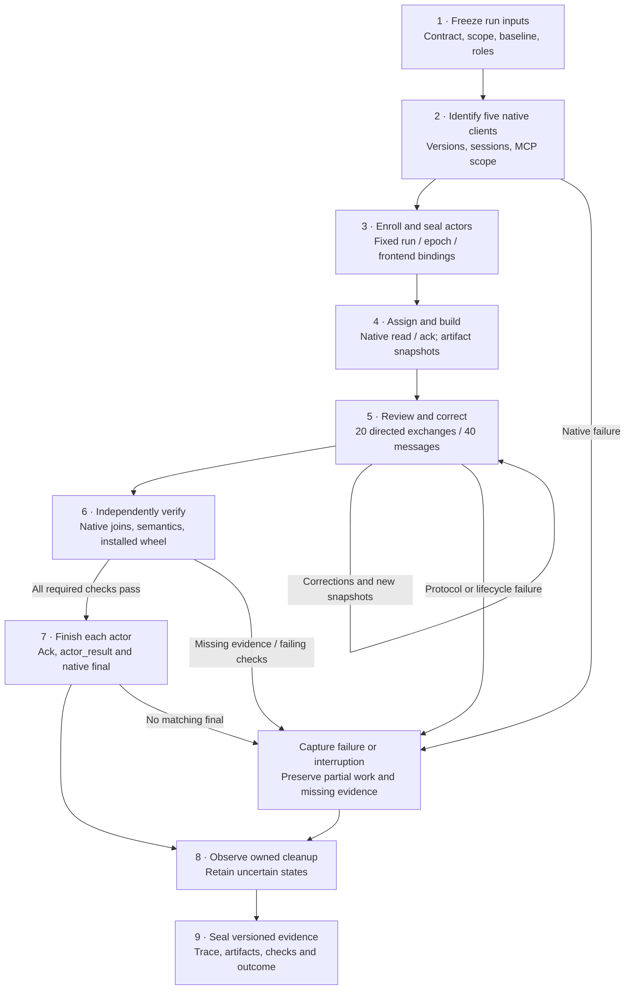
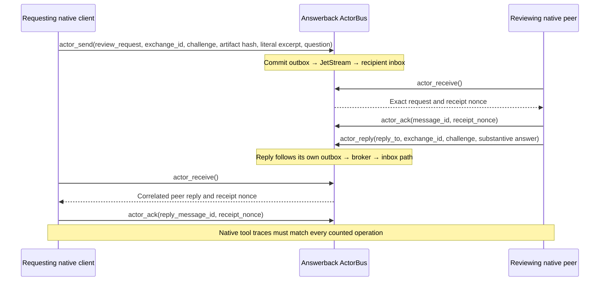

# Worktree Guard: the five-client acceptance project and its one attempt

Five CLI clients of different kinds build one installable Python package, review each other's
work through Answerback, and deliver it together, with every peer review traceable to a native
tool call. That is the acceptance bar for "several agents deliver one package", and the one
attempt to date, CLI-1, ended **`FAILED_INCOMPLETE`**. The specification and the record of that
attempt follow; the failed run stays a failed run.

It is for a maintainer planning or reviewing a full multi-agent acceptance run. Have
[the test layers](TESTING-HARNESSES.md#choose-a-test-layer) and
[actor messaging](ACTOR-MESSAGES.md) first; this is not a step in the first hour with the tool.

**Worktree Guard is an installable, read-only Git worktree auditor.** The scenario tests a concrete
failure: two checkouts can point at the same commit while one still holds uncommitted, untracked,
ignored or nested-repository work. Matching branch commits alone must never make that worktree
eligible for cleanup.

In short, three things broke in CLI-1. A hook that fires when a Claude Code task starts failed for
good, so that task ended without the required finish-and-result exchange. The observer on the Codex
CLI agent failed at its 30-minute budget while the model kept running. Kiro's consent handling did
not preserve more than one approval round.

The full account is under
[CLI-1 result and retained limitations](#cli-1-result-and-retained-limitations). Partial code and
evidence are retained.

## The project each client delivers

| Participant | Owned module | Contribution |
| --- | --- | --- |
| Kiro CLI | `src/worktree_guard/git_io.py` | Run bounded, read-only Git commands using argument arrays; preserve errors and truncation. |
| KiroCrew | `src/worktree_guard/status.py` | Parse porcelain v1 `-z` bytes, including ignored entries, renames, Unicode and whitespace. |
| Codex CLI | `src/worktree_guard/discover.py` | Resolve worktree/Git/common-repository identity, inspect status and nested repositories, and detect changes during inspection. |
| Claude Code | `src/worktree_guard/policy.py` | Pure decision function returning `keep` unless a complete clean observation has matching integration evidence. |
| Grok Build CLI | `src/worktree_guard/cli.py` | Provide the installed `worktree-guard` command, human output and the exact JSON contract. |

Each participant owns only its assigned module and optional
`tests/test_<module>.py`. Shared records come from `worktree_guard.model`.
Interface changes must be requested through project messages.

The coordinator owns `CONTRACT.md`, `LIVE_PROTOCOL.md`, the fixed roster,
`model.py`, package scaffolding, integration, independent acceptance checks
and `docs/operator-guide.md`. It also owns integration of the inherited
`evidence.py` validator. That validator retains its earlier Codex Desktop
authorship; using it in this CLI run earns no new participant credit. Unchanged
inherited modules must likewise be credited as validation or correction, rather
than fresh authorship.

Desktop clients are excluded from this five-client acceptance scope.
Herdr integration is recorded and qualified per selected route and native
version; a native-provider run does not by itself qualify the Herdr host route.
Private integrations are outside the scenario.

## Observable project behavior

An audit returns `keep` or `candidate`. The latter is an advisory result:
the tool has no prune, remove, archive, reset, clean or delete operation.
Tests create their own synthetic repositories.

| Acceptance case | Required result |
| --- | --- |
| Matching HEAD with modified tracked files | `keep`, including `tracked_changes`. |
| Untracked or ignored files | `keep`, with the corresponding reason. |
| Nested repository, including a dirty child beneath a clean parent | `keep`; identify the nested repository for separate review. |
| Missing integration declaration | `keep`, including `integration_missing`. |
| Malformed, duplicate-key, extra-key or mismatched declaration | `keep`; report malformed or mismatched evidence explicitly. |
| Complete clean synthetic worktree with exact matching declaration | `candidate`, with an empty reason tuple. |
| Whitespace, Unicode, rename paths and terminal control characters | Preserve path identity; escape controls in human-facing output. |
| Inspection timeout, truncated output, traversal limit or concurrent change | Incomplete observation and `keep`. |
| Every audit | Preserve the repository and all files; perform no cleanup. |

The declaration is bounded JSON tied to the observed repository, worktree,
HEAD and snapshot digest. Validation checks an explicit declaration; it does
not establish the author's honesty or supply a digital signature.

The package was never delivered, so no run of it is recorded here. Its specified command line,
after building and installing the package in the test environment:

| Invocation | Returns |
| --- | --- |
| `uv run worktree-guard <worktree> --json` | The audit as JSON: the disposition and its reasons. |
| `uv run worktree-guard <worktree> --evidence <integration.json> --json` | The same, with the integration declaration validated. |

A completed audit returns exit `0` for either disposition. Invalid invocation
returns `2`. The independent checks must inspect the returned decision and
evidence, not treat exit `0` alone as cleanup eligibility.

## Orchestration flow

*The nine steps of one full run, and where a failure leaves it. The step texts are summaries, not
message texts.*

Preparation freezes `CONTRACT.md`, `LIVE_PROTOCOL.md`, scope and inherited
files. The supervisor observes each native session before activating its
actor (a sealed, addressable agent identity bound to one run; see
[actor messaging](ACTOR-MESSAGES.md)); sealing fixes the roster before
assignments are sent. Native models
receive and acknowledge their addressed assignments. Each contribution is
snapshotted as exact content plus SHA-256 before peer review, and every
correction adds another snapshot.

The coordinator joins the native message traces and verifies the integrated
package independently, including an isolated installed wheel. Only after the
required checks pass does it send `finish`, then collect each participant's
acknowledgement, `actor_result` and native final. Cleanup observations and the
complete capture feed the final versioned record.

New full attempts use the evidence tool's `supervise` wrapper around the pinned
run controller. It journals coordinator inputs and stdout/stderr while passing
the authorized interactive session through. The separate `build` wrapper
records the pinned project verifier. Both preserve a capture on failure as
well as success. They do not synthesize peer messages, replay control inputs
or decide native permissions.

Prepare the run root and frozen source directory as owned, owner-only
directories. The wrapper executes retained digest-verified entry script bytes
and passes an explicitly selected environment to the controller or verifier.
The snapshot must contain only its manifest, listed files and their parent
directories; this is checked before and after execution.

Repeatable `--pass-env NAME` options record any operator-selected additions to the default
child environment without recording their values.
The wrapper fixes `PYTHONDONTWRITEBYTECODE=1` and starts the bootstrap with `-B`
so ordinary Python subprocesses and multiprocessing spawn workers leave the
snapshot free of generated caches.
The [evidence contract](evidence/worktree-guard/README.md#supervise-build-and-capture)
lists the retained settings, refusal behaviour, source-identity fields and
remaining same-user import and temporary-file limits.

The final record can contain a failed outcome even when some modules and
tests passed. A later repair gets a new run identity and another record.
Reusing an uncertain native task, replacing an actor after sealing, or
rewriting failed evidence would invalidate the comparison.

### What counts as an inter-agent exchange

Each client must originate four substantive review requests and answer the
four requests addressed to it. That gives **20 directed exchanges and 40
required review messages**. The reverse-direction question is a separate
exchange. Assignments, artifact reports, finish messages, duplicate deliveries
and coordinator-relayed messages add trace entries but do not increase this count.
Every exchange below travels over Answerback's ActorBus, the message bus
actors use to send, receive and acknowledge work (see
[actor messaging](ACTOR-MESSAGES.md)).

*One counted exchange: request, receive, acknowledge, reply, receive, acknowledge. The message
texts are examples.*

The request must include the exact roster challenge, an observed artifact
hash and a verbatim excerpt from the corresponding saved artifact version.
The question connects the author's component to the peer's component. The
reply must contribute an interface fact, test vector or concrete correction.
Echoes, greetings, prose substituted for source excerpts and invented hashes
cannot pass.

Every counted send, receive, acknowledgement and reply must be issued by the
actual model through its bound MCP frontend. Supervisor scripts may capture
and check evidence; they may not synthesize the agents' review conversation.
Participants send all independent requests before waiting and keep processing
incoming work while their own replies are outstanding.

An `artifact_ready` report includes `artifact_path`, `artifact_sha256`,
`content` with the exact UTF-8 file bytes, and a summary. The coordinator
checks the hash and preserves that version before corrections. A later file
must not silently replace the artifact a peer actually reviewed.

## Separate acceptance gates

| Gate | Evidence required |
| --- | --- |
| Native identity | Exact client/version, native session and actor/frontend/run binding; no replacement actor inside the sealed run. |
| Contribution | Attributable authoring, validation or correction by each assigned client; baseline and subsequent file digests. |
| Communication | All 20 distinct directed reviews, literal artifacts, substantive answers, exact native tool-call joins, delivery and acknowledgements on requests and replies. |
| Software | Independent semantic cases on purpose-created Git repositories, plus the built wheel installed and exercised in an isolated environment. |
| Completion | Coordinator finish, recipient acknowledgement, `actor_result` and matching native final for every participant. |
| Cleanup and record | Observed owned-resource disposition, explicitly reported uncertainty, preserved full trace and a sealed per-run evidence record. |

No single gate substitutes for another. Passing module tests does not prove
the bridge carried peer reviews. A broker acknowledgement does not prove a
model read a message. A native final does not establish that the integrated
project meets its contract.

## CLI-1 result and retained limitations

CLI-1 admitted five native model prompts and sealed the roster. Participants
authored or validated parts of the project, but the full acceptance flow did
not complete.

- Claude Code's foreground `task_started` event triggered a permanently failed
  hook path. The native task ended without the required finish/result exchange.
- The Codex CLI observer failed at its 30-minute active-budget boundary while the
  native model continued. Observer failure did not establish native termination.
- Kiro consent handling exposed a round-cache assumption that did not preserve
  multiple native approval rounds.

The recorded outcome is **`FAILED_INCOMPLETE`**. Partial contributions,
messages and native evidence remain useful for diagnosis and comparison;
they do not establish a completed five-client build. Repairs and later test
results must be recorded as new evidence, never backdated into this run.

A retained native project check passed 133 tests. A later isolated wheel build
and installation passed 155 tests, while its overall project check failed on
Ruff. The failed build was captured and committed automatically in the private
history. Those results describe the checked source snapshot; they do not satisfy
the communication or native completion gates.

Later review also found that the frozen coordinator test helper disables
hooks for its synthetic Git commands, contrary to this scenario's contract.
That additional qualification gap is retained separately; the passing test
assertions do not establish an acceptable verification procedure.

CLI-1 predates the `supervise` wrapper. Native, ActorBus and control-result
evidence remains, but the run has no complete dedicated coordinator-input
journal. That historical gap must remain explicit in every later capture;
CLI-1 cannot claim a complete trace across all orchestration layers.

## A versioned record for every run

Every full scenario run must capture its inputs before work begins, append
trace and artifact evidence while it runs, and retain a final record on
success, failure or interruption. Comparisons must identify changed inputs,
versions, code and acceptance requirements before interpreting improved counts.

The [run-evidence contract](evidence/worktree-guard/README.md) defines the
capture requirements and public/private evidence boundary. The reusable utility
records selected evidence and journals new supervised controller runs; its
review matrix contains ID-reference observations with native and semantic
validation explicitly unassessed. Independent scenario validation is still
required, and a later capture cannot fill an earlier trace gap.

Three real CLI-1 captures are committed in a separate private Git history with no remote, and their
retained-file hashes were independently checked. All three explicitly retain the historical trace
gap. The public repository holds no copy of them: for CLI-1 there is no committed record a reader
can open beyond the account above and [VALIDATION.md](../VALIDATION.md).

## See also

- [architecture/README.md](architecture/README.md): where the two diagrams above sit in the software structure.
- [ACTOR-MESSAGES.md](ACTOR-MESSAGES.md): the message protocol every counted exchange travels over.
- [TESTING-HARNESSES.md](TESTING-HARNESSES.md): the single-route test that qualifies a smaller boundary.
- [VALIDATION.md](../VALIDATION.md): the recorded project result beside the other qualifications.
- [evidence/worktree-guard/README.md](evidence/worktree-guard/README.md): the run-evidence contract.
