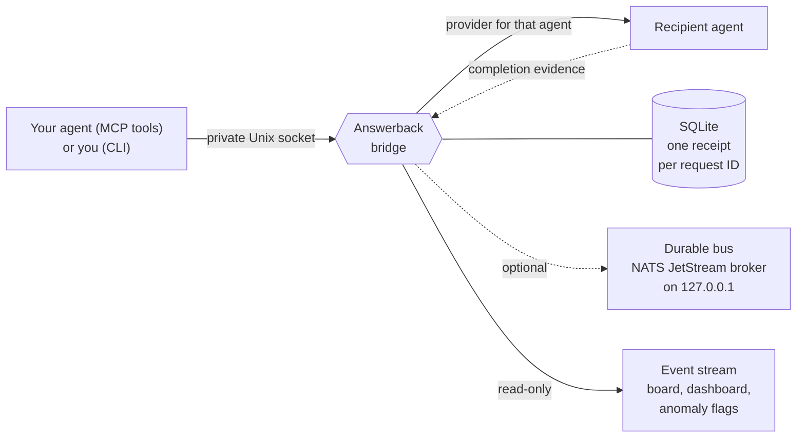
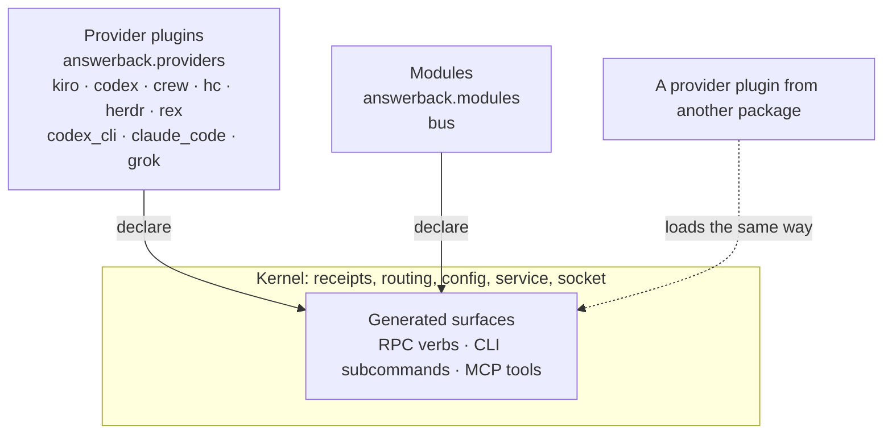

# How Answerback is built

Answerback is one local bridge process per machine and OS user. Your agent or the command line talks to it
over a private Unix socket. The bridge hands work to a recipient through that recipient's own protocol,
keeps one task receipt per request ID in SQLite, and feeds a read-only event stream. An optional durable
bus keeps queued work across restarts.

This page is for someone who wants to understand the design before changing or extending it. The C4
diagrams below go from the whole system down to the components inside the bridge.

## The system on one page

*Level 1. The bridge is the only process your agent talks to. Dotted lines are evidence coming back and
the optional bus.*

The core bridge opens no TCP port. The optional bus, the dashboard and the event viewer bind authenticated
listeners to 127.0.0.1. Receipts are kept in an owner-private configuration directory. Agents keep their
provider login and their native permission mechanism.

The trust boundary is your OS user. Anything running as you can talk to the bridge, and where the recipient
reports its own result (Herdr terminals, KiroCrew chats) any local program could report one. Treat it as a
local developer tool, not a sandbox ([SECURITY.md](../../SECURITY.md)).

## Kernel, provider plugins and modules

Since 0.16 the bridge is a kernel plus plugins. The **kernel** owns the receipts, the routing, the
configuration file, the service and the socket, and it names no provider. A **provider plugin** is the
piece that knows how to reach one kind of agent. It is a Python package that the kernel loads from the
`answerback.providers` entry-point group. A **module** is a service loaded from `answerback.modules`; today
the only one is the bus.

*The kernel builds its commands, RPC verbs and MCP tools from what the loaded plugins declare
(`src/answerback_bridge/plugin.py`). The names are the entry points in `pyproject.toml`.*

A provider that is not installed has no surface. A configuration that names one is kept and reported as
disabled, not refused. The public composition is the kernel with the providers above. A composition can
add a provider package; the public diagrams name none.

## Read the diagrams

| View | Question it answers | Render |
| --- | --- | --- |
| [C4 context](c4-context.md) | Who uses Answerback, and where does Herdr fit? | [SVG](c4-context.svg) |
| [C4 containers](c4-containers.md) | Which processes and durable stores run locally? | [SVG](c4-containers.svg) |
| [C4 components](c4-components.md) | Which bridge components own admission, execution and actor delivery? | [SVG](c4-components.svg) |
| [Project orchestration](../WORKTREE-GUARD-SCENARIO.md#orchestration-flow) | How does a five-client run move from preparation to verified delivery and retained evidence? | [SVG](worktree-guard-orchestration.svg) |
| [Peer-review exchange](../WORKTREE-GUARD-SCENARIO.md#what-counts-as-an-inter-agent-exchange) | Which native send, read, acknowledgement and reply steps make one review count? | [SVG](worktree-guard-peer-review.svg) |

The [self-contained diagram viewer](index.html) shows all five rendered views with zoom controls and no
network dependency. The source pages hold the editable Mermaid and links to the code. The three C4 views
use C4 levels and explicit element stereotypes with Mermaid's flowchart layout. They add no deployment
units for Python classes or broker streams. The two scenario views show how the test scenario exercises
that architecture.

## Why the bus and Herdr have separate jobs

The bus makes accepted commands and project messages recoverable across disconnects and restarts. It
cannot tell that a client is idle, choose an execution owner, answer a native permission prompt or prove
that a model did useful work. Those decisions belong to the selected provider and its evidence.

Herdr hosts CLI sessions and exposes them. Answerback can address a verified session that is ready for work
(it reports `idle`, or `done` when `hc_send_to_done` is on) through the optional `hc` provider, or use a
native provider without Herdr. Both routes keep the same task-receipt boundary. Hosting a CLI in Herdr does
not give it a second owner or make its readiness report a completion result.

## Current acceptance scope

The project acceptance run, **CLI-1**, has five participants: Kiro CLI, KiroCrew, Codex CLI, Claude Code
and Grok Build. Desktop clients are not part of it; the [support matrix](../HARNESSES.md) covers them.

Acceptance requires a scoped project delivered, attributable work from every participant, and native trace
evidence of inter-agent requests, reads, acknowledgements and correlated replies. Passing protocol fixtures
or starting five clients does not meet that gate. **CLI-1 ended `FAILED_INCOMPLETE`**, and its partial code
and evidence are kept ([the CLI-1 result](../WORKTREE-GUARD-SCENARIO.md#cli-1-result-and-retained-limitations)).
Herdr integration for all five clients also needs live qualification per client and version.

The [Worktree Guard scenario](../WORKTREE-GUARD-SCENARIO.md) defines the five-client project, module
ownership, the orchestration flow, 20 directed peer reviews and independent installed-package acceptance
checks. Its [run-evidence contract](../evidence/worktree-guard/README.md) describes the versioned trace and
outcome records that let runs be compared.

## Evidence is a progression, not one status

| Observation | What it establishes |
| --- | --- |
| Command `queued` | The assignment and outbox entry are committed locally. |
| Broker publish acknowledgement | JetStream accepted the envelope. |
| Command `bound` | A durable command is tied to a task receipt. |
| Actor message delivered | The actor lane stored the broker message in its recipient's inbox. |
| Actor read | A bound frontend called `actor_receive`; a native trace is needed to tie it to one conversation. |
| Actor acknowledged | The bound frontend called `actor_ack` with the exact read receipt nonce. |
| Actor replied | `actor_reply` created a correlated reply, which has its own delivery and read lifecycle. |
| Task completed | The provider accepted its own completion evidence. |
| Project accepted | The orchestrator verified the deliverables, the required exchanges and the acceptance checks. |

These are separate records and protocols, not one database enum. Only a task receipt in `completed` means
the task is done ([RECEIPTS.md](../RECEIPTS.md)). Passive client inbox acknowledgement is separate again:
polling can make a notice available but cannot wake a model. Closing an actor run records administrative
closure and does not certify project success. Native approvals can span several rounds. An observer that
cannot verify a later round has lost evidence, which alone does not show that the native task stopped.

## What it cannot do yet

- One machine, one coordinator. There is no broker shared by several machines, no automatic failover, and
  no way to send one brief to several agents in one call. Remote `hc` sends to listed machines are
  Experimental ([HARNESSES.md](../HARNESSES.md)).
- Several agents do not yet deliver one package together: CLI-1 is on record as `FAILED_INCOMPLETE`.
- The C4 diagrams predate three parts that exist today: routing and the managed worker pool, the event hub
  with worker tracing, and the kernel and plugin split. The two diagrams on this page show the split.
  [Routing](../ROUTING.md), [events](../EVENTS.md) and [tracing](../TRACING.md) describe the others.
- The diagrams leave out model-provider internals, older recipient hosts and OS-specific supervision. They
  do not imply admission across hosts, tenant isolation, exactly-once external side effects or a universal
  way to wake a client.

## Source and verification

The C4 views were checked against the source at public commit `c4334f2baae0154c26f8619ead515d4d5e5c8d55`
on 2026-11-15, and each view links the files its relationships come from. The SVGs were rendered from the
Markdown fences with Mermaid CLI 11.12.0. They omit Mermaid's unused `data-points` metadata and end with a
newline; the viewer embeds the same SVGs. The two diagrams on this page are Mermaid source only and are not
in the viewer.

## See also

- [ADAPTERS.md](../ADAPTERS.md): the provider plugin contract, for adding a provider.
- [AGENT-BUS.md](../AGENT-BUS.md): the optional bus, its two receipts and its limits.
- [ACTOR-MESSAGES.md](../ACTOR-MESSAGES.md): the actor protocol in the container and component views.
- [VALIDATION.md](../../VALIDATION.md): what has been shown with live models, and what has not.
