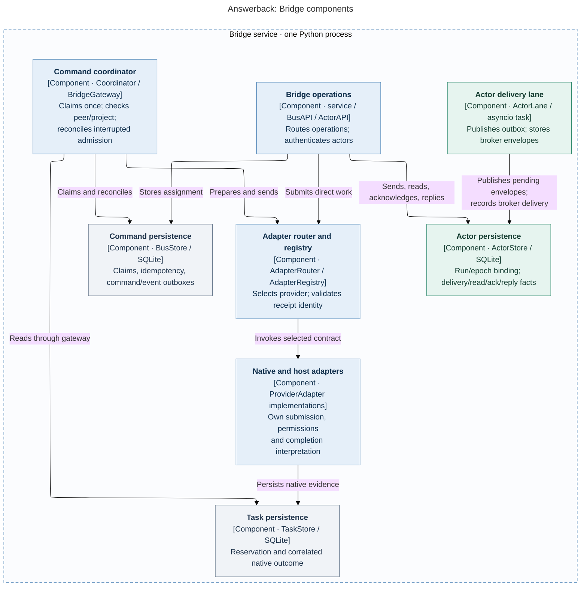

# Trace a command through the bridge

Inside the one bridge process, a command passes through the coordinator, the
adapter router and one provider adapter, and ends as a task receipt. Actor
messages among already-enrolled sessions travel a separate, independently
scheduled lane, so slow task admission does not stop them.

This page is for a contributor changing the coordinator, a provider adapter or
the actor lane; read [the processes and stores on one machine](c4-containers.md)
first.

Follow one bus command: **Bridge operations** stores it in **Command
persistence**, and the **Command coordinator** claims it there and hands it to
the **Adapter router and registry**. The router invokes the selected **Native and
host adapters**, which persist the native outcome in **Task persistence**, where
the coordinator reads the receipt. A direct `peer_submit` skips the coordinator
and enters at the router.





*The parts of the bridge service and the stores they write. The arrow labels are
examples of what passes between parts, not a complete list.*

The persistence components wrap SQLite stores; their physical databases are
shown at container level. Broker connections and
native client processes are omitted here; the container diagram shows those
external dependencies.

This diagram does not yet show three newer parts. The adapter router and
registry are now filled from provider plugins, and the coordinator and actor
lane belong to the bus module
([kernel and plugins](README.md#kernel-provider-plugins-and-modules)). The worker-tracing and
event-stream hub (`answerback debug`, `answerback events`) runs inside the
bridge process. The routing and managed-worker-pool orchestrator
(`answerback route`, `answerback workers`) does not: it runs in the command's
own process and reaches the bridge over the same private socket as any other
client.
[Routing](../ROUTING.md), [events](../EVENTS.md) and [tracing](../TRACING.md)
describe them as they exist today.

## Contract that keeps the broker independent

The coordinator uses this small Python protocol from
[bus/coordinator.py](../../src/answerback_bridge/bus/coordinator.py):

```python
class Gateway(Protocol):
    async def prepare(self, command: Command) -> PreparedTarget: ...
    async def send(self, target: PreparedTarget, command: Command) -> TaskReceipt: ...
    def lookup(self, command: Command) -> TaskReceipt | None: ...
    def get(self, task_id: str) -> TaskReceipt: ...
```

`BridgeGateway` supplies the adapter-backed implementation. The coordinator
needs stable admission and lookup operations; it does not need to understand a
Codex turn, a Claude prompt or a terminal session. This boundary allows an adapter
to change without making NATS responsible for native execution policy.

A command is checked against the local journal before dispatch, then claimed
before native submission. If an admission response is lost, lookup can bind
the existing receipt; missing or contradictory evidence leaves uncertainty.
The coordinator never automatically resends claimed work.

Actor delivery uses the existing JetStream connection, a separate stream and
consumer, and an independently scheduled task. A message is written to the
recipient inbox before the broker is acknowledged. The model must subsequently
call `actor_receive`, `actor_ack` and, when appropriate, `actor_reply`.
Those calls do not create a native execution task or wake an inactive client.

## Source evidence

- [Coordinator and gateway protocol](../../src/answerback_bridge/bus/coordinator.py)
  and [adapter-backed gateway](../../src/answerback_bridge/bus/gateway.py).
- [Adapter router](../../src/answerback_bridge/adapters/router.py),
  [registry](../../src/answerback_bridge/adapters/registry.py) and
  [composition root](../../src/answerback_bridge/adapters/factory.py).
- [Provider contracts](../../src/answerback_bridge/adapters/contracts.py) and
  [catalog](../../src/answerback_bridge/adapters/catalog.py); the provider packages under
  [`providers/`](../../src/answerback_bridge/providers/) and the
  [bus module](../../src/answerback_bridge/bus/plugin.py), composed by
  [`plugin.py`](../../src/answerback_bridge/plugin.py).
- [Actor API](../../src/answerback_bridge/actors/api.py),
  [store](../../src/answerback_bridge/actors/store.py) and
  [delivery transport](../../src/answerback_bridge/actors/transport.py).

## See also

- [Architecture overview](README.md): the kernel, plugins and modules that fill these components.
- [Find the processes and stores on one machine](c4-containers.md): where these components run.
- [Adapter contract](../ADAPTERS.md): what a provider adapter must implement.
