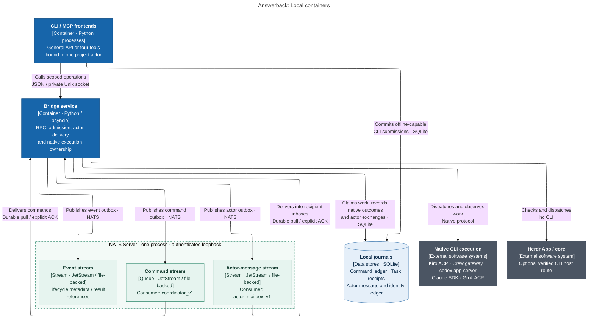

# Find the processes and stores on one machine

On one machine Answerback runs two processes, the bridge service and a NATS
server, and keeps four local store files. The command coordinator, the actor
delivery lane and the provider adapters run inside the bridge process, and each
native session has its own execution identity.

This page is for a contributor tracing where state lives or what a restart
keeps; read [who and what Answerback talks to](c4-context.md) first.

To find where a bus command is kept, start at **CLI / MCP frontends**, which call
the **Bridge service**. The bridge publishes the command to the **Command
stream**, the coordinator inside the bridge receives it, and the claim and the
native outcome are written to **Local journals**: `bus/ledger.sqlite` and
`tasks.sqlite` in the table below.

The bridge service box is the kernel with its loaded plugins. The kernel owns
the socket, the RPC dispatch and the task receipts. Each provider plugin
(`answerback.providers`) supplies the adapter for one kind of native session,
which is why the native and Herdr boxes sit outside it. The bus module
(`answerback.modules`) supplies the coordinator, the actor lane and the three
broker streams; without it the bridge runs without the NATS server and the bus
stores ([kernel and plugins](README.md#kernel-provider-plugins-and-modules)).

*The bridge, the broker's three streams and the local stores on one machine. The
arrow labels are examples of what crosses each boundary, not a complete list.*

The three stream boxes are logical streams in **one broker**, not three
servers. Their subjects are `agents.v1.<namespace>.commands`,
`agents.v1.<namespace>.events` and `agents.v1.<namespace>.actor_messages`.
The single journal shape groups four separate local store files for
readability: three SQLite databases and one JSON registry.

| Local store | Responsibility |
| --- | --- |
| `bus/ledger.sqlite` | Commands, claims, publication outbox and lifecycle events. |
| `tasks.sqlite` | Native task identity, reservation, permissions and result evidence. |
| `bus/actors.sqlite` | Sealed roster, identities, message outbox/inbox, reads, acknowledgements and replies. |
| `routing-workers.json` (JSON) | Managed worker-pool registry: holders, leases and gate state. |

Paths are relative to the selected bridge configuration directory. These
stores and the bridge operate under one OS user's trust boundary.

The neutral bus CLI can commit a command without a running coordinator, then
attempt publication itself. MCP submission goes through local RPC and leaves
publication to the coordinator. The optional CLI publication arrow is omitted
from the diagram for readability; it uses the same command/event outbox.

The optional web monitor runs as a separate process and reads the command
journal plus bounded coordinator/task observations. It never consumes the NATS
command queue. It does not replace the actor-run export or the native
conversation traces needed for project acceptance.

## Source evidence

- [Runtime lifecycle](../../src/answerback_bridge/runtime.py):
  Unix socket server and in-process bus task.
- [Local RPC transport](../../src/answerback_bridge/transport.py) and
  [bridge composition](../../src/answerback_bridge/service.py).
- [Bus API](../../src/answerback_bridge/bus/api.py),
  [offline-capable CLI](../../src/answerback_bridge/bus/cli.py) and
  [command store](../../src/answerback_bridge/bus/store.py).
- [Stream configuration](../../src/answerback_bridge/bus/config.py) and
  [JetStream publisher/consumer](../../src/answerback_bridge/bus/jetstream.py).
- [Actor store binding](../../src/answerback_bridge/actors/api.py),
  [actor lane](../../src/answerback_bridge/actors/runtime.py) and
  [actor stream](../../src/answerback_bridge/actors/transport.py).
- [Task store](../../src/answerback_bridge/tasks.py) and
  [monitor](../../src/answerback_bridge/bus/monitor.py).

## See also

- [Who and what Answerback talks to](c4-context.md): the system boundary around these processes.
- [Trace a command through the bridge](c4-components.md): the parts inside the bridge service.
- [Agent bus](../AGENT-BUS.md): the commands that use the broker and the bus stores.
