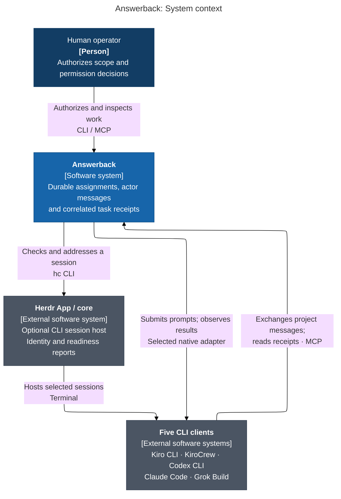

# See who and what Answerback talks to

Answerback sits between you, the coding agents on your machine and an optional
Herdr session host. You authorize work, agents hand it to each other through
Answerback and read its receipts, and Answerback submits it over the recipient's
native protocol or a verified Herdr session.

This page is for a contributor or reviewer who wants the system boundary before
the code; read the [architecture overview](README.md) first.

To follow one hand-off, start at **Human operator**, who authorizes the work. An
agent in **Five CLI clients** hands it to **Answerback**, which submits it to the
recipient client, through **Herdr App / core** only when the recipient runs in a
Herdr terminal. The sender then reads the receipt from **Answerback**.

*Who authorizes, sends and hosts work around Answerback. The arrow labels are
examples of what crosses each boundary, not a complete list.*

Native and Herdr routes are alternatives selected per recipient. The Herdr
arrow does not claim that every installed CLI version has been qualified there.
The current five-client project remains an acceptance gate; Desktop clients
are outside this view.

A provider plugin from another package extends the system the same way the
shipped providers do ([kernel and plugins](README.md#kernel-provider-plugins-and-modules)).
That is a packaging boundary, not an extra deployed service.

## Source evidence

- [Public provider catalog](../../src/answerback_bridge/adapters/catalog.py):
  opt-in native providers and optional `hc`/legacy providers.
- [Plugin contract and entry-point loader](../../src/answerback_bridge/plugin.py):
  `ProviderPlugin`, `ModulePlugin`, `KernelContext`, the `answerback.providers` and
  `answerback.modules` groups.
- [Native worker transport selection](../../src/answerback_bridge/providers/native/workers.py):
  `codex app-server`, Claude SDK and Grok ACP execution ownership.
- [Kiro worker ownership](../../src/answerback_bridge/providers/kiro/workers.py) and
  [Crew gateway client](../../src/answerback_bridge/providers/crew/client.py).
- [Core identity/readiness checks](../../src/answerback_bridge/providers/herdr/core.py) and
  [Core adapter](../../src/answerback_bridge/providers/herdr/adapters/core.py).
- [Actor MCP frontend](../../src/answerback_bridge/actors/frontend.py):
  enrolled send, receive, acknowledge and reply operations.

## See also

- [Architecture overview](README.md): the kernel, plugins and modules behind the Answerback box.
- [Local containers](c4-containers.md): the processes and stores inside it.
- [Adapter contract](../ADAPTERS.md): what each provider must implement.
